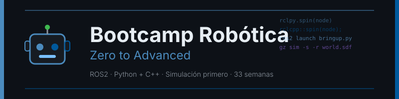

<p align="center">
  
</p>

<p align="center">
  <a href="LICENSE"></a>
  <a href="#"></a>
  <a href="#"></a>
  <a href="#"></a>
  <a href="#"></a>
</p>

<p align="center">
  <a href="README_EN.md"></a>
</p>

---

## 📋 Descripción

Bootcamp de **33 semanas (~8 meses, 12 h/semana)** enfocado en **robótica con ROS2
Jazzy**, desde cero absoluto en robótica hasta nivel avanzado, en una **ruta única**:
robot móvil autónomo (SLAM+Nav2), brazo manipulador con visión (MoveIt2), manipulación
móvil y un bloque avanzado (multi-robot, tiempo real, SROS2, despliegue, micro-ROS). Todo
verificable en simulación, con **Python y C++ como lenguajes de primera clase**.

### 🎯 Objetivos

Al finalizar el bootcamp, los estudiantes serán capaces de:

- ✅ Dominar el grafo computacional de ROS2 (nodos, topics, servicios, acciones, QoS)
- ✅ Escribir nodos equivalentes en `rclpy` y `rclcpp`, y saber cuándo usar cada uno
- ✅ Modelar un robot en URDF/Xacro y razonar sobre su árbol TF2
- ✅ Simular un robot completo en Gazebo Harmonic y verificarlo en modo headless
- ✅ Controlar actuadores con `ros2_control`
- ✅ Construir percepción 2D (OpenCV), 3D (point clouds) y por deep learning
- ✅ Fusionar sensores con un EKF y justificar cuándo un nodo necesita C++
- ✅ Cartografiar, localizar y navegar de forma autónoma con Nav2, incluidos plugins
  propios en C++
- ✅ Planificar movimientos y ejecutar pick&place completo con MoveIt2, incluido un
  planning adapter en C++
- ✅ Integrar navegación y manipulación en un manipulador móvil
- ✅ Operar varios robots, medir latencia con `ros2_tracing`, asegurar con SROS2,
  desplegar con Docker y CI, y conectar microcontroladores con micro-ROS
- ✅ Documentar y demostrar un sistema robótico con evidencia reproducible

### 🚀 ¿Por qué este bootcamp?

> **Ambos lenguajes de primera clase desde el día 1** — Python para prototipar y
> orquestar, C++ donde el framework lo exige o hay presupuesto de latencia real.

Instructor y estudiantes parten sin experiencia previa en robótica (aunque sí con
programación previa): el curriculum se apoya solo en documentación oficial y stacks
maduros (ROS2 LTS, Nav2, MoveIt2, Gazebo Harmonic), sin rutas experimentales.

---

## 🗓️ Estructura del Bootcamp

| Fase | Semanas | Horas | Temas principales |
| :--: | :-----: | :---: | ----------------- |
| **1 · Fundamentos ROS2 bilingüe** | 1-6 | 72 h | Grafo/DDS, topics, QoS, servicios, acciones, executors, lifecycle, testing, `rosbag2`, TF2, URDF — en `rclpy` **y** `rclcpp` |
| **2 · Matemáticas, simulación y control** | 7-12 | 72 h | Transformaciones y cuaterniones, Gazebo Harmonic, sensores, `ros2_control`, OpenCV, EKF |
| **3 · Robot móvil autónomo** | 13-18 | 72 h | Control clásico, SLAM, AMCL, costmaps, Nav2 con plugins C++, behavior trees, misión |
| **4 · Manipulación** | 19-24 | 72 h | Cinemática de brazo, MoveIt2, OMPL, percepción 3D, grasping, pick&place |
| **5 · Avanzado** | 25-30 | 72 h | Deep learning, manipulación móvil, multi-robot, tiempo real, SROS2 + CI, micro-ROS |
| **6 · Capstone** | 31-33 | 36 h | Arquitectura, implementación y demo del sistema de tu dominio |

**Total: 33 semanas** | **396 horas** · Índice con el estado de cada semana:
[bootcamp/README.md](bootcamp/README.md) · Decisión de ritmo y ruta única:
[docs/decision-semanas.md](docs/decision-semanas.md)

### 🎯 Un solo sistema, tu dominio

Eliges una misión en la semana 01 (almacén, laboratorio, inspección industrial...) y la
mantienes las 33 semanas: cada semana añade una capa al mismo sistema. Ver
[docs/dominios.md](docs/dominios.md) (incluye el catálogo anticopia).

---

## 📚 Contenido por Semana

Cada semana incluye:

```
bootcamp/week-XX-tema_principal/
├── README.md                 # Objetivos y cronograma
├── rubrica-evaluacion.md     # Criterios de evaluación
├── 0-assets/                 # Diagramas SVG
├── 1-teoria/                 # Material teórico
├── 2-practicas/              # Ejercicios guiados (rclpy y/o rclcpp)
├── 3-proyecto/                # Capa semanal del proyecto (tu dominio)
├── 4-recursos/                # ebooks-free/, videografia/, webgrafia/
└── 5-glosario/                 # Términos clave
```

### 🔑 Componentes Clave

- 📖 **Teoría**: conceptos con el porqué antes del cómo, en `rclpy` y/o `rclcpp`
- 💻 **Práctica**: ejercicios guiados (patrón "descomentar"), verificados con
  `colcon test` y simulación headless
- 📝 **Evaluación**: Conocimiento (30%) + Desempeño (40%) + Producto (30%)
- 🎓 **Recursos**: glosarios, referencias oficiales, material complementario

---

## 🛠️ Stack Tecnológico

| Tecnología | Versión | Uso |
|------------|---------|-----|
| ROS2 | **Jazzy Jalisco** | Middleware, LTS |
| Ubuntu | **24.04 LTS** | Sistema base |
| Python | **3.12.3** (`rclpy`) | Prototipado, orquestación, percepción |
| C++ | **17** (`rclcpp`) | Hot path, plugins Nav2/MoveIt2 |
| Gazebo | **Harmonic** (`gz-sim` 8.7.0) | Simulación |
| `ros2_control` | rama `jazzy` | Control de actuadores |
| Nav2 | rama `jazzy` | Navegación autónoma |
| MoveIt2 | rama `jazzy` | Manipulación |
| OpenCV | `python3-opencv` (apt) | Percepción |
| uv | **0.13.7** | Tooling Python (nunca `pip`) |
| Docker | **27.5.1** | Entorno de desarrollo obligatorio |

**Entorno de desarrollo**: Docker + WSLg/X11 para GUI de RViz2/Gazebo (❌ NO instalar
ROS2 directamente sobre el sistema operativo salvo la alternativa nativa documentada).

Ver [docs/stack-versions.md](docs/stack-versions.md) para el detalle completo pinneado.

---

## 🚀 Inicio Rápido

### Prerrequisitos

- **Docker** y **Docker Compose** instalados
- **Programación previa en Python y/o C++** (este bootcamp no enseña sintaxis básica)
- **Git** para control de versiones
- **VS Code** (recomendado) con extensiones incluidas

### 1. Clonar el Repositorio

```bash
git clone https://github.com/ergrato-dev/bc-robotica.git
cd bc-robotica
```

### 2. Configurar el Entorno

→ [Guía de configuración con Docker](docs/setup/con-docker.md) (recomendada, incluye
passthrough GUI para RViz2/Gazebo vía WSLg/X11)

### 3. Navegar a la Semana Actual

```bash
cd bootcamp/week-01-fundamentos_ros2_y_workspace
```

### 4. Seguir las Instrucciones

Cada semana contiene un `README.md` con instrucciones detalladas.

---

## 📊 Metodología de Aprendizaje

### Estrategias Didácticas

- 🎯 **Aprendizaje Basado en Proyectos**: un sistema que crece 33 semanas sobre tu
  misión, nunca un ejercicio desechable
- 🔁 **Descomentar para Aprender**: los ejercicios traen código y tests explicados; se
  aprende leyendo, descomentando y viendo pasar los tests
- 🐍🔧 **Bilingüe desde el día 1**: cada concepto de comunicación (semanas 01-06) se
  implementa en Python y C++, lado a lado
- 🖥️ **Simulación antes que hardware**: todo se valida primero en Gazebo headless; el
  hardware físico es siempre una extensión opcional (ver
  [docs/hardware-opcional.md](docs/hardware-opcional.md))
- 📏 **Mide, no asumas**: benchmarking `rclpy` vs `rclcpp` en los checkpoints
  (semanas 18 y 24) y perfilado con `ros2_tracing` (semana 28)

---

## 📜 Licencia

Este bootcamp está bajo licencia [CC BY-NC-SA 4.0](LICENSE) — uso educativo, no
comercial, las adaptaciones comparten la misma licencia.

## 🤝 Código de Conducta

Ver [CODE_OF_CONDUCT.md](CODE_OF_CONDUCT.md).

## 🔒 Seguridad

Ver [SECURITY.md](SECURITY.md).

---

## 🔗 Navegación

| Anterior | Actual | Siguiente |
| -------- | ------ | --------- |
| — | **Inicio del bootcamp** | [Documentación](docs/README.md) |
