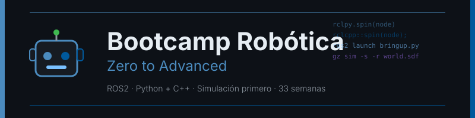

<p align="center">
  
</p>

<p align="center">
  <a href="LICENSE"></a>
  <a href="#"></a>
  <a href="#"></a>
  <a href="#"></a>
  <a href="#"></a>
</p>

<p align="center">
  <a href="README.md"></a>
</p>

---

## 📋 Description

A **33-week (~8 months, 12 h/week)** bootcamp focused on **robotics with ROS2 Jazzy**,
from absolute zero in robotics to advanced level, on a **single path**: autonomous mobile
robot (SLAM+Nav2), manipulator arm with vision (MoveIt2), mobile manipulation and an
advanced block (multi-robot, real time, SROS2, deployment, micro-ROS). Everything
verifiable in simulation, with **Python and C++ as first-class languages**.

### 🎯 Goals

By the end of the bootcamp, students will be able to:

- ✅ Master the ROS2 computational graph (nodes, topics, services, actions, QoS)
- ✅ Write equivalent nodes in `rclpy` and `rclcpp`, and know when to use each
- ✅ Model a robot in URDF/Xacro and reason about its TF2 tree
- ✅ Simulate a full robot in Gazebo Harmonic and verify it headless
- ✅ Control actuators with `ros2_control`
- ✅ Build 2D (OpenCV), 3D (point clouds) and deep-learning perception
- ✅ Fuse sensors with an EKF and justify when a node needs C++
- ✅ Map, localize and navigate autonomously with Nav2, including your own C++ plugins
- ✅ Plan motion and run a full pick&place pipeline with MoveIt2, including a C++
  planning adapter
- ✅ Integrate navigation and manipulation on a mobile manipulator
- ✅ Run multiple robots, measure latency with `ros2_tracing`, secure with SROS2, deploy
  with Docker and CI, and connect microcontrollers with micro-ROS
- ✅ Document and demonstrate a robotic system with reproducible evidence

### 🚀 Why this bootcamp?

> **Both languages first-class from day one** — Python to prototype and orchestrate,
> C++ where the framework requires it or there's a real latency budget.

Instructor and students both start with no prior robotics experience (though with
prior programming experience): the curriculum relies only on official documentation
and mature stacks (ROS2 LTS, Nav2, MoveIt2, Gazebo Harmonic), no experimental paths.

---

## 🗓️ Bootcamp Structure

| Phase | Weeks | Hours | Main topics |
| :---: | :---: | :---: | ----------- |
| **1 · Bilingual ROS2 Fundamentals** | 1-6 | 72 h | Graph/DDS, topics, QoS, services, actions, executors, lifecycle, testing, `rosbag2`, TF2, URDF — in `rclpy` **and** `rclcpp` |
| **2 · Math, Simulation and Control** | 7-12 | 72 h | Transforms and quaternions, Gazebo Harmonic, sensors, `ros2_control`, OpenCV, EKF |
| **3 · Autonomous Mobile Robot** | 13-18 | 72 h | Classic control, SLAM, AMCL, costmaps, Nav2 with C++ plugins, behavior trees, mission |
| **4 · Manipulation** | 19-24 | 72 h | Arm kinematics, MoveIt2, OMPL, 3D perception, grasping, pick&place |
| **5 · Advanced** | 25-30 | 72 h | Deep learning, mobile manipulation, multi-robot, real time, SROS2 + CI, micro-ROS |
| **6 · Capstone** | 31-33 | 36 h | Architecture, implementation and demo of your domain's system |

**Total: 33 weeks** | **396 hours** · Week index with status:
[bootcamp/README.md](bootcamp/README.md) · Pace and single-path decision:
[docs/decision-semanas.md](docs/decision-semanas.md)

### 🎯 One system, your domain

You pick a mission in week 01 (warehouse, lab, industrial inspection...) and keep it for
all 33 weeks: each week adds a layer to the same system. See
[docs/dominios.md](docs/dominios.md) (includes the anti-plagiarism catalog).

---

## 📚 Weekly Content

Each week includes:

```
bootcamp/week-XX-main_topic/
├── README.md                 # Objectives and schedule
├── rubrica-evaluacion.md     # Evaluation criteria
├── 0-assets/                 # SVG diagrams
├── 1-teoria/                 # Theoretical material
├── 2-practicas/              # Guided exercises (rclpy and/or rclcpp)
├── 3-proyecto/                # Weekly project layer (your domain)
├── 4-recursos/                # ebooks-free/, videografia/, webgrafia/
└── 5-glosario/                 # Key terms
```

### 🔑 Key Components

- 📖 **Theory**: concepts with the why before the how, in `rclpy` and/or `rclcpp`
- 💻 **Practice**: guided exercises (uncomment pattern), verified with `colcon test`
  and headless simulation
- 📝 **Evaluation**: Knowledge (30%) + Performance (40%) + Product (30%)
- 🎓 **Resources**: glossaries, official references, supplementary material

---

## 🛠️ Tech Stack

| Technology | Version | Use |
|------------|---------|-----|
| ROS2 | **Jazzy Jalisco** | Middleware, LTS |
| Ubuntu | **24.04 LTS** | Base system |
| Python | **3.12.3** (`rclpy`) | Prototyping, orchestration, perception |
| C++ | **17** (`rclcpp`) | Hot path, Nav2/MoveIt2 plugins |
| Gazebo | **Harmonic** (`gz-sim` 8.7.0) | Simulation |
| `ros2_control` | `jazzy` branch | Actuator control |
| Nav2 | `jazzy` branch | Autonomous navigation |
| MoveIt2 | `jazzy` branch | Manipulation |
| OpenCV | `python3-opencv` (apt) | Perception |
| uv | **0.13.7** | Python tooling (never `pip`) |
| Docker | **27.5.1** | Mandatory development environment |

**Development environment**: Docker + WSLg/X11 for RViz2/Gazebo GUI (❌ do NOT install
ROS2 directly on the host OS except via the documented native alternative).

See [docs/stack-versions.md](docs/stack-versions.md) for full pinned details.

---

## 🚀 Quick Start

### Prerequisites

- **Docker** and **Docker Compose** installed
- **Prior programming experience in Python and/or C++** (this bootcamp does not teach
  basic syntax)
- **Git** for version control
- **VS Code** (recommended) with included extensions

### 1. Clone the Repository

```bash
git clone https://github.com/ergrato-dev/bc-robotica.git
cd bc-robotica
```

### 2. Set Up the Environment

→ [Docker setup guide](docs/setup/con-docker.md) (recommended, includes GUI
passthrough for RViz2/Gazebo via WSLg/X11)

### 3. Go to the Current Week

```bash
cd bootcamp/week-01-fundamentos_ros2_y_workspace
```

### 4. Follow the Instructions

Each week contains a `README.md` with detailed instructions.

---

## 📊 Learning Methodology

### Teaching Strategies

- 🎯 **Project-Based Learning**: one system that grows over 33 weeks on your
  domain, never a throwaway exercise
- 🔁 **Uncomment to Learn**: exercises ship with explained code and tests; you learn by
  reading, uncommenting, and watching tests pass
- 🐍🔧 **Bilingual from day one**: every communication concept (weeks 01-06) is
  implemented in Python and C++, side by side
- 🖥️ **Simulation before hardware**: everything is validated in headless Gazebo first;
  physical hardware is always an optional extension (see
  [docs/hardware-opcional.md](docs/hardware-opcional.md))
- 📏 **Measure, don't assume**: `rclpy` vs `rclcpp` benchmarking at the checkpoints
  (weeks 18 and 24) and profiling with `ros2_tracing` (week 28)

---

## 📜 License

This bootcamp is licensed under [CC BY-NC-SA 4.0](LICENSE) — educational use,
non-commercial, adaptations share the same license.

## 🤝 Code of Conduct

See [CODE_OF_CONDUCT.md](CODE_OF_CONDUCT.md).

## 🔒 Security

See [SECURITY.md](SECURITY.md).

---

## 🔗 Navigation

| Previous | Current | Next |
| -------- | ------- | ---- |
| — | **Bootcamp home** | [Documentation (ES)](docs/README.md) |
