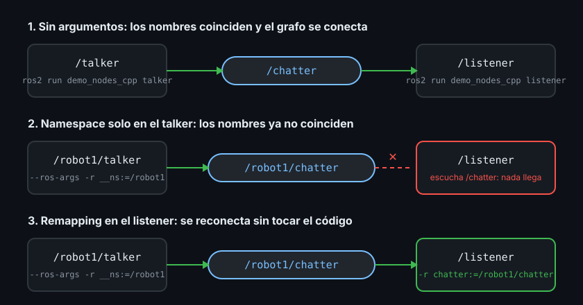

# Introspección del grafo con la CLI, nombres y remapping

> Un robot que no ves por dentro no se puede depurar: la CLI `ros2` es el multímetro del grafo, y el remapping es lo que te deja reconectar cables sin soldar de nuevo.

## 🎯 Objetivos

- Inspeccionar un grafo vivo (nodos, topics, tipos, frecuencias) sin escribir código
- Publicar un mensaje a mano desde la terminal para probar un nodo aislado
- Entender cómo ROS2 resuelve un nombre: relativo, absoluto y privado
- Cambiar nombres de nodo, de topic y de namespace al arrancar un nodo (remapping)

## 1. Qué problema resuelve

En las teorías 03 y 04 escribiste un publisher y un subscriber. Cuando algo falla
(el listener no imprime nada, por ejemplo) hay tres sospechosos: el publisher no
publica, el topic tiene otro nombre o el tipo de mensaje no coincide. Sin herramientas,
la única forma de saberlo sería añadir `print` a todo.

La **CLI** (Command Line Interface, interfaz de línea de comandos) `ros2` pregunta al
grafo qué hay en él, con el mismo mecanismo de descubrimiento DDS que usan tus nodos
(teoría 01). No necesita que los nodos colaboren: si existe en tu `ROS_DOMAIN_ID`, la
CLI lo ve.

El segundo problema es de reutilización. Un nodo escrito por otra persona publica en
`chatter`, pero tu sistema espera `sensor/state`. O quieres dos copias del mismo nodo,
una por robot. Editar el código fuente para cada caso no escala. El **remapping**
(reasignación de nombres) cambia los nombres al arrancar el nodo, desde fuera.

## 2. Cómo funciona: la CLI y el daemon

Cada subcomando de `ros2` es una vista del grafo:

| Comando | Qué responde |
|---|---|
| `ros2 pkg executables <paquete>` | Qué ejecutables trae un paquete |
| `ros2 run <paquete> <ejecutable>` | Arranca un nodo |
| `ros2 node list` / `ros2 node info <nodo>` | Qué nodos viven y qué publica/escucha cada uno |
| `ros2 topic list -t` | Qué topics existen y su tipo |
| `ros2 topic info <topic>` | Cuántos publishers y subscribers tiene |
| `ros2 topic echo <topic>` | Imprime cada mensaje que pasa |
| `ros2 topic hz <topic>` | Frecuencia real de publicación |
| `ros2 topic pub <topic> <tipo> <datos>` | Publica desde la terminal |
| `ros2 interface show <tipo>` | Los campos de un tipo de mensaje |

Para no repetir el descubrimiento DDS (lento: segundos) en cada comando, la CLI arranca
la primera vez un proceso en segundo plano, el **daemon** (`ros2 daemon`), que mantiene
una copia del grafo. Es rápido, pero a veces se queda con información vieja: si
`ros2 node list` muestra un nodo que ya cerraste, reinícialo con
`ros2 daemon stop` (el siguiente comando lo vuelve a arrancar).

## 3. Cómo se usa, paso a paso

Usas los nodos de demostración `talker` y `listener` del paquete `demo_nodes_cpp`, que
vienen instalados en la imagen Docker del bootcamp. Así practicas la CLI sin depender de
tu propio código.

### 3.1 Ver qué hay

```bash
# Terminal 1
ros2 run demo_nodes_cpp talker
# [INFO] [1762600000.100000000] [talker]: Publishing: 'Hello World: 1'

# Terminal 2
ros2 node list
# /talker

ros2 topic list -t
# /chatter [std_msgs/msg/String]
# /parameter_events [rcl_interfaces/msg/ParameterEvent]
# /rosout [rcl_interfaces/msg/Log]
```

`/parameter_events` y `/rosout` los crea **todo** nodo automáticamente: el primero
anuncia cambios de parámetros (Semana 03) y el segundo recoge los logs de
`get_logger()`. Por eso aparecen aunque tú solo hayas pedido `/chatter`.

```bash
ros2 topic info /chatter
# Type: std_msgs/msg/String
# Publisher count: 1
# Subscription count: 0

ros2 interface show std_msgs/msg/String
# (líneas de comentario del archivo .msg)
# string data
```

`Subscription count: 0` dice que nadie escucha todavía. `string data` dice que el
mensaje tiene un solo campo llamado `data`, que es lo que usaste en `msg.data`.

### 3.2 Escuchar y medir

```bash
# Terminal 2
ros2 topic echo /chatter
# data: 'Hello World: 7'
# ---
# data: 'Hello World: 8'
# ---
```

`ros2 topic echo` es un subscriber más: mientras corre, `ros2 topic info /chatter`
mostrará `Subscription count: 1`. `Ctrl+C` lo cierra.

```bash
ros2 topic hz /chatter
# average rate: 1.000
#   min: 1.000s max: 1.000s std dev: 0.00010s window: 3
```

### 3.3 Publicar a mano

Cierra el talker (`Ctrl+C` en la terminal 1) y arranca el listener en su lugar:

```bash
# Terminal 1
ros2 run demo_nodes_cpp listener

# Terminal 2
ros2 topic pub --once /chatter std_msgs/msg/String "{data: 'hola desde la CLI'}"
# publisher: beginning loop
# publishing #1: std_msgs.msg.String(data='hola desde la CLI')

# En la terminal 1 aparece:
# [INFO] [1762600050.200000000] [listener]: I heard: [hola desde la CLI]
```

Los datos van en formato YAML (`{campo: valor}`). Sin `--once`, publica en bucle a 1 Hz
(cámbialo con `--rate 5`). Así pruebas un subscriber **aislado**, sin necesitar el
publisher real: es la primera técnica de depuración que vas a usar cada semana.

## 4. Nombres: relativo, absoluto y privado

Todo nombre de topic en ROS2 se **resuelve** a un nombre completo que empieza por `/`.
Cómo se resuelve depende de cómo lo escribiste en el código:

| En el código | Tipo | Nodo `talker` en namespace `/robot1` lo resuelve a |
|---|---|---|
| `"chatter"` | relativo | `/robot1/chatter` |
| `"/chatter"` | absoluto | `/chatter` (ignora el namespace) |
| `"~/chatter"` | privado | `/robot1/talker/chatter` |

Un **namespace** (espacio de nombres) es un prefijo que agrupa nodos y topics, como una
carpeta. Su uso principal es tener varios robots iguales en el mismo grafo
(`/robot1/...`, `/robot2/...`, Semana 27).

Por eso en tus nodos escribiste `"sensor/state"` **sin** `/` inicial: es relativo y
funciona en cualquier namespace. Con `"/sensor/state"` absoluto, dos robots publicarían
en el mismo topic y sus datos se mezclarían.

## 5. Remapping desde la terminal

Todo lo que va detrás de `--ros-args` son argumentos para ROS2, no para tu programa.
`-r origen:=destino` reasigna un nombre:

```bash
# Cambiar el nombre del nodo
ros2 run demo_nodes_cpp talker --ros-args -r __node:=mi_talker
# ros2 node list  ->  /mi_talker

# Cambiar el nombre de un topic
ros2 run demo_nodes_cpp talker --ros-args -r chatter:=sensor/state
# ros2 topic list ->  /sensor/state

# Meter el nodo en un namespace
ros2 run demo_nodes_cpp talker --ros-args -r __ns:=/robot1
# ros2 node list  ->  /robot1/talker
# ros2 topic list ->  /robot1/chatter
```

`__node` y `__ns` (con dos guiones bajos) son nombres reservados: el nombre del nodo y
su namespace. El diagrama muestra el caso típico en el que un namespace "rompe" la
conexión y un remapping la repara:



```bash
# Terminal 1: talker dentro de /robot1
ros2 run demo_nodes_cpp talker --ros-args -r __ns:=/robot1

# Terminal 2: listener sin tocar -> no imprime nada
ros2 run demo_nodes_cpp listener

# Terminal 2 (tras Ctrl+C): listener remapeado -> vuelve a imprimir
ros2 run demo_nodes_cpp listener --ros-args -r chatter:=/robot1/chatter
# [INFO] [...] [listener]: I heard: [Hello World: 12]
```

Esto funciona igual con tus nodos `rclpy` y `rclcpp`, sin cambiar una línea: el
remapping lo aplica la librería cliente (`rcl`) que comparten ambos lenguajes.

## 6. Antipatrones

- ❌ **Nombres absolutos (`/topic`) "por si acaso".** Rompen los namespaces: dos robots
  en el mismo grafo publicarían en el mismo topic. Usa relativos salvo que el topic sea
  global de verdad
- ❌ **Editar el código para cambiar un nombre de topic.** Para eso está `-r`; en la
  Semana 06 lo harás desde un launch file
- ❌ **Creer a `ros2 node list` cuando acabas de cerrar nodos.** El daemon puede
  mostrar fantasmas unos segundos; `ros2 daemon stop` si dudas
- ❌ **Depurar un subscriber arrancando todo el sistema.** Publica a mano con
  `ros2 topic pub --once` y aíslalo
- ❌ **Olvidar las comillas en `ros2 topic pub`.** Sin `"..."` alrededor del YAML, la
  shell parte el texto en varios argumentos y el comando falla

## 7. Trucos

- `ros2 topic echo /chatter --once` — imprime un solo mensaje y sale
- `ros2 topic echo /chatter --field data` — solo el campo que te interesa
- `ros2 node info /talker` — publishers, subscribers y servicios de un nodo en una vista
- `ros2 topic list -t | grep sensor` — filtrar topics cuando el grafo crece
- `rqt_graph` — el mismo grafo dibujado; refresca con el botón de recarga tras cada
  cambio
- `Tab` autocompleta nombres de paquetes, ejecutables, nodos y topics en `ros2 ...`

## 📚 Recursos Adicionales

- [Understanding nodes — ROS2 Jazzy](https://docs.ros.org/en/jazzy/Tutorials/Beginner-CLI-Tools/Understanding-ROS2-Nodes/Understanding-ROS2-Nodes.html)
- [Understanding topics — ROS2 Jazzy](https://docs.ros.org/en/jazzy/Tutorials/Beginner-CLI-Tools/Understanding-ROS2-Topics/Understanding-ROS2-Topics.html)
- [Node arguments (remapping, `--ros-args`) — ROS2 Jazzy](https://docs.ros.org/en/jazzy/How-To-Guides/Node-arguments.html)
- [Topic and service name mapping (diseño) — design.ros2.org](https://design.ros2.org/articles/topic_and_service_names.html)

## ✅ Checklist de Verificación

- [ ] Sé listar nodos y topics, y ver el tipo y los contadores de un topic
- [ ] Publiqué un mensaje con `ros2 topic pub --once` y lo vi llegar a un listener
- [ ] Sé a qué nombre completo se resuelve `"chatter"`, `"/chatter"` y `"~/chatter"`
      dentro de un namespace
- [ ] Reconecté un listener a un talker en otro namespace usando solo `-r`

---

## 🔗 Navegación

| Anterior | Actual | Siguiente |
| -------- | ------ | --------- |
| [04 · Primer nodo rclcpp](04-primer-nodo-rclcpp.md) | **05 · Introspección CLI y remapping** | [Prácticas](../2-practicas/README.md) |

← [Volver a la Semana 01](../README.md)
