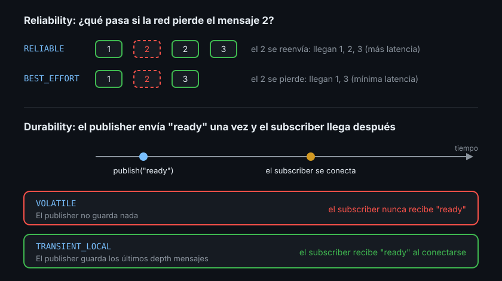
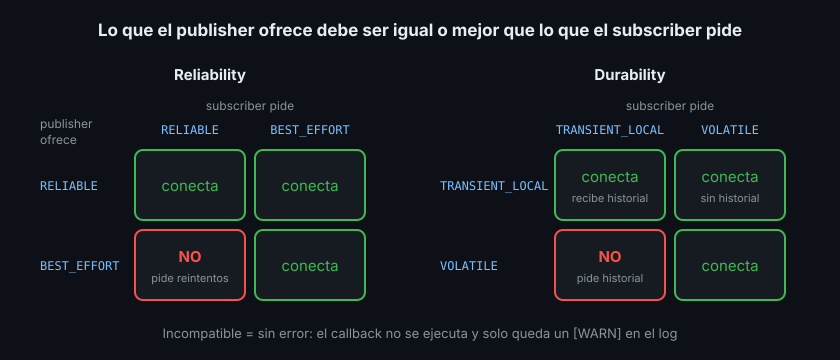

# Políticas QoS y compatibilidad

> El mismo topic no vale para todo: una cámara a 30 Hz puede perder un fotograma, un comando de parada no. QoS es la forma de decirle a ROS2 qué garantías necesita cada flujo de datos.

## 🎯 Objetivos

- Definir qué es un perfil QoS y cada una de sus políticas principales
- Distinguir `RELIABLE` de `BEST_EFFORT` y `VOLATILE` de `TRANSIENT_LOCAL`
- Predecir si un publisher y un subscriber con QoS distintos se conectarán
- Elegir el perfil predefinido adecuado para cada tipo de dato

## 1. Qué problema resuelve

En la Semana 01 pasaste un `10` a `create_publisher` y lo llamamos "cola de
historial". Ese número es solo una parte de algo mayor: la **calidad de servicio**
(Quality of Service, QoS), el conjunto de reglas sobre **cómo** se entregan los
mensajes de un topic.

ROS2 viaja sobre DDS, que funciona sobre redes reales: WiFi que pierde paquetes, nodos
que arrancan tarde, sensores que publican más rápido de lo que nadie lee. No hay una
regla que sirva para todo:

| Dato | Qué importa | Qué no importa |
|---|---|---|
| Lectura de un láser a 10 Hz | Lo más reciente, sin retraso | Perder una lectura vieja |
| Comando "para" | Que llegue, aunque tarde un poco | — |
| Mapa del entorno | Que lo reciba quien llegue tarde | Que llegue rápido |

Cada fila necesita un QoS distinto. Usar el mismo para todo da sistemas lentos (si
reintentas todo) o frágiles (si no reintentas nada).

## 2. Cómo funciona: las políticas

Un **perfil QoS** (QoS profile) es un conjunto de **políticas** (policies). Cada
publisher **ofrece** un perfil y cada subscriber **pide** uno.



### 2.1 History y depth: cuántos guarda

- `KEEP_LAST` + `depth` (profundidad) — guarda los últimos N mensajes. Es lo normal
- `KEEP_ALL` — guarda todos los que quepan en memoria. Casi nunca lo necesitas

El `depth` es un **búfer**: si el subscriber procesa más lento de lo que llega, los
mensajes más viejos del búfer se descartan. `depth=1` significa "solo me importa el
último".

### 2.2 Reliability: ¿se reintenta?

- `RELIABLE` (fiable) — si un mensaje se pierde por la red, DDS lo reenvía hasta que
  llega (mientras quepa en el búfer). Más latencia y más tráfico cuando la red falla
- `BEST_EFFORT` (mejor esfuerzo) — se envía una vez; si se pierde, se pierde. Mínima
  latencia. Ideal para sensores a alta frecuencia: el siguiente dato llega enseguida y
  es más útil que reenviar el viejo

### 2.3 Durability: ¿qué pasa con quien llega tarde?

- `VOLATILE` (volátil) — el subscriber recibe solo lo que se publica **después** de
  conectarse. Es lo que viste en la Semana 01: el listener empezaba en `#7`, no en `#0`
- `TRANSIENT_LOCAL` (persistente local) — el publisher guarda sus últimos `depth`
  mensajes y se los entrega a cada subscriber que llegue después. Es el patrón
  **latched** (enganchado): publicar una vez un mapa o una configuración y que todos lo
  reciban aunque arranquen más tarde

### 2.4 Políticas de tiempo (menos frecuentes)

| Política | Qué controla | Ejemplo |
|---|---|---|
| `deadline` (plazo) | Tiempo máximo entre dos mensajes; si se supera, se dispara un evento | "Un láser debe publicar al menos cada 200 ms" |
| `lifespan` (vida útil) | Edad máxima de un mensaje; los más viejos se descartan sin entregar | "Un comando de más de 1 s ya no vale" |
| `liveliness` (vivacidad) + `lease_duration` | Cómo se detecta que un publisher sigue vivo | Detectar un nodo colgado |

Por defecto ninguna está activa (valor "infinito"). Esta semana solo las nombras; la
detección de fallos con `deadline` y `liveliness` vuelve en la Semana 17.

## 3. Perfiles predefinidos

No tienes que elegir cada política a mano. ROS2 trae **perfiles predefinidos**
(presets):

| Perfil | History / depth | Reliability | Durability | Para qué |
|---|---|---|---|---|
| Por defecto (al pasar un número) | `KEEP_LAST` / ese número | `RELIABLE` | `VOLATILE` | Estado, comandos |
| `sensor_data` | `KEEP_LAST` / 5 | `BEST_EFFORT` | `VOLATILE` | Sensores de alta frecuencia |
| `services_default` | `KEEP_LAST` / 10 | `RELIABLE` | `VOLATILE` | Servicios (Semana 03) |
| `parameters` | `KEEP_LAST` / 1000 | `RELIABLE` | `VOLATILE` | Servicios de parámetros |
| `system_default` | La del middleware | La del middleware | La del middleware | Casi nunca: depende del RMW |

Para el patrón latched no hay preset con nombre: lo construyes tú con
`depth=1`, `RELIABLE` y `TRANSIENT_LOCAL` (teoría 03).

## 4. Compatibilidad: pedido contra ofrecido

Publisher y subscriber con el mismo nombre y tipo pueden **no conectarse** si sus QoS
son incompatibles. La regla, llamada **RxO** (Request vs Offered, pedido contra
ofrecido), es: lo que el publisher **ofrece** tiene que ser igual o mejor que lo que el
subscriber **pide**.



| Publisher ofrece | Subscriber pide | ¿Conectan? | Por qué |
|---|---|---|---|
| `RELIABLE` | `RELIABLE` | ✅ | Igual |
| `RELIABLE` | `BEST_EFFORT` | ✅ | Ofrece más de lo que se pide |
| `BEST_EFFORT` | `BEST_EFFORT` | ✅ | Igual |
| `BEST_EFFORT` | `RELIABLE` | ❌ | El subscriber pide reintentos que el publisher no da |
| `TRANSIENT_LOCAL` | `TRANSIENT_LOCAL` | ✅ | Igual: el tardío recibe el historial |
| `TRANSIENT_LOCAL` | `VOLATILE` | ✅ | Conecta, pero el subscriber no recibe el historial |
| `VOLATILE` | `VOLATILE` | ✅ | Igual |
| `VOLATILE` | `TRANSIENT_LOCAL` | ❌ | El subscriber pide un historial que el publisher no guarda |

`history`, `depth` y `lifespan` **no** afectan a la compatibilidad: cada extremo usa
los suyos. `deadline` y `liveliness` sí, con la misma lógica (el publisher tiene que
prometer un plazo igual o más corto que el pedido).

El caso que más vas a ver: un driver de sensor publica con `sensor_data`
(`BEST_EFFORT`) y tu nodo se suscribe con un número (`RELIABLE`). Resultado: tu
callback **nunca se ejecuta** y ROS2 solo deja un aviso en el log:

```text
[WARN] [...] [mi_nodo]: New publisher discovered on topic 'sensor/range',
offering incompatible QoS. No messages will be received from it.
Last incompatible policy: RELIABILITY
```

Lee siempre los `[WARN]` al arrancar: este aviso aparece una sola vez.

## 5. Cómo elegir

Responde dos preguntas por cada topic que diseñes:

1. **¿Perder un mensaje es grave?** No (llega otro enseguida): `BEST_EFFORT`.
   Sí: `RELIABLE`
2. **¿Quien llega tarde necesita el último valor?** Sí (mapa, descripción del robot,
   estado de una misión): `TRANSIENT_LOCAL` con `depth=1`. No: `VOLATILE`

Y una regla para suscribirte a datos ajenos: **usa el mismo QoS que el publisher**. Si
no sabes cuál es, `ros2 topic info -v` te lo dice (teoría 03).

## 6. Antipatrones

- ❌ **`RELIABLE` para un sensor a alta frecuencia por WiFi.** Los reintentos se
  acumulan, la latencia crece y acabas procesando datos de hace un segundo
- ❌ **Suscribirte con un número (`10`) a un topic de sensor.** Pides `RELIABLE`; si el
  driver ofrece `BEST_EFFORT`, no recibes nada
- ❌ **Publicar una configuración una sola vez con `VOLATILE`.** Solo la reciben los
  nodos que ya estaban conectados en ese instante; el resto, nunca
- ❌ **`depth` enorme "por si acaso".** Con `RELIABLE`, un subscriber lento acumula
  retraso en lugar de saltar al dato actual
- ❌ **Ignorar los `[WARN]` de QoS incompatible.** Es el único aviso que vas a tener

## 7. Trucos

- La pregunta "¿por qué no recibo nada?" tiene tres sospechosos: nombre, tipo y QoS.
  Revisa los tres en ese orden
- El `depth` cuenta por subscriber: un subscriber lento no frena a uno rápido
- Con `TRANSIENT_LOCAL`, el `depth` del publisher decide cuántos mensajes viejos
  recibe el tardío

## 📚 Recursos Adicionales

- [Quality of Service settings — ROS2 Jazzy concepts](https://docs.ros.org/en/jazzy/Concepts/Intermediate/About-Quality-of-Service-Settings.html)
- [QoS policies — diseño (design.ros2.org)](https://design.ros2.org/articles/qos.html)

## ✅ Checklist de Verificación

- [ ] Sé qué significan `depth`, `RELIABLE`, `BEST_EFFORT`, `VOLATILE` y `TRANSIENT_LOCAL`
- [ ] Sé qué preset usar para un sensor y cuál para un comando
- [ ] Sé predecir las dos combinaciones incompatibles (reliability y durability)
- [ ] Sé qué aviso aparece en el log cuando el QoS es incompatible

---

## 🔗 Navegación

| Anterior | Actual | Siguiente |
| -------- | ------ | --------- |
| [01 · Tipos de mensaje](01-tipos-de-mensaje-e-interfaces-estandar.md) | **02 · Políticas QoS** | [03 · QoS en código](03-qos-en-codigo-y-diagnostico.md) |

← [Volver a la Semana 02](../README.md)
