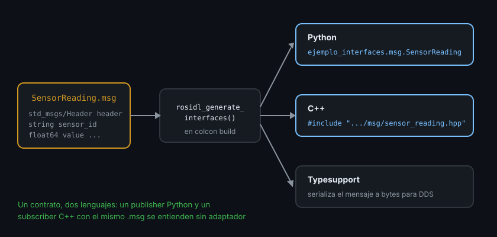

# Interfaces custom con `rosidl`

> Cuando ningún tipo estándar describe tu dato, escribes el tuyo en un archivo `.msg` de diez líneas, y ROS2 genera por ti el código Python y C++ que lo usa. Un solo contrato, dos lenguajes.

## 🎯 Objetivos

- Crear un paquete `_interfaces` con un `.msg` propio
- Conocer la sintaxis del `.msg`: campos, constantes, valores por defecto, límites
- Configurar `CMakeLists.txt` y `package.xml` para que `rosidl` genere el código
- Comprobar el resultado con `ros2 interface show`

## 1. Qué problema resuelve

Tu robot de almacén quiere publicar "batería al 64 %, 3 pedidos pendientes, en el
pasillo B". No hay un tipo estándar con esos campos, y meterlo en un `String` es el
antipatrón de la teoría 01.

`rosidl` (ROS Interface Definition Language) es el sistema que lee tus archivos
`.msg`, `.srv` y `.action` y **genera** el código de cada lenguaje: una clase Python,
un `struct` C++ y el código de serialización (typesupport) que convierte el mensaje en
bytes para DDS. Escribes la definición una vez; Python y C++ usan exactamente la misma.



## 2. Cómo funciona: un paquete aparte, siempre `ament_cmake`

Dos reglas que no se discuten:

1. **Las interfaces van en su propio paquete**, por convención con sufijo
   `_interfaces` (`mi_robot_interfaces`). Así cualquier paquete, en cualquier lenguaje,
   depende de él sin arrastrar nodos que no necesita
2. **Ese paquete es `ament_cmake`**, aunque todos tus nodos sean Python. La generación
   la hace CMake; un paquete `ament_python` no puede generar interfaces

## 3. Sintaxis del `.msg`

```text
# Lectura de un sensor genérico, con unidad y estado.
# Las líneas con # son comentarios: aparecen en `ros2 interface show`.

std_msgs/Header header       # tipo compuesto de otro paquete

string sensor_id             # campo: tipo + nombre
float64 value
string unit "m"              # valor por defecto: tras el nombre, separado por espacio
bool is_valid true

uint8 STATUS_OK=0            # constante: MAYÚSCULAS y "=" sin espacios
uint8 STATUS_WARN=1
uint8 STATUS_ERROR=2
uint8 status                 # el campo que toma uno de esos valores

float64[<=16] history        # secuencia acotada: como máximo 16 valores
```

Reglas de nombres (si no las cumples, `colcon build` falla con un error de `rosidl`):

| Elemento | Regla | ✅ | ❌ |
|---|---|---|---|
| Archivo y tipo | `PascalCase`, el archivo se llama como el tipo | `SensorReading.msg` | `sensor_reading.msg` |
| Campo | `snake_case`: minúsculas, dígitos y `_`, empieza por letra | `battery_percent` | `batteryPercent`, `_value` |
| Campo | Sin `__` doble ni `_` final | `max_range` | `max__range`, `range_` |
| Constante | `MAYÚSCULAS` | `STATUS_OK` | `StatusOk` |

## 4. Cómo se crea, paso a paso

Desde `src/` de tu workspace:

```bash
cd src
ros2 pkg create --build-type ament_cmake --license Apache-2.0 ejemplo_interfaces
# going to create a new package
# package name: ejemplo_interfaces
# ...
mkdir ejemplo_interfaces/msg
```

### 4.1 El archivo `msg/SensorReading.msg`

Ruta: `src/ejemplo_interfaces/msg/SensorReading.msg`. Contenido: el bloque de la
sección 3 (sin la línea `history` si no la necesitas).

### 4.2 `CMakeLists.txt`

Ruta: `src/ejemplo_interfaces/CMakeLists.txt`. Añade estas líneas **antes** de
`ament_package()`:

```cmake
find_package(rosidl_default_generators REQUIRED)
# Cada paquete cuyos tipos uses dentro del .msg (aquí std_msgs/Header) se busca
# y se declara en DEPENDENCIES; si falta, la generación falla al no encontrar Header.
find_package(std_msgs REQUIRED)

rosidl_generate_interfaces(${PROJECT_NAME}
  "msg/SensorReading.msg"
  DEPENDENCIES std_msgs
)

# Los paquetes que dependan de este también necesitan el runtime de rosidl.
ament_export_dependencies(rosidl_default_runtime)
```

### 4.3 `package.xml`

Ruta: `src/ejemplo_interfaces/package.xml`. Añade dentro de `<package>`:

```xml
<buildtool_depend>rosidl_default_generators</buildtool_depend>
<depend>std_msgs</depend>
<exec_depend>rosidl_default_runtime</exec_depend>
<!-- Registra el paquete como paquete de interfaces: sin esta línea colcon no
     genera el typesupport de todos los lenguajes y falla al usarlo desde Python. -->
<member_of_group>rosidl_interface_packages</member_of_group>
```

### 4.4 Compilar y comprobar

Desde la raíz del workspace:

```bash
colcon build --packages-select ejemplo_interfaces
# Starting >>> ejemplo_interfaces
# Finished <<< ejemplo_interfaces [25.3s]
# Summary: 1 package finished [25.6s]

source install/setup.bash
ros2 interface show ejemplo_interfaces/msg/SensorReading
```

Salida esperada (empieza por tus comentarios, después los campos):

```text
# Lectura de un sensor genérico, con unidad y estado.
...
std_msgs/Header header
	builtin_interfaces/Time stamp
		int32 sec
		uint32 nanosec
	string frame_id
string sensor_id
float64 value
string unit "m"
bool is_valid true
uint8 STATUS_OK=0
uint8 STATUS_WARN=1
uint8 STATUS_ERROR=2
uint8 status
```

La primera compilación tarda (de 20 a 60 s): genera código para C, C++, Python y cada
typesupport. Es normal.

### 4.5 Qué se ha generado

```bash
ls install/ejemplo_interfaces/include/ejemplo_interfaces/ejemplo_interfaces/msg/
# sensor_reading.hpp  sensor_reading.h  detail/  ...

ls install/ejemplo_interfaces/lib/python3.12/site-packages/ejemplo_interfaces/msg/
# __init__.py  _sensor_reading.py  ...
```

Nunca edites esos archivos: se regeneran en cada build. La fuente de verdad es el
`.msg`.

## 5. Cambiar un `.msg` sin romper nada

Cambiar un campo (nombre, tipo, quitarlo) cambia el contrato. Todos los nodos que usan
el tipo deben **recompilarse** con la versión nueva: un nodo compilado contra la
versión vieja no se comunica bien con uno compilado contra la nueva.

```bash
colcon build --packages-up-to <paquete_que_usa_la_interfaz>
```

`--packages-up-to` compila el paquete y todas sus dependencias, interfaces incluidas.

## 6. Antipatrones

- ❌ **El `.msg` dentro del paquete de nodos.** Obliga a quien solo quiere el tipo a
  depender de tus nodos. Y si el paquete es `ament_python`, directamente no funciona
- ❌ **Olvidar `<member_of_group>`.** Compila, pero falla al importar o usar el tipo
- ❌ **Usar un tipo de otro paquete sin declararlo en `DEPENDENCIES` y en `<depend>`**
- ❌ **Campos sin unidad en el nombre o en el comentario.** `float64 value` no dice si
  son metros o voltios; `float64 voltage_v` o un comentario sí
- ❌ **Constantes como `string`.** Usa enteros (`uint8`): ocupan un byte y se comparan
  sin ambigüedad

## 7. Trucos

- `ros2 interface list | grep <tu_paquete>` — comprueba que el tipo está registrado
- Si `ros2 interface show` dice `Unknown package`, olvidaste `source install/setup.bash`
  tras compilar un paquete **nuevo**
- `colcon build --packages-select ... --cmake-clean-cache` cuando un error de CMake no
  desaparece tras arreglarlo
- En la Semana 03 añades `srv/` y `action/` al mismo paquete y a la misma llamada
  `rosidl_generate_interfaces`

## 📚 Recursos Adicionales

- [Creating custom msg and srv files — ROS2 Jazzy](https://docs.ros.org/en/jazzy/Tutorials/Beginner-Client-Libraries/Custom-ROS2-Interfaces.html)
- [Interfaces: field types, constants, defaults — ROS2 Jazzy concepts](https://docs.ros.org/en/jazzy/Concepts/Basic/About-Interfaces.html)

## ✅ Checklist de Verificación

- [ ] Sé por qué las interfaces van en un paquete `ament_cmake` aparte
- [ ] Escribí un `.msg` con campo compuesto, valor por defecto y constantes
- [ ] Sé qué líneas añadir en `CMakeLists.txt` y en `package.xml`
- [ ] Vi mi tipo con `ros2 interface show`

---

## 🔗 Navegación

| Anterior | Actual | Siguiente |
| -------- | ------ | --------- |
| [03 · QoS en código](03-qos-en-codigo-y-diagnostico.md) | **04 · Interfaces custom** | [05 · Usar interfaces en Python y C++](05-usar-interfaces-custom-en-python-y-cpp.md) |

← [Volver a la Semana 02](../README.md)
