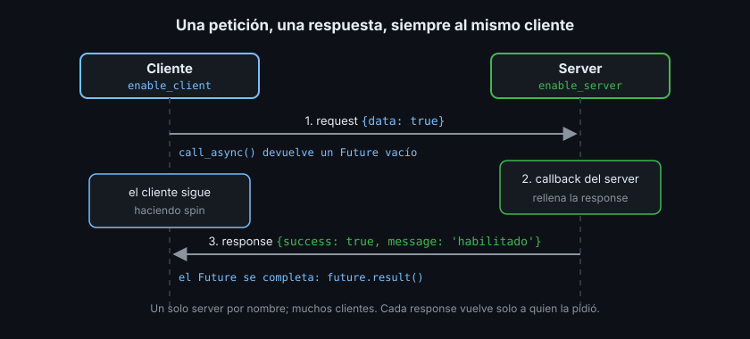

# Servicios: pregunta y respuesta

> Un topic es una emisora: publica aunque nadie escuche y nunca sabe si alguien recibió. Para "habilita los motores y dime si lo hiciste" necesitas otra cosa: una llamada con respuesta.

## 🎯 Objetivos

- Explicar qué es un servicio y en qué se diferencia de un topic
- Leer un `.srv`: la parte de petición y la de respuesta
- Descubrir, inspeccionar y llamar servicios desde la CLI (`ros2 service`)
- Saber cuándo un servicio es la herramienta correcta y cuándo no

## 1. Qué problema resuelve

En las Semanas 01 y 02 todo fue publish/subscribe: el publisher no sabe quién
escucha ni si el mensaje llegó. Muchas operaciones de un robot no encajan ahí:

| Operación | Qué necesita el que pide |
|---|---|
| "Habilita los motores" | Saber si se hizo, y si no, por qué |
| "Dame la configuración actual" | Recibir un dato **una vez**, cuando lo pide |
| "Pon el robot en modo carga" | Que alguien concreto lo ejecute y lo confirme |

Un **servicio** (service) es una comunicación **petición-respuesta**
(request/response): un nodo **cliente** (client) envía una petición, un nodo
**server** la atiende y devuelve una respuesta a ese cliente, y solo a él.

## 2. Cómo funciona



| | Topic | Servicio |
|---|---|---|
| Dirección | Uno a muchos | Uno a uno: cada response vuelve a quien la pidió |
| ¿Hay respuesta? | No | Sí, siempre una por petición |
| ¿Cuándo se envía? | Cuando el publisher quiera | Cuando el cliente pide |
| Si no hay nadie al otro lado | Se publica igual y se pierde | El cliente puede esperar a que aparezca el server |
| Uso típico | Flujos continuos (sensores, estado) | Órdenes cortas y consultas puntuales |

Reglas que conviene fijar desde el principio:

- Un servicio tiene **un nombre y un tipo**, como un topic: `/robot/enable` de
  tipo `std_srvs/srv/SetBool`
- Debe haber **un solo server** por nombre. Puede haber muchos clientes
- El server debe responder **rápido** (milisegundos). Si la tarea tarda
  segundos, es una acción (teoría 03)

## 3. Anatomía de un `.srv`

Un `.srv` son dos mensajes separados por `---`: arriba la **request**, abajo la
**response**.

```bash
ros2 interface show std_srvs/srv/SetBool
```

```text
bool data # e.g. for hardware enabling / disabling
---
bool success   # indicate successful run of triggered service
string message # informational, e.g. for error messages
```

Las líneas de campo siguen la misma sintaxis que un `.msg` (teoría 01 de la
Semana 02): tipos primitivos, otros mensajes, constantes. Paquetes estándar con
servicios:

| Paquete | Servicios | Para qué |
|---|---|---|
| `std_srvs` | `SetBool`, `Trigger`, `Empty` | Encender/apagar algo, disparar una acción sin argumentos |
| `rcl_interfaces` | `GetParameters`, `SetParameters`... | Los usa ROS2 internamente para los parámetros (teoría 05) |
| `example_interfaces` | `AddTwoInts` | Solo tutoriales |

Si ninguno encaja, escribes tu `.srv` en tu paquete `_interfaces`, igual que un
`.msg` (el proyecto de esta semana lo hace). La línea de CMake es la misma:

```cmake
rosidl_generate_interfaces(${PROJECT_NAME}
  "msg/DomainState.msg"
  "srv/SetMode.srv"
  DEPENDENCIES std_msgs
)
```

La regla de nombres también: el tipo `SetMode` se incluye en C++ como
`proyecto_dominio_interfaces/srv/set_mode.hpp` y se importa en Python como
`from proyecto_dominio_interfaces.srv import SetMode`.

## 4. Servicios desde la CLI, paso a paso

Con un server corriendo (el del Ejercicio 01, por ejemplo), en otra terminal
con `source install/setup.bash` hecho:

```bash
ros2 service list -t | grep robot
# /robot/enable [std_srvs/srv/SetBool]

ros2 service type /robot/enable
# std_srvs/srv/SetBool

ros2 service call /robot/enable std_srvs/srv/SetBool "{data: true}"
# waiting for service to become available...
# requester: making request: std_srvs.srv.SetBool_Request(data=True)
#
# response:
# std_srvs.srv.SetBool_Response(success=True, message='habilitado')
```

`ros2 service call` es un cliente de usar y tirar: espera al server, envía una
petición, imprime la response y termina. Los campos que no escribes en el YAML
toman su valor por defecto, como en `ros2 topic pub`.

`ros2 service list` también muestra servicios que **no** creaste tú: cada nodo
trae de serie los de sus parámetros (`/<nodo>/get_parameters`,
`/<nodo>/set_parameters`...). Los verás en la teoría 05.

## 5. Antipatrones

- ❌ **Un servicio para datos que cambian continuamente.** Si el cliente pide la
  batería diez veces por segundo, debería suscribirse a un topic
- ❌ **Un servicio para algo que tarda segundos.** El cliente no recibe progreso
  ni puede cancelar. Eso es una acción
- ❌ **Dos servers con el mismo nombre.** Los dos responden y el cliente se queda
  con la primera respuesta que llegue, sin saber de cuál
- ❌ **Response sin información de error.** `success=False` sin `message` obliga a
  leer el log del server para saber qué pasó

## 6. Trucos

- `ros2 service list -t` — nombre y tipo a la vez
- `ros2 service find std_srvs/srv/SetBool` — todos los servicios de un tipo
- `ros2 interface proto std_srvs/srv/SetBool` — YAML de la request listo para
  `ros2 service call`

## 📚 Recursos Adicionales

- [Understanding services — ROS2 Jazzy](https://docs.ros.org/en/jazzy/Tutorials/Beginner-CLI-Tools/Understanding-ROS2-Services/Understanding-ROS2-Services.html)
- [Services — ROS2 Jazzy concepts](https://docs.ros.org/en/jazzy/Concepts/Basic/About-Services.html)

## ✅ Checklist de Verificación

- [ ] Sé explicar la diferencia entre un topic y un servicio con un ejemplo de robot
- [ ] Sé leer un `.srv` y distinguir request de response
- [ ] Llamé a un servicio con `ros2 service call` y leí la response
- [ ] Sé por qué una tarea de varios segundos no debe ser un servicio

---

## 🔗 Navegación

| Anterior | Actual | Siguiente |
| -------- | ------ | --------- |
| [Semana 03](../README.md) | **01 · Servicios** | [02 · Servicios en código](02-servicios-en-python-y-cpp.md) |

← [Volver a la Semana 03](../README.md)
