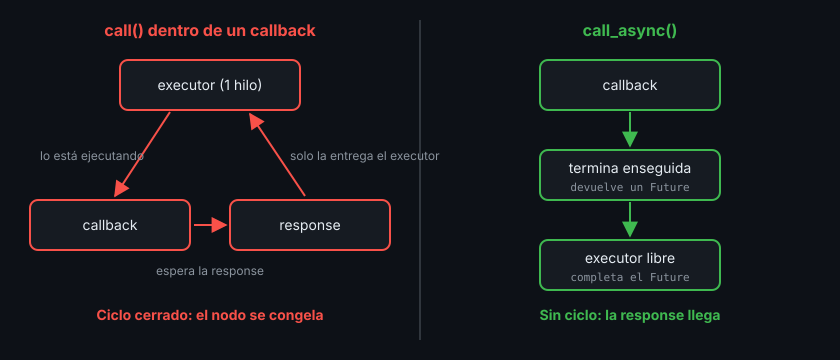

# Servicios en Python y C++

> Escribir un server es fácil: una función que recibe la request y rellena la response. Lo delicado es el cliente: esperar la respuesta sin bloquear el nodo que la tiene que recibir.

## 🎯 Objetivos

- Crear un service server en `rclpy` y en `rclcpp`
- Crear un cliente que espera al server y llama de forma **asíncrona**
- Entender el bloqueo (deadlock) que produce llamar a un servicio de forma síncrona dentro de un callback
- Comprobar que un cliente Python habla con un server C++ y al revés

## 1. Qué problema resuelve

Desde la CLI, `ros2 service call` hace todo por ti. En un nodo tienes que
resolver tres cosas: anunciar el server, encontrarlo desde el cliente y recibir
la response sin congelar el nodo mientras llega.

## 2. Server en Python, paso a paso

```python
from rclpy.node import Node
from std_srvs.srv import SetBool


class EnableServer(Node):
    def __init__(self) -> None:
        super().__init__("enable_server")
        self.enabled = False
        # Tipo, nombre relativo y la función que atiende cada petición.
        self._service = self.create_service(SetBool, "robot/enable", self._on_enable)

    def _on_enable(
        self, request: SetBool.Request, response: SetBool.Response
    ) -> SetBool.Response:
        # rclpy crea la response vacía; tú la rellenas y la devuelves.
        self.enabled = request.data
        response.success = True
        response.message = "habilitado" if request.data else "deshabilitado"
        return response
```

- El callback recibe **dos** argumentos: la request (lo que pidió el cliente) y
  la response (vacía, para que la rellenes)
- **Tienes que devolver la response.** Si olvidas el `return`, el callback
  devuelve `None`, `spin` lanza un `TypeError` y el nodo server se cae
- `SetBool.Request` y `SetBool.Response` son clases generadas a partir del
  `.srv`, como cualquier mensaje

## 3. Cliente en Python, paso a paso

```python
from rclpy.node import Node
from rclpy.task import Future
from std_srvs.srv import SetBool


class EnableClient(Node):
    def __init__(self) -> None:
        super().__init__("enable_client")
        self._client = self.create_client(SetBool, "robot/enable")

    def send(self, enable: bool) -> Future:
        # Sin server no hay a quién preguntar: espera hasta 2 s a que aparezca.
        if not self._client.wait_for_service(timeout_sec=2.0):
            raise RuntimeError("el servicio robot/enable no está disponible")
        # Devuelve enseguida; la response llegará dentro del Future.
        return self._client.call_async(SetBool.Request(data=enable))
```

Y quien use el cliente hace spin **hasta** que el `Future` se complete:

```python
future = node.send(True)
rclpy.spin_until_future_complete(node, future, timeout_sec=5.0)
result = future.result()  # None si venció el timeout
```

Un **`Future`** es una caja vacía que se llena más tarde. `call_async` envía la
petición y devuelve la caja; la response la mete ahí el executor cuando llega,
durante el spin. Sin spin, la caja nunca se llena.

### 3.1 El bloqueo que debes evitar

rclpy también tiene `client.call(request)`, que espera la response **sin**
devolver el control. Si lo usas dentro de un callback (de un timer, de una
subscripción, de otro servicio), el nodo se queda colgado para siempre:

```python
def _on_timer(self) -> None:
    # ❌ Deadlock: call() espera la response, pero la response solo puede
    # procesarla el executor, que está ocupado ejecutando este mismo callback.
    result = self._client.call(SetBool.Request(data=True))
```



En este bootcamp: **siempre `call_async`**. Si necesitas actuar al llegar la
response desde un callback, añade una función al `Future`:

```python
future = self._client.call_async(request)
future.add_done_callback(lambda f: self.get_logger().info(f.result().message))
```

La Semana 04 explica los executors con varios hilos, la otra forma de resolverlo.

## 4. Server en C++, paso a paso

```cpp
#include "rclcpp/rclcpp.hpp"
#include "std_srvs/srv/set_bool.hpp"

#include <functional>
#include <memory>

class EnableServer : public rclcpp::Node {
 public:
  using SetBool = std_srvs::srv::SetBool;

  EnableServer() : Node("enable_server") {
    // _1 y _2 son los dos argumentos que rclcpp pasará: request y response.
    service_ = create_service<SetBool>(
        "robot/enable", std::bind(&EnableServer::on_enable, this, std::placeholders::_1,
                                  std::placeholders::_2));
  }

 private:
  void on_enable(const std::shared_ptr<SetBool::Request> request,
                 std::shared_ptr<SetBool::Response> response) {
    // Aquí no se devuelve nada: la response ya existe y rclcpp la envía al salir.
    enabled_ = request->data;
    response->success = true;
    response->message = request->data ? "habilitado" : "deshabilitado";
  }

  bool enabled_{false};
  rclcpp::Service<SetBool>::SharedPtr service_;
};
```

Diferencias con Python: request y response llegan como `std::shared_ptr` (de
ahí el `->`), el callback devuelve `void` y debes **guardar** el `service_`: si
el `SharedPtr` se destruye, el servicio desaparece del grafo.

## 5. Cliente en C++, paso a paso

```cpp
#include "rclcpp/rclcpp.hpp"
#include "std_srvs/srv/set_bool.hpp"

#include <chrono>
#include <memory>
#include <stdexcept>

class EnableClient : public rclcpp::Node {
 public:
  using SetBool = std_srvs::srv::SetBool;

  EnableClient() : Node("enable_client") { client_ = create_client<SetBool>("robot/enable"); }

  rclcpp::Client<SetBool>::SharedFuture send(bool enable) {
    if (!client_->wait_for_service(std::chrono::seconds(2))) {
      throw std::runtime_error("el servicio robot/enable no está disponible");
    }
    auto request = std::make_shared<SetBool::Request>();
    request->data = enable;
    // async_send_request devuelve un par (future, id); nos quedamos con el future.
    return client_->async_send_request(request).future.share();
  }

 private:
  rclcpp::Client<SetBool>::SharedPtr client_;
};
```

Y en `main`, igual que en Python:

```cpp
auto future = node->send(true);
if (rclcpp::spin_until_future_complete(node, future, std::chrono::seconds(5)) ==
    rclcpp::FutureReturnCode::SUCCESS) {
  RCLCPP_INFO(node->get_logger(), "%s", future.get()->message.c_str());
}
```

## 6. Entre lenguajes

El contrato es el `.srv`, no el lenguaje. Con el server C++ corriendo, el
cliente Python funciona sin cambiar nada:

```bash
# Terminal 1
ros2 run ejercicio02_servicio_cpp enable_server

# Terminal 2
ros2 run ejercicio01_servicio_py enable_client true
# [INFO] [...] [enable_client]: success=True message='habilitado'
```

Y al revés (server Python, cliente C++):

```bash
ros2 run ejercicio02_servicio_cpp enable_client true
# [INFO] [...] [enable_client]: success=1 message='habilitado'
```

El `1` en vez de `True` es solo el formato `%d` de C++ para un `bool`: el dato es
el mismo.

## 7. Errores típicos y su causa

| Síntoma | Causa | Arreglo |
|---|---|---|
| `el servicio robot/enable no está disponible` | Server sin arrancar, otro nombre o nombre absoluto en uno y relativo en otro | `ros2 service list -t` y compara |
| El nodo cliente se congela | `call()` síncrono dentro de un callback | `call_async` |
| El cliente nunca recibe la response | Nadie hace spin del nodo cliente | `spin_until_future_complete` o un executor |
| C++: el servicio no aparece en `ros2 service list` | El `SharedPtr` del servicio es una variable local y se destruyó | Guárdalo como miembro |
| Python: el server se cae con `TypeError` al recibir una petición | El callback no hace `return response` | Devuelve la response |

## 8. Antipatrones

- ❌ **`wait_for_service()` sin timeout.** Si el server no existe, el cliente se
  queda esperando para siempre sin decir nada
- ❌ **Lógica pesada en el callback del server.** Mientras se ejecuta, ese
  server no atiende a nadie más
- ❌ **Guardar el `Future` y no volver a mirarlo.** Si el server falla, nunca te
  enteras

## 📚 Recursos Adicionales

- [Writing a simple service and client (Python) — ROS2 Jazzy](https://docs.ros.org/en/jazzy/Tutorials/Beginner-Client-Libraries/Writing-A-Simple-Py-Service-And-Client.html)
- [Writing a simple service and client (C++) — ROS2 Jazzy](https://docs.ros.org/en/jazzy/Tutorials/Beginner-Client-Libraries/Writing-A-Simple-Cpp-Service-And-Client.html)
- [Synchronous vs. asynchronous service clients — ROS2 Jazzy](https://docs.ros.org/en/jazzy/How-To-Guides/Sync-Vs-Async.html)

## ✅ Checklist de Verificación

- [ ] Escribí un server que rellena y devuelve la response
- [ ] Mi cliente usa `wait_for_service` con timeout y `call_async`
- [ ] Sé explicar por qué `call()` dentro de un callback bloquea el nodo
- [ ] Hice hablar un cliente Python con un server C++

---

## 🔗 Navegación

| Anterior | Actual | Siguiente |
| -------- | ------ | --------- |
| [01 · Servicios](01-servicios-request-response.md) | **02 · Servicios en código** | [03 · Acciones](03-acciones-goal-feedback-result.md) |

← [Volver a la Semana 03](../README.md)
