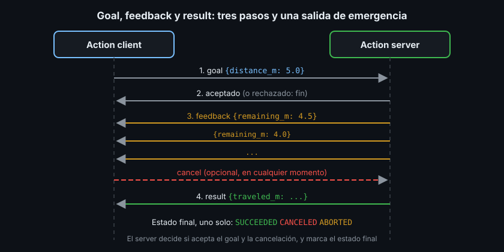

# Acciones: goal, feedback y result

> "Avanza 5 metros" no se responde en un milisegundo. Quien lo pide quiere saber si se aceptó, cuánto falta mientras tanto y poder decir "para" a mitad de camino. Eso es una acción.

## 🎯 Objetivos

- Explicar qué es una acción y qué añade sobre un servicio
- Leer un `.action`: goal, result y feedback
- Conocer los estados de un goal (aceptado, en ejecución, completado, cancelado, abortado)
- Enviar, seguir y cancelar goals desde la CLI (`ros2 action`)

## 1. Qué problema resuelve

Un servicio tiene dos limitaciones para tareas largas:

- El cliente **no sabe nada** hasta que llega la response: ni si se aceptó ni
  cuánto falta
- **No se puede cancelar**: una vez enviada la petición, solo queda esperar

Navegar hasta un punto, mover un brazo o cargar la batería tardan segundos o
minutos. Una **acción** (action) es la comunicación de ROS2 para tareas largas
con **objetivo** (goal), **progreso** (feedback), **resultado** (result) y
**cancelación** (cancel). Nav2 (Semana 16) y MoveIt2 (Semana 20) se manejan
casi por completo con acciones.

## 2. Cómo funciona



Por dentro, una acción son **tres servicios y dos topics** que ROS2 crea por ti:

| Pieza | Tipo de comunicación | Para qué |
|---|---|---|
| `send_goal` | Servicio | El cliente envía el goal; el server responde aceptado o rechazado |
| `cancel_goal` | Servicio | El cliente pide cancelar; el server acepta o no |
| `get_result` | Servicio | El cliente pide el result; la response llega cuando el goal termina |
| `feedback` | Topic | El server publica el progreso |
| `status` | Topic | Estado de todos los goals activos |

No tienes que manejarlas una a una: `rclpy.action` y `rclcpp_action` lo hacen.
Pero explica dos cosas que verás: que `ros2 service list` no muestra las
acciones (para eso está `ros2 action list`) y que el feedback, al ser un topic,
puede perder mensajes si nadie hace spin.

### 2.1 Estados de un goal

| Estado | Quién lo decide | Significado |
|---|---|---|
| Rechazado (rejected) | Server, al recibirlo | El goal no es válido; nunca empieza |
| `EXECUTING` | Server | Aceptado y en marcha |
| `CANCELING` | Server, al aceptar una cancelación | Va a parar, pero aún no ha parado |
| `SUCCEEDED` | Server | Terminó con éxito |
| `CANCELED` | Server | Paró porque se lo pidieron |
| `ABORTED` | Server | Paró por un fallo propio (obstáculo, batería...) |

La cancelación es una **petición**, no una orden: el server decide si la acepta
y cuándo para de verdad. Así un brazo puede terminar de soltar un objeto antes
de detenerse.

## 3. Anatomía de un `.action`

Tres bloques separados por `---`: goal, result y feedback, **en ese orden**.

```text
# Goal: lo que pide el cliente.
float64 distance_m        # distancia a recorrer, en metros (0 < d <= 10)
---
# Result: lo que devuelve el server al terminar (con éxito o cancelada).
float64 traveled_m        # distancia recorrida de verdad, en metros
---
# Feedback: lo que el server publica mientras trabaja.
float64 remaining_m       # distancia que falta, en metros
```

Es `ejercicio03_interfaces/action/MoveDistance.action`, el de esta semana. Un
paquete de interfaces con acciones necesita, además de lo de la Semana 02, una
dependencia más en `package.xml`:

```xml
<!-- Las acciones se apoyan en los tipos de action_msgs (GoalInfo, GoalStatus...). -->
<depend>action_msgs</depend>
```

En `CMakeLists.txt`, la ruta del `.action` va en `rosidl_generate_interfaces`
como cualquier otra interfaz:

```cmake
rosidl_generate_interfaces(${PROJECT_NAME}
  "action/MoveDistance.action"
)
```

El orden importa: si cambias el result de sitio con el feedback, el código
compila, pero cliente y server interpretan mal los datos.

## 4. Acciones desde la CLI, paso a paso

Con el action server del Ejercicio 03 corriendo:

```bash
ros2 action list -t
# /robot/move_distance [ejercicio03_interfaces/action/MoveDistance]

ros2 action info /robot/move_distance
# Action: /robot/move_distance
# Action clients: 0
# Action servers: 1
#     /move_server
```

Enviar un goal y ver el feedback:

```bash
ros2 action send_goal --feedback /robot/move_distance \
  ejercicio03_interfaces/action/MoveDistance "{distance_m: 0.2}"
# Waiting for an action server to become available...
# Sending goal:
#      distance_m: 0.2
#
# Goal accepted with ID: fcc550a5eb1243ce82de59a7430a85f5
#
# Feedback:
#     remaining_m: 0.15000000000000002
#
# ...
#
# Feedback:
#     remaining_m: 0.0
#
# Result:
#     traveled_m: 0.2
#
# Goal finished with status: SUCCEEDED
```

Los decimales largos (`0.15000000000000002`) son el redondeo normal de un
`float64`; el ID cambia en cada goal.

Un goal no válido se rechaza sin llegar a ejecutarse:

```bash
ros2 action send_goal /robot/move_distance \
  ejercicio03_interfaces/action/MoveDistance "{distance_m: -1.0}"
# ...
# Goal was rejected.
```

Para cancelar, envía un goal largo (`{distance_m: 5.0}`) y pulsa `Ctrl+C`
mientras corre:

```text
Goal accepted with ID: 57f4b840fc334c0a8f5f9ab2051f0dfd

^CCanceling goal...
```

El log del server confirma dónde paró: `Cancelado a 1.00 m`. En Jazzy, la CLI
puede imprimir además `Executor is already spinning` al cancelar; es un aviso de
la propia herramienta y no afecta al goal.

## 5. Antipatrones

- ❌ **Una acción para algo instantáneo.** "Dame la versión del firmware" no
  necesita feedback ni cancelación: es un servicio
- ❌ **Feedback a 1 kHz.** Es un topic: a esa frecuencia satura la red. Diez
  veces por segundo suele bastar para una barra de progreso
- ❌ **Ignorar la cancelación.** Un server que acepta cancelar y sigue hasta el
  final engaña al cliente; si no puedes parar, rechaza la cancelación
- ❌ **Usar `ABORTED` para "me cancelaron".** Cada estado final significa una
  cosa distinta y el cliente decide qué hacer según cuál recibe

## 6. Trucos

- `ros2 action list -t` — acciones con su tipo
- `ros2 interface show <paquete>/action/<Tipo>` — los tres bloques del `.action`
- `ros2 topic list --include-hidden-topics | grep _action` — los topics internos
  de feedback y status

## 📚 Recursos Adicionales

- [Understanding actions — ROS2 Jazzy](https://docs.ros.org/en/jazzy/Tutorials/Beginner-CLI-Tools/Understanding-ROS2-Actions/Understanding-ROS2-Actions.html)
- [Actions — ROS2 Jazzy concepts](https://docs.ros.org/en/jazzy/Concepts/Basic/About-Actions.html)
- [Creating an action — ROS2 Jazzy](https://docs.ros.org/en/jazzy/Tutorials/Intermediate/Creating-an-Action.html)

## ✅ Checklist de Verificación

- [ ] Sé qué añade una acción sobre un servicio (feedback y cancelación)
- [ ] Sé leer un `.action` y en qué orden van sus tres bloques
- [ ] Sé distinguir `SUCCEEDED`, `CANCELED` y `ABORTED`
- [ ] Envié, seguí y cancelé un goal con `ros2 action send_goal`

---

## 🔗 Navegación

| Anterior | Actual | Siguiente |
| -------- | ------ | --------- |
| [02 · Servicios en código](02-servicios-en-python-y-cpp.md) | **03 · Acciones** | [04 · Acciones en código](04-acciones-en-python-y-cpp.md) |

← [Volver a la Semana 03](../README.md)
