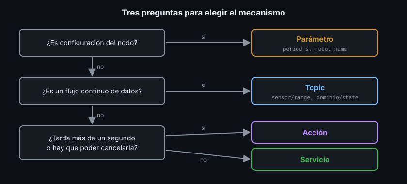

# Parámetros: configurar un nodo sin recompilar

> El mismo nodo de latido sirve para un robot de almacén que late cada segundo y para uno de laboratorio que late cada 200 ms. Lo que cambia no es el código, es la configuración. Los parámetros son esa configuración, con nombre, tipo y reglas.

## 🎯 Objetivos

- Declarar parámetros con valor por defecto y descriptor (descripción, rango, solo lectura)
- Pasar valores al arrancar con `-p` y con un archivo YAML (`--params-file`)
- Leer, cambiar y volcar parámetros en marcha con `ros2 param`
- Reaccionar a un cambio con una post-set callback
- Elegir entre topic, servicio, acción y parámetro

## 1. Qué problema resuelve

Hasta ahora, el periodo del timer o el nombre del topic estaban escritos en el
código. Cambiarlos obligaba a editar y recompilar. Un **parámetro** (parameter)
es un valor de configuración que pertenece a un nodo, tiene nombre y tipo, y se
puede fijar al arrancar o cambiar con el nodo en marcha.

| Sin parámetros | Con parámetros |
|---|---|
| `create_timer(1.0, ...)` | `create_timer(self.get_parameter("period_s").value, ...)` |
| Un ejecutable por robot | Un ejecutable + un YAML por robot |
| Para ajustar, recompilar | `ros2 param set /heartbeat period_s 0.2` |

## 2. Cómo funciona

- Cada parámetro pertenece a **un nodo**: `/heartbeat` tiene su `period_s`;
  otro nodo puede tener uno con el mismo nombre sin que choquen
- Hay que **declararlo** antes de usarlo: nombre, valor por defecto y,
  opcionalmente, un **descriptor** (descriptor) con reglas
- Tipos posibles: `bool`, `int`, `double`, `string`, sus arrays y `byte[]`. El
  tipo lo fija el valor por defecto: `1.0` es `double`, `1` es `int`
- Por dentro, `ros2 param` usa **servicios** del nodo (`/heartbeat/get_parameters`,
  `/heartbeat/set_parameters`...): por eso aparecen en `ros2 service list`

### 2.1 De dónde sale el valor

Cuando el nodo declara `period_s`, el valor final es:

- El que llegue por `--ros-args` al arrancar: `-p period_s:=0.3` o un archivo
  YAML con `--params-file`. Si llegan los dos, **gana el último** de la línea de
  comandos: `--params-file f.yaml -p period_s:=0.3` da `0.3`; al revés, da el
  del YAML
- Si no llega ninguno, el valor por defecto del código

Después, `ros2 param set` lo puede cambiar en marcha si el descriptor lo permite.

## 3. Declarar con descriptor en Python, paso a paso

```python
from rcl_interfaces.msg import FloatingPointRange, ParameterDescriptor

self.declare_parameter(
    "robot_name",
    "robot",  # valor por defecto: fija el tipo string
    ParameterDescriptor(description="Nombre en cada latido", read_only=True),
)
self.declare_parameter(
    "period_s",
    1.0,  # double
    ParameterDescriptor(
        description="Segundos entre latidos",
        floating_point_range=[FloatingPointRange(from_value=0.1, to_value=5.0)],
    ),
)
period_s = self.get_parameter("period_s").value
```

| Campo del descriptor | Efecto |
|---|---|
| `description` | Texto que muestra `ros2 param describe` |
| `read_only=True` | Se fija al arrancar; `ros2 param set` lo rechaza |
| `floating_point_range` / `integer_range` | ROS2 rechaza los valores fuera del rango |

## 4. Lo mismo en C++

En `rclcpp` el descriptor es un mensaje que se rellena campo a campo:

```cpp
#include "rcl_interfaces/msg/floating_point_range.hpp"
#include "rcl_interfaces/msg/parameter_descriptor.hpp"

rcl_interfaces::msg::FloatingPointRange range;
range.from_value = 0.1;
range.to_value = 5.0;
rcl_interfaces::msg::ParameterDescriptor descriptor;
descriptor.description = "Segundos entre latidos";
descriptor.floating_point_range.push_back(range);
// declare_parameter<double> devuelve el valor final (defecto, YAML o -p).
const double period_s = declare_parameter<double>("period_s", 1.0, descriptor);
```

Añade `rcl_interfaces` como dependencia (`<depend>` en `package.xml`,
`find_package` y `ament_target_dependencies` en CMake).

## 5. Reaccionar a cambios en marcha

ROS2 ofrece dos callbacks para los cambios. En Jazzy:

| Callback | Cuándo se llama | Para qué |
|---|---|---|
| `add_on_set_parameters_callback` | **Antes** de aplicar el cambio | Validar reglas que el descriptor no cubre; puede rechazar |
| `add_post_set_parameters_callback` | **Después** de aplicarlo | Usar el valor nuevo: recrear un timer, reconectar... |

Para el rango y `read_only` basta el descriptor. Para aplicar el periodo nuevo:

```python
def _on_parameters_set(self, parameters: list[Parameter]) -> None:
    for parameter in parameters:
        if parameter.name == "period_s":
            # El timer de rclpy permite cambiar el periodo sin recrearlo.
            self.timer.timer_period_ns = int(parameter.value * 1e9)


# En __init__:
self.add_post_set_parameters_callback(self._on_parameters_set)
```

En C++ la callback se registra igual, pero **guarda el handle** que devuelve: si
se destruye, rclcpp deja de llamarla. Y como un `rclcpp` timer no cambia de
periodo, se crea otro (el anterior se destruye al reasignar el `SharedPtr`):

```cpp
post_set_handle_ = add_post_set_parameters_callback(
    [this](const std::vector<rclcpp::Parameter>& parameters) {
      for (const auto& parameter : parameters) {
        if (parameter.get_name() == "period_s") {
          timer_ = create_wall_timer(std::chrono::duration<double>(parameter.as_double()),
                                     [this]() { on_timer(); });
        }
      }
    });
```

## 6. Archivo YAML de parámetros

```yaml
# La clave de primer nivel es el nombre del nodo; ros__parameters
# (con dos guiones bajos) es obligatorio.
heartbeat:
  ros__parameters:
    robot_name: "explorer"
    period_s: 0.5
```

Se instala en `share/<paquete>/config/` para encontrarlo después de compilar:

```python
# setup.py, dentro de data_files
(f"share/{package_name}/config", ["config/heartbeat.yaml"]),
```

```cmake
# CMakeLists.txt
install(DIRECTORY config DESTINATION share/${PROJECT_NAME})
```

Y se pasa al arrancar:

```bash
ros2 run ejercicio04_parametros_py heartbeat --ros-args \
  --params-file install/ejercicio04_parametros_py/share/ejercicio04_parametros_py/config/heartbeat.yaml
```

Como el YAML va por **nombre de nodo**, el mismo archivo sirve para la versión
Python y la C++ si ambas se llaman `heartbeat`. En la Semana 06 los launch files
lo pasan por ti.

## 7. `ros2 param`, paso a paso

Con `ros2 run ejercicio04_parametros_py heartbeat` corriendo:

```bash
ros2 param list /heartbeat
#   period_s
#   robot_name
#   start_type_description_service
#   use_sim_time

ros2 param describe /heartbeat period_s
# Parameter name: period_s
#   Type: double
#   Description: Segundos entre latidos
#   Constraints:
#     Min value: 0.1
#     Max value: 5.0

ros2 param set /heartbeat period_s 10.0
# Setting parameter failed: Parameter period_s out of range Min: 0.1, Max: 5.0, value: 10.0

ros2 param set /heartbeat robot_name otro
# Setting parameter failed: Trying to set a read-only parameter: robot_name.

ros2 param set /heartbeat period_s 1
# Setting parameter failed: Wrong parameter type, expected 'Type.DOUBLE' got 'Type.INTEGER'

ros2 param set /heartbeat period_s 0.2
# Set parameter successful

ros2 param dump /heartbeat
# /heartbeat:
#   ros__parameters:
#     period_s: 0.2
#     robot_name: robot
#     start_type_description_service: true
#     use_sim_time: false
```

- `use_sim_time` y `start_type_description_service` los declara ROS2 en
  **todos** los nodos. `use_sim_time` vuelve en la Semana 08, con Gazebo
- `period_s 1` falla porque `1` es un entero: escribe `1.0`
- `ros2 param dump` imprime un YAML que puedes guardar y reutilizar con
  `--params-file`

## 8. ¿Topic, servicio, acción o parámetro?



| Necesidad | Mecanismo | Ejemplo |
|---|---|---|
| Datos que fluyen continuamente | Topic | Lecturas de un sensor, estado del robot |
| Orden o consulta corta con respuesta | Servicio | Habilitar motores, cambiar de modo |
| Tarea larga con progreso y cancelación | Acción | Avanzar 5 m, navegar a un punto |
| Configuración del nodo | Parámetro | Periodo de publicación, nombre del robot |

## 9. Antipatrones

- ❌ **Leer el parámetro una vez y olvidar los cambios.** Si se puede cambiar en
  marcha, registra la post-set callback; si no, márcalo `read_only`
- ❌ **Un parámetro como canal de datos.** Cambiar `target_x` diez veces por
  segundo es un topic disfrazado
- ❌ **Descriptor sin `description`.** `ros2 param describe` es la documentación
  que leerá quien configure tu nodo
- ❌ **Rutas absolutas a YAML de tu máquina.** Instala el archivo en `share/` y
  búscalo ahí

## 📚 Recursos Adicionales

- [Understanding parameters — ROS2 Jazzy](https://docs.ros.org/en/jazzy/Tutorials/Beginner-CLI-Tools/Understanding-ROS2-Parameters/Understanding-ROS2-Parameters.html)
- [Using parameters in a class (Python) — ROS2 Jazzy](https://docs.ros.org/en/jazzy/Tutorials/Beginner-Client-Libraries/Using-Parameters-In-A-Class-Python.html)
- [Using parameters in a class (C++) — ROS2 Jazzy](https://docs.ros.org/en/jazzy/Tutorials/Beginner-Client-Libraries/Using-Parameters-In-A-Class-CPP.html)
- [Parameters — ROS2 Jazzy concepts](https://docs.ros.org/en/jazzy/Concepts/Basic/About-Parameters.html)

## ✅ Checklist de Verificación

- [ ] Declaré un parámetro con descripción y rango, y otro de solo lectura
- [ ] Pasé valores con `-p` y con `--params-file`
- [ ] Vi los tres rechazos de `ros2 param set` (rango, solo lectura, tipo)
- [ ] Sé elegir entre topic, servicio, acción y parámetro con un ejemplo de cada uno

---

## 🔗 Navegación

| Anterior | Actual | Siguiente |
| -------- | ------ | --------- |
| [04 · Acciones en código](04-acciones-en-python-y-cpp.md) | **05 · Parámetros** | [Prácticas](../2-practicas/README.md) |

← [Volver a la Semana 03](../README.md)
