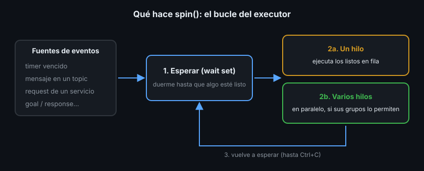

# Executors: quién ejecuta tus callbacks

> Desde la Semana 01 escribes `rclpy.spin(node)` sin preguntarte qué pasa dentro. Ahí vive el executor, la pieza que decide cuándo y en qué hilo corre cada callback. Mientras todos los callbacks son cortos no lo notas. El día que uno tarda medio segundo, el resto del nodo se congela.

## 🎯 Objetivos

- Explicar qué hace `spin()` por dentro: esperar, elegir y ejecutar callbacks
- Distinguir `SingleThreadedExecutor` y `MultiThreadedExecutor`
- Usar `spin`, `spin_once` y `spin_until_future_complete` sabiendo qué bloquea cada uno
- Reconocer el síntoma de un callback lento: un timer que deja de latir

## 1. Qué problema resuelve

Un nodo no es un programa que corre de arriba abajo. Es un conjunto de
**callbacks** (funciones que ROS2 llama cuando pasa algo): un timer vence, llega
un mensaje, llega una request. Alguien tiene que esperar esos eventos y llamar a
la función correcta. Ese alguien es el **executor** (ejecutor).

Hasta ahora usabas el executor sin verlo:

```python
rclpy.spin(node)  # crea un SingleThreadedExecutor, le añade el nodo y hace spin
```

## 2. Cómo funciona



`spin()` es un bucle de tres pasos:

1. **Esperar**. El executor junta en un **wait set** (conjunto de espera) todos
   los timers, subscriptions, servicios y clientes de sus nodos, y duerme hasta
   que alguno tenga trabajo. Dormir no gasta CPU
2. **Ejecutar** los callbacks listos
3. **Volver a esperar**, hasta que el proceso recibe `Ctrl+C`

El paso 2 depende del tipo de executor:

| Executor | Hilos | Qué pasa si un callback tarda 0.5 s |
|---|---|---|
| `SingleThreadedExecutor` | 1 | Todo el nodo espera 0.5 s: timers, mensajes y requests se acumulan |
| `MultiThreadedExecutor` | Varios (por defecto, uno por núcleo de CPU) | Otros callbacks pueden correr en otro hilo... si su **callback group** lo permite (teoría 02) |

En C++ los nombres son los mismos: `rclcpp::executors::SingleThreadedExecutor` y
`rclcpp::executors::MultiThreadedExecutor`.

## 3. Usar un executor explícito, paso a paso

`rclpy.spin(node)` es un atajo. Escrito entero, en Python:

```python
from rclpy.executors import MultiThreadedExecutor

rclpy.init()
node = Monitor()
executor = MultiThreadedExecutor()  # sin argumentos: un hilo por núcleo
executor.add_node(node)             # un executor puede llevar varios nodos
try:
    executor.spin()
finally:
    executor.shutdown()
    node.destroy_node()
    rclpy.try_shutdown()
```

En C++:

```cpp
rclcpp::init(argc, argv);
auto node = std::make_shared<Monitor>();
rclcpp::executors::MultiThreadedExecutor executor;
executor.add_node(node);
executor.spin();
rclcpp::shutdown();
```

`add_node` admite varios nodos: el executor atiende los callbacks de todos. Es
lo que hacen los tests desde la Semana 03, y la base de la composición
(teoría 03).

## 4. Las variantes de `spin`

| Llamada | Bloquea hasta... | Para qué |
|---|---|---|
| `spin()` | `Ctrl+C` | El `main` de un nodo |
| `spin_once(timeout_sec=0.1)` | Un callback ejecutado o el timeout | Tests y bucles propios |
| `spin_until_future_complete(future)` | El future tiene resultado | Un cliente que espera su response (Semana 03) |
| `spin_some()` (solo C++) | Ejecutar lo que ya está listo, sin esperar | Tests en C++ |

## 5. El síntoma: un timer que deja de latir

El nodo `monitor` del Ejercicio 01 tiene un timer a 10 Hz y un servicio que tarda
0.5 s. El servicio responde cuántos ticks dio el timer mientras él trabajaba:

```bash
ros2 service call /robot/slow_check std_srvs/srv/Trigger
# response:
# std_srvs.srv.Trigger_Response(success=True, message='ticks durante la comprobación: 0')
```

Cero ticks: durante medio segundo el timer no corrió ni una vez. Con un solo
hilo, el executor estaba dentro del servicio y no podía hacer otra cosa. En un
robot, ese timer podría ser el que publica la odometría o el que vigila la
batería.

Cambiar a `MultiThreadedExecutor` es la mitad de la solución. La otra mitad son
los callback groups: la teoría siguiente.

## 6. Antipatrones

- ❌ **`time.sleep` o un bucle largo dentro de un callback con executor de un
  hilo.** Congela el nodo entero. Si es inevitable, mueve el callback a su propio
  grupo con un executor multihilo
- ❌ **`MultiThreadedExecutor` "por si acaso".** Si todos los callbacks son
  cortos no ganas nada y empiezas a necesitar protección contra accesos
  simultáneos (teoría 02, sección 5)
- ❌ **Llamar a `spin()` dos veces sobre el mismo nodo**, por ejemplo desde un
  hilo propio y desde `main`. Un nodo pertenece a un solo executor a la vez

## 📚 Recursos Adicionales

- [Executors — ROS2 Jazzy concepts](https://docs.ros.org/en/jazzy/Concepts/Intermediate/About-Executors.html)
- [Using callback groups — ROS2 Jazzy how-to](https://docs.ros.org/en/jazzy/How-To-Guides/Using-callback-groups.html)

## ✅ Checklist de Verificación

- [ ] Sé explicar los tres pasos del bucle de `spin()`
- [ ] Sé escribir `rclpy.spin(node)` con un executor explícito, en Python y en C++
- [ ] Sé qué variante de `spin` bloquea hasta qué
- [ ] Sé por qué el servicio lento deja el timer a 0 ticks con un solo hilo

---

## 🔗 Navegación

| Anterior | Actual | Siguiente |
| -------- | ------ | --------- |
| [Semana 04](../README.md) | **01 · Executors** | [02 · Callback groups](02-callback-groups.md) |

← [Volver a la Semana 04](../README.md)
