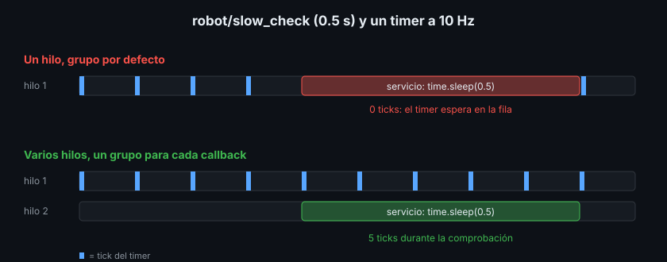

# Callback groups: qué puede correr a la vez

> Un executor con ocho hilos no sirve de nada si todos los callbacks hacen cola en la misma fila. Los callback groups son esas filas: tú decides qué callbacks se esperan entre sí y cuáles pueden correr en paralelo.

## 🎯 Objetivos

- Distinguir `MutuallyExclusiveCallbackGroup` y `ReentrantCallbackGroup`
- Saber cuál es el grupo por defecto y por qué un executor multihilo no basta
- Asignar grupos a timers, servicios, clientes y subscriptions en Python y C++
- Resolver con grupos el bloqueo de `call()` dentro de un callback (Semana 03)
- Proteger los datos que comparten callbacks que corren en hilos distintos

## 1. Qué problema resuelve

En la teoría 01 el servicio lento dejaba el timer a 0 ticks. Si cambias a
`MultiThreadedExecutor` y no haces nada más, el resultado **sigue siendo 0**. El
motivo es el grupo por defecto.

Un **callback group** (grupo de callbacks) es una etiqueta que pones a cada
timer, subscription, servicio o cliente. El executor la consulta antes de
lanzar un callback en un hilo libre.

## 2. Los dos tipos

| Grupo | Regla | Para qué |
|---|---|---|
| `MutuallyExclusiveCallbackGroup` | Como mucho **un** callback del grupo corriendo a la vez | Callbacks que tocan los mismos datos sin protección |
| `ReentrantCallbackGroup` | Cualquier número a la vez, **incluso el mismo callback dos veces** | Callbacks independientes, como `execute` y `cancel` de un action server |

Y la regla que lo explica todo:

- Cada nodo tiene un **grupo por defecto**, `MutuallyExclusive`. Todo lo que
  creas sin `callback_group=` va a ese grupo
- Así, aunque haya ocho hilos, el timer y el servicio están en la misma fila: el
  timer espera a que el servicio acabe



## 3. Asignar grupos, paso a paso

### 3.1 Python

```python
from rclpy.callback_groups import MutuallyExclusiveCallbackGroup

# En __init__ del nodo: un grupo para cada callback que no debe esperar al otro.
self.timer_group = MutuallyExclusiveCallbackGroup()
self.service_group = MutuallyExclusiveCallbackGroup()

self.timer = self.create_timer(0.1, self._on_tick, callback_group=self.timer_group)
self.service = self.create_service(
    Trigger, "robot/slow_check", self._on_slow_check,
    callback_group=self.service_group,
)
```

Y en `main`, un `MultiThreadedExecutor` (teoría 01, sección 3). Con las dos
piezas:

```bash
ros2 service call /robot/slow_check std_srvs/srv/Trigger
# std_srvs.srv.Trigger_Response(success=True, message='ticks durante la comprobación: 5')
```

### 3.2 C++

En `rclcpp` el grupo lo crea el nodo y se pasa como último argumento:

```cpp
timer_group_ = create_callback_group(rclcpp::CallbackGroupType::MutuallyExclusive);
service_group_ = create_callback_group(rclcpp::CallbackGroupType::MutuallyExclusive);

timer_ = create_wall_timer(100ms, [this]() { ++ticks_; }, timer_group_);
service_ = create_service<Trigger>(
    "robot/slow_check",
    std::bind(&Monitor::on_slow_check, this, std::placeholders::_1, std::placeholders::_2),
    rclcpp::ServicesQoS(), service_group_);  // el grupo va después del QoS
```

Para subscriptions y clientes el grupo va dentro de las opciones:

```cpp
rclcpp::SubscriptionOptions options;
options.callback_group = sensor_group_;
auto sub = create_subscription<std_msgs::msg::Float64>("robot/range_m", 10, callback, options);
```

### 3.3 Qué combinación da qué

| Executor | Grupos | Timer durante el servicio lento |
|---|---|---|
| Un hilo | Por defecto | 0 ticks |
| Un hilo | Uno para cada callback | 0 ticks: solo hay un hilo |
| Varios hilos | Por defecto | 0 ticks: misma fila |
| Varios hilos | Uno para cada callback | ~5 ticks ✅ |

## 4. `call()` síncrono dentro de un callback

En la Semana 03 viste que `client.call()` dentro de un callback bloquea el nodo
para siempre: el executor está ocupado en ese callback y no puede atender la
response. Allí la solución era `call_async`. La otra solución es poner el
**cliente en su propio grupo** y usar un executor multihilo:

```python
self._client_group = MutuallyExclusiveCallbackGroup()
self._client = self.create_client(
    SetBool, "robot/enable", callback_group=self._client_group
)


def _on_timer(self) -> None:
    # Este hilo espera aquí; otro hilo libre recibe la response.
    response = self._client.call(SetBool.Request(data=True), timeout_sec=3.0)
```

| Cliente en... | Resultado de `call()` (executor multihilo) |
|---|---|
| El grupo por defecto, como el timer | `None` tras 3 s: la response no se atiende hasta que el timer acabe |
| Su propio grupo | La response, al momento |

Con `timeout_sec` al menos no se cuelga para siempre. Aun así, en esta semana
el criterio es: **`call_async` por defecto**; `call()` con grupo propio solo
cuando el código secuencial sea mucho más claro.

## 5. Datos compartidos entre hilos

Con varios hilos, dos callbacks pueden tocar la misma variable a la vez:

| Situación | Qué hacer |
|---|---|
| Los dos callbacks están en el **mismo** grupo `MutuallyExclusive` | Nada: nunca corren a la vez |
| Grupos distintos, un contador o un `bool` en C++ | `std::atomic<int>`, `std::atomic<bool>` |
| Grupos distintos, una estructura (lista, mapa, mensaje) | Un `threading.Lock` / `std::mutex` alrededor de cada acceso |
| En Python, un `int` que solo se incrementa y se lee | Funciona por el GIL, pero un `Lock` deja la intención clara |

El `monitor` en C++ usa `std::atomic<int> ticks_`: el timer lo escribe en un
hilo y el servicio lo lee en otro.

## 6. Antipatrones

- ❌ **Todo en un `ReentrantCallbackGroup` "para que vaya rápido".** El mismo
  callback puede correr dos veces a la vez sobre los mismos datos. Usa
  `Reentrant` solo cuando sabes que el callback lo soporta
- ❌ **Crear los grupos y olvidar el executor multihilo** (o al revés). Hacen
  falta las dos piezas
- ❌ **Un grupo nuevo por cada mensaje o cada llamada.** Los grupos se crean una
  vez, en el constructor
- ❌ **Proteger con `Lock` y llamar a `call()` mientras lo tienes.** Si el
  callback de la response necesita el mismo lock, vuelves al bloqueo

## 📚 Recursos Adicionales

- [Using callback groups — ROS2 Jazzy how-to](https://docs.ros.org/en/jazzy/How-To-Guides/Using-callback-groups.html)
- [Executors — ROS2 Jazzy concepts](https://docs.ros.org/en/jazzy/Concepts/Intermediate/About-Executors.html)

## ✅ Checklist de Verificación

- [ ] Sé por qué `MultiThreadedExecutor` solo no basta
- [ ] Sé asignar un grupo a un timer, un servicio, una subscription y un cliente, en los dos lenguajes
- [ ] Sé llenar la tabla de la sección 3.3 sin mirarla
- [ ] Sé cuándo un dato compartido necesita `atomic` o `mutex`

---

## 🔗 Navegación

| Anterior | Actual | Siguiente |
| -------- | ------ | --------- |
| [01 · Executors](01-executors-y-spin.md) | **02 · Callback groups** | [03 · Composición](03-composicion-y-componentes.md) |

← [Volver a la Semana 04](../README.md)
