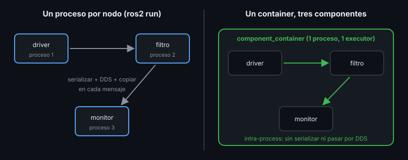

# Composición: varios nodos en un proceso

> Un robot con veinte nodos son veinte procesos, y cada imagen de cámara que pasa de uno a otro se copia y se serializa por el camino. La composición mete esos nodos en un solo proceso sin cambiar su código: el mismo nodo sirve para `ros2 run` y para un container.

## 🎯 Objetivos

- Explicar qué ganas al cargar nodos como componentes en un container
- Convertir un nodo `rclcpp` en componente y registrarlo con CMake
- Cargar, listar y descargar componentes con `ros2 component`
- Elegir el container (`component_container` o `_mt`) y justificar el executor
- Saber qué ofrece Python en su lugar

## 1. Qué problema resuelve

Hasta ahora cada nodo era un ejecutable y cada `ros2 run`, un proceso. Es
simple, pero:

- Cada mensaje entre procesos se **serializa** (se convierte en bytes), pasa por
  DDS y se vuelve a construir. Para un `Float64` da igual; para una nube de
  puntos de 2 MB a 30 Hz, no
- Cada proceso tiene su executor, sus hilos y su memoria

Un **componente** (component) es un nodo compilado como biblioteca compartida
(`.so`). Un **container** (contenedor de componentes) es un proceso vacío que
carga componentes en marcha y los ejecuta con un solo executor.



## 2. Cómo funciona

- El nodo no cambia: sigue siendo una clase que hereda de `rclcpp::Node` (o de
  `rclcpp_lifecycle::LifecycleNode`, teoría 04)
- Su constructor recibe `const rclcpp::NodeOptions&`. Por ahí le llegan del
  container el nombre, los parámetros y las opciones de comunicación
- Una macro registra la clase con su nombre completo
  (`ejercicio02_componente_cpp::Monitor`) para que el container la encuentre
- CMake compila la biblioteca, la anuncia en el índice de ament y, si quieres,
  genera también un ejecutable para seguir usando `ros2 run`

## 3. Convertir un nodo en componente, paso a paso

**1. Constructor con `NodeOptions`** (en el header):

```cpp
namespace ejercicio02_componente_cpp {

class Monitor : public rclcpp::Node {
 public:
  explicit Monitor(const rclcpp::NodeOptions& options = rclcpp::NodeOptions())
      : Node("monitor", options) {
    // ... igual que antes
  }
};

}  // namespace ejercicio02_componente_cpp
```

El `namespace` no es obligatorio, pero evita choques: dos paquetes podrían tener
una clase `Monitor`.

**2. Registrar la clase** (en un `.cpp`, una sola vez por clase):

```cpp
#include "ejercicio02_componente_cpp/monitor.hpp"
#include "rclcpp_components/register_node_macro.hpp"

RCLCPP_COMPONENTS_REGISTER_NODE(ejercicio02_componente_cpp::Monitor)
```

**3. Compilar como biblioteca y registrarla** (`CMakeLists.txt`):

```cmake
find_package(rclcpp_components REQUIRED)

add_library(monitor_component SHARED src/monitor_component.cpp)
target_include_directories(monitor_component PUBLIC
  $<BUILD_INTERFACE:${CMAKE_CURRENT_SOURCE_DIR}/include>)
ament_target_dependencies(monitor_component rclcpp rclcpp_components std_srvs)
rclcpp_components_register_node(monitor_component
  PLUGIN "ejercicio02_componente_cpp::Monitor"  # el nombre de la macro
  EXECUTABLE monitor                            # opcional: genera ros2 run ... monitor
  EXECUTOR MultiThreadedExecutor)               # opcional: por defecto, SingleThreaded
install(TARGETS monitor_component
  ARCHIVE DESTINATION lib
  LIBRARY DESTINATION lib
  RUNTIME DESTINATION bin)
```

Y en `package.xml`, `<depend>rclcpp_components</depend>`.

**4. Comprobar el registro** (tras `colcon build` y `source install/setup.bash`):

```bash
ros2 component types | grep -A1 ejercicio02
# ejercicio02_componente_cpp
#   ejercicio02_componente_cpp::Monitor
```

## 4. `ros2 component`, paso a paso

```bash
# Terminal 1: un container vacío, con executor de un hilo
ros2 run rclcpp_components component_container
```

```bash
# Terminal 2
ros2 component load /ComponentManager ejercicio02_componente_cpp ejercicio02_componente_cpp::Monitor
# Loaded component 1 into '/ComponentManager' container node as '/monitor'

ros2 component list
# /ComponentManager
#   1  /monitor

ros2 component unload /ComponentManager 1
# Unloaded component 1 from '/ComponentManager' container node
```

`/ComponentManager` es el nombre del nodo del container; `1` es el identificador
que le dio al componente al cargarlo. `load` admite `-p nombre:=valor` para
parámetros y `-r __node:=otro_nombre` para cargar dos copias con nombres
distintos.

## 5. Qué container elegir

`rclcpp_components` trae varios:

| Container | Executor | Cuándo |
|---|---|---|
| `component_container` | `SingleThreadedExecutor` | Todos los callbacks de todos los componentes son cortos |
| `component_container_mt` | `MultiThreadedExecutor` | Algún componente tiene callbacks lentos y grupos propios (teoría 02) |
| `component_container_isolated` | Uno por componente | Componentes que no deben retrasarse entre sí |

Con el `monitor` del Ejercicio 02:

| Cargado en... | `ros2 service call /robot/slow_check ...` |
|---|---|
| `component_container` | `ticks durante la comprobación: 0` |
| `component_container_mt` | `ticks durante la comprobación: 5` |

El componente es el mismo; lo que cambia es el executor del proceso que lo
carga. Por eso **justificar el executor** es parte del diseño: escribe qué
callbacks pueden tardar y qué no debe esperar a ellos.

## 6. Comunicación intra-process

Dentro de un mismo proceso, ROS2 puede pasar los mensajes entre nodos **sin
serializarlos ni pasar por DDS**. Se activa por componente:

```bash
ros2 component load /ComponentManager <paquete> <clase> -e use_intra_process_comms:=true
```

O en código, con `rclcpp::NodeOptions().use_intra_process_comms(true)`. Si
además publicas con `std::unique_ptr<Mensaje>`, el mensaje llega a un único
subscriber sin ninguna copia. La Semana 28 (rendimiento) lo mide con números.

## 7. ¿Y en Python?

`rclpy` **no tiene componentes ni containers**: un nodo Python no se puede
cargar con `ros2 component load`. Lo más parecido es meter varios nodos en el
mismo executor dentro de un `main`:

```python
executor = MultiThreadedExecutor()
executor.add_node(RangeDriver())
executor.add_node(Monitor())
executor.spin()
```

Comparten proceso y executor, pero no hay intra-process ni carga en marcha. Por
eso la regla del bootcamp: cuando el rendimiento entre nodos importa, el nodo va
en C++ como componente.

## 8. Antipatrones

- ❌ **Lógica en `main()`.** Un componente no tiene `main`: todo lo que el nodo
  necesita debe estar en el constructor
- ❌ **Usar `rclcpp::spin` o crear un executor dentro del componente.** El
  executor es del container; el componente solo crea sus callbacks
- ❌ **Cargar en `component_container` un componente con callbacks lentos**
  sin pensar en los demás: todos comparten ese único hilo
- ❌ **Olvidar la macro o el `rclcpp_components_register_node`.** Compila, pero
  `ros2 component types` no lo muestra y `load` falla

## 📚 Recursos Adicionales

- [Composing multiple nodes in a single process — ROS2 Jazzy](https://docs.ros.org/en/jazzy/Tutorials/Intermediate/Composition.html)
- [About composition — ROS2 Jazzy concepts](https://docs.ros.org/en/jazzy/Concepts/Intermediate/About-Composition.html)
- [Writing a composable node (C++) — ROS2 Jazzy](https://docs.ros.org/en/jazzy/Tutorials/Intermediate/Writing-a-Composable-Node.html)
- [Intra-process communication — ROS2 Jazzy](https://docs.ros.org/en/jazzy/Tutorials/Demos/Intra-Process-Communication.html)

## ✅ Checklist de Verificación

- [ ] Sé los tres cambios que convierten un nodo `rclcpp` en componente
- [ ] Cargué, listé y descargué un componente con `ros2 component`
- [ ] Sé elegir entre `component_container` y `component_container_mt`, con motivo
- [ ] Sé qué ofrece Python en lugar de los componentes

---

## 🔗 Navegación

| Anterior | Actual | Siguiente |
| -------- | ------ | --------- |
| [02 · Callback groups](02-callback-groups.md) | **03 · Composición** | [04 · Nodos lifecycle](04-nodos-lifecycle.md) |

← [Volver a la Semana 04](../README.md)
