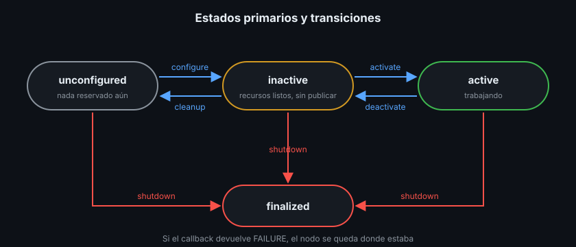

# Nodos lifecycle: arrancar en orden

> El driver del lidar arranca antes de que el puerto USB esté listo; el planificador empieza a pedir datos antes de que llegue el mapa. Con nodos normales, cada uno empieza a trabajar en cuanto existe. Un nodo lifecycle espera a que alguien le diga "configúrate" y "empieza", y así el arranque de un robot es una secuencia controlada en lugar de una carrera.

## 🎯 Objetivos

- Recorrer los estados y transiciones de un nodo lifecycle
- Decidir qué va en cada callback (`on_configure`, `on_activate`...)
- Escribir un nodo lifecycle en `rclpy` y en `rclcpp` con su publisher lifecycle
- Controlar un nodo lifecycle con `ros2 lifecycle`
- Saber por qué Nav2 y MoveIt2 usan este modelo

## 1. Qué problema resuelve

Un nodo normal reserva recursos y empieza a publicar en el constructor. Si algo
falla (no hay sensor, un parámetro es absurdo), el nodo queda a medias o el
proceso se cae, y nadie más lo sabe. Tampoco hay forma de decirle "para un
momento, sin morir".

Un **nodo lifecycle** (managed node, nodo gestionado) tiene una máquina de
estados estándar. Otro nodo, o tú desde la CLI, le pide transiciones, y el nodo
responde si lo consiguió.

## 2. Estados y transiciones



| Estado | Qué significa | Ejemplo en un driver |
|---|---|---|
| `unconfigured` | Recién creado; solo existen sus parámetros | Nada abierto |
| `inactive` | Recursos reservados, sin trabajar | Puerto serie abierto, publisher creado, sin publicar |
| `active` | Trabajando | Lee el sensor y publica |
| `finalized` | Terminado; solo queda destruirlo | Todo cerrado |

Cada transición llama a un callback tuyo:

| Transición | De → a | Callback | Qué haces dentro |
|---|---|---|---|
| `configure` | unconfigured → inactive | `on_configure` | Leer y validar parámetros, crear publishers y servicios, abrir el hardware |
| `activate` | inactive → active | `on_activate` | Arrancar timers, activar publishers |
| `deactivate` | active → inactive | `on_deactivate` | Parar timers; los recursos se quedan |
| `cleanup` | inactive → unconfigured | `on_cleanup` | Liberar lo que creó `on_configure` |
| `shutdown` | cualquiera → finalized | `on_shutdown` | Liberar todo, esté donde esté |

Cada callback devuelve:

- `SUCCESS`: la transición se completa
- `FAILURE`: el nodo **se queda en el estado de partida**. Útil en
  `on_configure` si un parámetro no sirve
- `ERROR`: algo grave; el nodo pasa por un estado de manejo de errores. No lo
  usarás esta semana

## 3. El publisher lifecycle

Un nodo lifecycle crea **publishers lifecycle**: existen desde `configure`, pero
solo entregan mensajes en `active`. Fuera de `active`, `publish()` descarta el
mensaje (en C++ escribe además un warning; en Python, nada).

La activación de esos publishers la hace la implementación **base** de
`on_activate`. Si la sobrescribes, llámala al final:

| Lenguaje | Al final de `on_activate` | Al final de `on_deactivate` |
|---|---|---|
| Python | `return super().on_activate(state)` | `return super().on_deactivate(state)` |
| C++ | `return LifecycleNode::on_activate(previous);` | `return LifecycleNode::on_deactivate(previous);` |

Sin esa llamada la transición dice `SUCCESS`, el nodo está en `active`... y no
sale ni un mensaje. Es el fallo más común con nodos lifecycle.

## 4. En Python, paso a paso

```python
from rclpy.lifecycle import Node as LifecycleNode
from rclpy.lifecycle import State, TransitionCallbackReturn
from std_msgs.msg import Float64


class RangeDriver(LifecycleNode):
    def __init__(self) -> None:
        super().__init__("range_driver")
        # Parámetros en __init__: así se pueden fijar con -p antes de configurar.
        self.declare_parameter("rate_hz", 5.0)
        self.publisher = None
        self.timer = None

    def on_configure(self, state: State) -> TransitionCallbackReturn:
        rate_hz = self.get_parameter("rate_hz").value
        if rate_hz <= 0.0:
            return TransitionCallbackReturn.FAILURE  # se queda en unconfigured
        self.publisher = self.create_lifecycle_publisher(Float64, "robot/range_m", 10)
        return TransitionCallbackReturn.SUCCESS

    def on_activate(self, state: State) -> TransitionCallbackReturn:
        period_s = 1.0 / self.get_parameter("rate_hz").value
        self.timer = self.create_timer(period_s, self._on_timer)
        return super().on_activate(state)  # activa el publisher

    def on_deactivate(self, state: State) -> TransitionCallbackReturn:
        self.destroy_timer(self.timer)
        self.timer = None
        return super().on_deactivate(state)
```

`on_cleanup` destruye el publisher con `self.destroy_publisher(...)`. El `main`
es el de siempre: `rclpy.spin(node)`.

## 5. En C++, paso a paso

```cpp
#include "rclcpp_lifecycle/lifecycle_node.hpp"

using CallbackReturn = rclcpp_lifecycle::node_interfaces::LifecycleNodeInterface::CallbackReturn;

class RangeDriver : public rclcpp_lifecycle::LifecycleNode {
 public:
  explicit RangeDriver(const rclcpp::NodeOptions& options = rclcpp::NodeOptions())
      : LifecycleNode("range_driver", options) {
    declare_parameter<double>("rate_hz", 5.0);
  }

  CallbackReturn on_configure(const rclcpp_lifecycle::State&) override {
    if (get_parameter("rate_hz").as_double() <= 0.0) {
      return CallbackReturn::FAILURE;
    }
    // En un LifecycleNode, create_publisher devuelve un LifecyclePublisher.
    publisher_ = create_publisher<std_msgs::msg::Float64>("robot/range_m", 10);
    return CallbackReturn::SUCCESS;
  }

  CallbackReturn on_activate(const rclcpp_lifecycle::State& previous) override {
    timer_ = create_wall_timer(200ms, [this]() { on_timer(); });
    return LifecycleNode::on_activate(previous);
  }
  // on_deactivate, on_cleanup y on_shutdown siguen el mismo patrón.

 private:
  rclcpp_lifecycle::LifecyclePublisher<std_msgs::msg::Float64>::SharedPtr publisher_;
  rclcpp::TimerBase::SharedPtr timer_;
};
```

Dependencias: `rclcpp_lifecycle` y `lifecycle_msgs` en `package.xml` y en CMake.
Un `LifecycleNode` no es un `rclcpp::Node`: para añadirlo a un executor o a
`rclcpp::spin`, usa `node->get_node_base_interface()`. Y como tiene el
constructor con `NodeOptions`, también puede ser componente (teoría 03): así
están hechos los nodos de Nav2.

## 6. `ros2 lifecycle`, paso a paso

Con `ros2 run ejercicio03_lifecycle_py range_driver` (o su versión C++) en otra
terminal:

```bash
ros2 lifecycle nodes
# /range_driver

ros2 lifecycle get /range_driver
# unconfigured [1]

ros2 lifecycle set /range_driver activate
# Unknown transition requested, available ones are:
# - configure [1]
# - shutdown [5]

ros2 lifecycle set /range_driver configure
# Transitioning successful
ros2 lifecycle set /range_driver activate
# Transitioning successful

ros2 topic echo /robot/range_m --once
# data: 2.0646424733950353   (el valor cambia con cada lectura)
# ---

ros2 lifecycle list /range_driver
# - deactivate [4]
# 	Start: active
# 	Goal: deactivating
# - shutdown [7]
# 	Start: active
# 	Goal: shuttingdown
```

Por dentro, `ros2 lifecycle` llama a servicios que el nodo crea solo:
`/range_driver/change_state`, `/range_driver/get_state`... Y cada transición se
publica en `/range_driver/transition_event`.

Una configuración que falla:

```bash
ros2 run ejercicio03_lifecycle_py range_driver --ros-args -p rate_hz:=0.0
```

```bash
ros2 lifecycle set /range_driver configure
# Transitioning failed
ros2 lifecycle get /range_driver
# unconfigured [1]
```

## 7. ¿Quién llama a las transiciones?

En el ejercicio, tú desde la CLI. En un robot, un nodo **lifecycle manager**
(gestor) que configura y activa los nodos en orden y los para si uno falla. Nav2
trae el suyo, `nav2_lifecycle_manager`, y lo usarás desde la Semana 15. Los
launch files de la Semana 06 también pueden pedir transiciones.

## 8. Antipatrones

- ❌ **Publicar o crear timers en el constructor.** Entonces no es un nodo
  lifecycle: trabaja antes de que nadie se lo pida
- ❌ **Olvidar `super().on_activate(state)` / `LifecycleNode::on_activate`.**
  Activo, pero mudo
- ❌ **Reservar recursos en `on_activate` y no soltarlos en `on_deactivate`.**
  Tras diez ciclos activate/deactivate tienes diez timers
- ❌ **`on_cleanup` que no deshace `on_configure`.** Un segundo `configure`
  crea un segundo publisher sobre el mismo topic
- ❌ **Validar parámetros con `raise` en vez de devolver `FAILURE`.** Quien pidió
  la transición no se entera del motivo; con `FAILURE` y un log de error, sí

## 📚 Recursos Adicionales

- [Managed nodes — ROS2 design](https://design.ros2.org/articles/node_lifecycle.html)
- [Using lifecycle nodes (demo) — ROS2 Jazzy](https://docs.ros.org/en/jazzy/Tutorials/Demos/Managed-Nodes.html)
- [Nav2 lifecycle manager](https://docs.nav2.org/configuration/packages/configuring-lifecyle.html)

## ✅ Checklist de Verificación

- [ ] Sé dibujar la máquina de estados con sus cinco transiciones
- [ ] Sé qué va en cada uno de los cinco callbacks
- [ ] Sé por qué un nodo `active` puede no publicar nada
- [ ] Llevé un nodo de `unconfigured` a `finalized` con `ros2 lifecycle`

---

## 🔗 Navegación

| Anterior | Actual | Siguiente |
| -------- | ------ | --------- |
| [03 · Composición](03-composicion-y-componentes.md) | **04 · Nodos lifecycle** | [Prácticas](../2-practicas/README.md) |

← [Volver a la Semana 04](../README.md)
