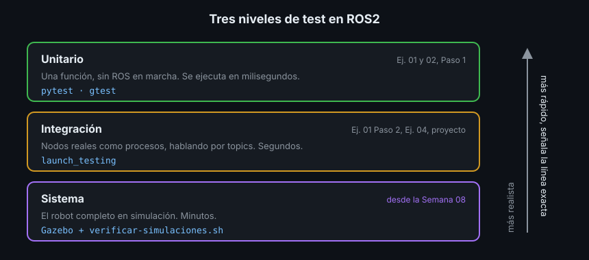

# Tests con pytest y gtest

> Llevas cuatro semanas pasando tests que ya venían escritos. Esta semana los escribes tú. Un test es un programa pequeño que ejecuta tu código con datos conocidos y comprueba el resultado. Si mañana cambias algo y rompes lo de ayer, el test te lo dice antes que el robot.

## 🎯 Objetivos

- Distinguir test unitario, de integración y de sistema
- Separar la lógica de un nodo en funciones que se prueban sin ROS
- Escribir tests con `pytest` (Python) y `gtest` (C++)
- Ejecutarlos con `colcon test` y leer el resultado con `colcon test-result`
- Comprobar que un test de verdad detecta fallos

## 1. Qué problema resuelve

Un nodo puede "parecer que funciona": arranca, publica y en `ros2 topic echo` salen
números. Pero ¿filtra bien una lectura de 9.9 m? ¿Qué hace con una lista vacía?
Probarlo a mano cada vez que cambias algo es lento, y acabas dejando de hacerlo.

Un **test automático** hace esas comprobaciones por ti, siempre igual y en
segundos. `colcon test` ejecuta todos los tests de tu workspace con una sola orden.

## 2. Tres niveles de test



| Nivel | Qué prueba | Herramienta | Esta semana |
|---|---|---|---|
| **Unitario** (unit test) | Una función o clase sola, sin ROS en marcha | `pytest`, `gtest` | Este archivo |
| **Integración** (integration test) | Varios nodos como procesos reales | `launch_testing` | Teoría 02 |
| **Sistema** (system test) | El robot entero en simulación | Gazebo | Desde la Semana 08 |

Cuanto más bajo el nivel, más rápido corre el test y más exacto es el aviso: un
test unitario que falla te señala la función rota. Por eso la mayoría de tus
tests deberían ser unitarios.

## 3. Separar la lógica del nodo

Para probar una función sin ROS, esa función no puede depender de ROS. El
Ejercicio 01 lo hace así:

```python
# filtering.py: Python puro, sin un solo import de rclpy
from collections.abc import Sequence
from statistics import median


def filter_range(window: Sequence[float], min_m: float, max_m: float) -> float:
    if not window:
        raise ValueError("la ventana de lecturas está vacía")
    return min(max(median(window), min_m), max_m)
```

El nodo (`range_filter.py`) solo recibe el mensaje, llama a `filter_range` y
publica. Toda la lógica que puede fallar queda en `filtering.py`, y ahí se prueba
en milisegundos. En C++ es igual: `filter_range` vive en un header sin `rclcpp`.

## 4. pytest, paso a paso

`pytest` busca en la carpeta `test/` del paquete los archivos `test_*.py`, y en
ellos las funciones `test_*`. Ejecuta cada una; si ningún `assert` falla, el test
pasa.

```python
import pytest

from ejercicio01_tests_rosbag2_py.filtering import filter_range


def test_mediana_ignora_un_reflejo() -> None:
    # La mediana de [1.0, 1.0, 1.1, 1.2, 9.9] es 1.1: el 9.9 no cuenta.
    assert filter_range([1.0, 1.1, 9.9, 1.2, 1.0], 0.05, 4.0) == 1.1


def test_ventana_vacia_es_un_error() -> None:
    # pytest.raises: el test pasa solo si el bloque lanza ValueError.
    with pytest.raises(ValueError):
        filter_range([], 0.05, 4.0)
```

Para el mismo test con varios datos, `parametrize` lo repite una vez por fila:

```python
@pytest.mark.parametrize(
    ("window", "expected"),
    [
        ([5.0, 6.0, 7.0], 4.0),  # todo por encima del máximo
        ([2.0], 2.0),  # una sola lectura
    ],
)
def test_recorta_al_rango_del_sensor(window: list[float], expected: float) -> None:
    assert filter_range(window, 0.05, 4.0) == expected
```

Y si un test necesita una carpeta temporal (por ejemplo, para escribir una bag),
pide el argumento `tmp_path`: pytest crea una carpeta vacía nueva para ese test.
Eso es una **fixture**, un recurso que pytest prepara antes del test.

En `package.xml` el paquete declara `<test_depend>python3-pytest</test_depend>`.

## 5. gtest, paso a paso

En C++ se usa **GoogleTest** (gtest). Cada `TEST(Grupo, Nombre)` es un test:

```cpp
#include "ejercicio02_gtest_rosbag2_cpp/filtering.hpp"
#include "gtest/gtest.h"

#include <stdexcept>

using ejercicio02_gtest_rosbag2_cpp::filter_range;

TEST(FilterRangeTest, MedianaIgnoraUnReflejo) {
  EXPECT_DOUBLE_EQ(filter_range({1.0, 1.1, 9.9, 1.2, 1.0}, 0.05, 4.0), 1.1);
}

TEST(FilterRangeTest, VentanaVaciaEsUnError) {
  EXPECT_THROW(filter_range({}, 0.05, 4.0), std::invalid_argument);
}
```

| Macro | Qué comprueba | Si falla |
|---|---|---|
| `EXPECT_EQ(a, b)` | `a == b` | Anota el fallo y sigue |
| `ASSERT_EQ(a, b)` | `a == b` | Anota el fallo y **corta** el test |
| `EXPECT_DOUBLE_EQ(a, b)` | Dos `double` iguales salvo redondeo | Sigue |
| `EXPECT_THROW(expr, Tipo)` | `expr` lanza una excepción `Tipo` | Sigue |

Usa `ASSERT_*` cuando seguir no tiene sentido (si el vector está vacío, no leas
su primer elemento). Para comparar `double` usa siempre `EXPECT_DOUBLE_EQ` o
`EXPECT_NEAR`: con `EXPECT_EQ`, `0.1 + 0.2` no es `0.3`.

El test se registra en `CMakeLists.txt`, dentro de `if(BUILD_TESTING)`:

```cmake
if(BUILD_TESTING)
  find_package(ament_cmake_gtest REQUIRED)
  # Compila el test como ejecutable de gtest y lo apunta para colcon test.
  ament_add_gtest(test_filtering test/test_filtering.cpp)
  target_link_libraries(test_filtering range_tools)
endif()
```

`range_tools` es la biblioteca con el código que se prueba. El ejecutable del
nodo y los tests enlazan **la misma** biblioteca: así pruebas exactamente lo que
se ejecuta. En `package.xml`: `<test_depend>ament_cmake_gtest</test_depend>`.

## 6. Ejecutar y leer los resultados

Desde la raíz del workspace:

```bash
colcon build --symlink-install
colcon test --packages-select ejercicio01_tests_rosbag2_py
colcon test-result --verbose
# build/ejercicio01_tests_rosbag2_py/pytest.xml: 8 tests, 0 errors, 0 failures, 0 skipped
# Summary: 8 tests, 0 errors, 0 failures, 0 skipped
```

`colcon test` no imprime si los tests pasaron: los ejecuta y guarda los
resultados en `build/`. `colcon test-result` los lee. Con `--verbose`, para cada
test que falla muestra su nombre y el mensaje del `assert`:

```text
- ejercicio01_tests_rosbag2_py.test.test_filtering test_mediana_ignora_un_reflejo
  <<< failure message
    assert 2.84 == 1.1
```

Para ejecutar solo una parte:

| Quieres | Comando |
|---|---|
| Los tests de un paquete | `colcon test --packages-select <paquete>` |
| Solo los tests Python cuyo nombre contiene `filtering` | `colcon test --packages-select <paquete> --pytest-args -k filtering` |
| Solo un ejecutable de gtest | `colcon test --packages-select <paquete> --ctest-args -R test_filtering` |
| Ver la salida de los tests mientras corren | `colcon test --event-handlers console_direct+` |

`colcon test-result` acumula: suma todos los resultados que hay en `build/`, no
solo los de la última ejecución. Para empezar de cero, borra `build/` del paquete.

## 7. Tests que usan nodos

Los tests de las semanas 01-04 crean nodos dentro del propio test. Recuerda dos
detalles que ya traían:

- **Dominio DDS propio**: `rclpy.init(domain_id=os.getpid() % 100 + 1)` en Python
  y `options.set_domain_id(...)` en el `main` de gtest. `colcon test` ejecuta
  paquetes en paralelo, y sin esto los nodos de un test recibirían mensajes de
  otro
- **`spin_once` en bucle con plazo**: el test hace girar los nodos durante un
  tiempo máximo y después comprueba lo recibido. Nunca un bucle sin plazo: si el
  mensaje no llega, el test se queda colgado en vez de fallar

Si `gtest` lleva tu propio `main` (para inicializar `rclcpp`), regístralo igual
con `ament_add_gtest`: usará tu `main` en vez del de gtest.

## 8. ¿El test detecta fallos?

Un test que pasa siempre no protege de nada. Compruébalo una vez: rompe el código
a propósito y mira cómo falla. En el Ejercicio 01, cambia `median` por `mean` en
`filtering.py`:

```text
- ejercicio01_tests_rosbag2_py.test.test_filtering test_mediana_ignora_un_reflejo
  <<< failure message
    assert 2.84 == 1.1
```

La media de `[1.0, 1.1, 9.9, 1.2, 1.0]` es 2.84: el reflejo arrastra el
resultado. El test lo detecta. Deshaz el cambio y vuelve a verlo pasar.

## 9. Antipatrones

- ❌ **Probar solo el caso feliz.** Los fallos están en los bordes: lista vacía,
  valor fuera de rango, `None`, la primera lectura
- ❌ **Un test que depende de otro.** Cada test prepara lo suyo; pytest y gtest
  no garantizan el orden
- ❌ **`time.sleep(5)` y comprobar.** Lento siempre y frágil en un ordenador
  cargado. Espera en bucle **hasta** que llegue lo esperado, con un plazo máximo
- ❌ **`EXPECT_EQ` con `double`.** Usa `EXPECT_DOUBLE_EQ` o `EXPECT_NEAR`
- ❌ **Lógica dentro del callback.** Lo que está dentro del callback solo se
  puede probar arrancando el nodo; sácala a una función

## 📚 Recursos Adicionales

- [Testing — ROS2 Jazzy](https://docs.ros.org/en/jazzy/Tutorials/Intermediate/Testing/Testing-Main.html)
- [Writing basic tests with Python — ROS2 Jazzy](https://docs.ros.org/en/jazzy/Tutorials/Intermediate/Testing/Python.html)
- [Writing basic tests with C++ with GTest — ROS2 Jazzy](https://docs.ros.org/en/jazzy/Tutorials/Intermediate/Testing/Cpp.html)
- [GoogleTest Primer](https://google.github.io/googletest/primer.html)
- [pytest: Get started](https://docs.pytest.org/en/stable/getting-started.html)

## ✅ Checklist de Verificación

- [ ] Sé qué prueba cada uno de los tres niveles de test
- [ ] Sé por qué la lógica va en una función aparte del nodo
- [ ] Sé escribir un test con `assert`, `pytest.raises` y `parametrize`
- [ ] Sé cuándo usar `EXPECT_*` y cuándo `ASSERT_*`
- [ ] Sé ejecutar los tests de un solo paquete y leer qué falló

---

## 🔗 Navegación

| Anterior | Actual | Siguiente |
| -------- | ------ | --------- |
| [Semana 05](../README.md) | **01 · pytest y gtest** | [02 · launch_testing](02-tests-de-integracion-con-launch-testing.md) |

← [Volver a la Semana 05](../README.md)
