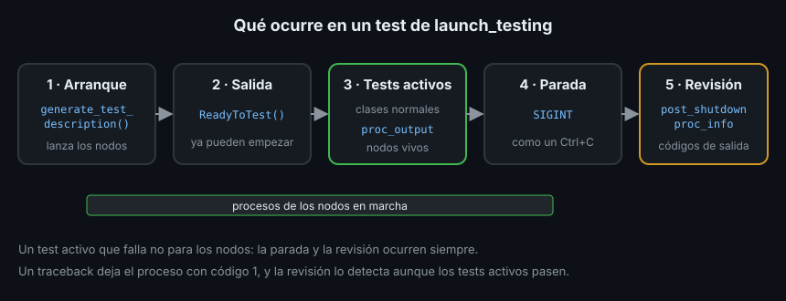

# Tests de integración con launch_testing

> `filter_range` pasa todos sus tests unitarios, pero el robot sigue recibiendo lecturas de 9.9 m. ¿El nodo se suscribe al topic correcto? ¿Arranca siquiera? Eso solo se ve arrancando los nodos de verdad, como procesos, y escuchando lo que publican. Es lo que hace `launch_testing`.

## 🎯 Objetivos

- Saber qué detecta un test de integración que uno unitario no puede
- Escribir un test con `launch_testing`: arranque, tests activos y tests de cierre
- Esperar una línea concreta en la salida de un nodo con `proc_output`
- Comprobar que los nodos terminan sin error con `assertExitCodes`

## 1. Qué problema resuelve

Un test unitario prueba una función. No detecta:

- Un topic con el nombre mal escrito (`robot/range_raw` frente a `robot/range_raw_m`)
- Un QoS incompatible entre publicador y suscriptor
- Un parámetro que el nodo lee mal al arrancar
- Un nodo que termina con un traceback al recibir el primer mensaje

Un **test de integración** arranca los nodos como procesos separados, igual que
`ros2 run`, y comprueba lo que ocurre entre ellos.

## 2. Cómo funciona



Un archivo de `launch_testing` tiene tres partes:

| Parte | Qué hace | Cuándo corre |
|---|---|---|
| `generate_test_description()` | Dice qué procesos arrancar | Al principio |
| Clases `unittest.TestCase` normales | Tests **activos**: comprueban con los nodos en marcha | Tras `ReadyToTest` |
| Clases con `@launch_testing.post_shutdown_test()` | Tests **de cierre**: revisan cómo terminaron | Tras parar los nodos |

`launch_testing` usa la **API de launch** de ROS2: la misma con la que en la
Semana 06 escribirás launch files para arrancar todo tu robot con una orden. Aquí
solo necesitas dos piezas: `launch_ros.actions.Node` (un nodo) y
`launch.LaunchDescription` (la lista de lo que se arranca).

## 3. El test del Ejercicio 01, paso a paso

```python
import os
import time
import unittest

import launch
import launch_ros.actions
import launch_testing.actions
import launch_testing.asserts
import pytest
import rclpy
from std_msgs.msg import Float64

# Mismo truco que en los tests unitarios: un dominio DDS propio.
DOMAIN_ID = os.getpid() % 100 + 1
PACKAGE = "ejercicio01_tests_rosbag2_py"


@pytest.mark.launch_test
def generate_test_description() -> launch.LaunchDescription:
    # additional_env: variables de entorno extra para ese proceso.
    env = {"ROS_DOMAIN_ID": str(DOMAIN_ID)}
    return launch.LaunchDescription(
        [
            launch_ros.actions.Node(
                package=PACKAGE, executable="range_sim", additional_env=env
            ),
            launch_ros.actions.Node(
                package=PACKAGE, executable="range_filter", additional_env=env
            ),
            launch_testing.actions.ReadyToTest(),
        ]
    )
```

`@pytest.mark.launch_test` le dice a pytest que este archivo es un test de
`launch_testing`. `Node(package=..., executable=...)` equivale a
`ros2 run <package> <executable>`. `ReadyToTest()` marca el momento en que pueden
empezar los tests activos.

El test activo es un `unittest.TestCase` con un nodo de prueba propio:

```python
class TestRangeFilter(unittest.TestCase):
    def test_salida_sin_reflejos_ni_ecos_perdidos(self) -> None:
        rclpy.init(domain_id=DOMAIN_ID)
        node = rclpy.create_node("probe_range")
        received: list[float] = []
        node.create_subscription(
            Float64, "robot/range_m", lambda msg: received.append(msg.data), 10
        )
        try:
            deadline = time.monotonic() + 10.0
            while len(received) < 30 and time.monotonic() < deadline:
                rclpy.spin_once(node, timeout_sec=0.1)
        finally:
            node.destroy_node()
            rclpy.shutdown()
        self.assertGreaterEqual(len(received), 30)
        for value in received:
            self.assertTrue(0.4 < value < 2.6, f"lectura sin filtrar: {value}")
```

Y el test de cierre:

```python
@launch_testing.post_shutdown_test()
class TestShutdown(unittest.TestCase):
    def test_los_nodos_salen_con_codigo_0(self, proc_info):
        launch_testing.asserts.assertExitCodes(proc_info)
```

Al terminar los tests activos, `launch_testing` manda **SIGINT** a cada proceso,
la misma señal que `Ctrl+C`. `assertExitCodes` comprueba que todos salieron con
código 0. Un traceback deja el proceso con código 1:

```text
AssertionError: Proc battery_watchdog-2 exited with code 1
```

Por eso los `main` del bootcamp capturan `ExternalShutdownException` y llaman a
`rclpy.try_shutdown()`: así un `Ctrl+C` termina con código 0.

## 4. Leer la salida de un proceso: `proc_output`

A veces lo que quieres comprobar no se publica en un topic sino que se escribe
en el log. Un test activo puede pedir el argumento `proc_output`:

```python
WATCHDOG = launch_ros.actions.Node(
    package="ejercicio04_depuracion_py",
    executable="battery_watchdog",
    additional_env=ENV,
)

class TestWatchdog(unittest.TestCase):
    def test_estima_el_tiempo_restante(self, proc_output):
        # Espera hasta 15 s a que el watchdog escriba esa frase.
        proc_output.assertWaitFor("tiempo restante", process=WATCHDOG, timeout=15)
```

`assertWaitFor` espera **hasta** que aparece el texto, con un plazo máximo. Si el
proceso nunca lo escribe, falla:

```text
AssertionError: Waiting for output timed out
```

`launch_testing` pasa los argumentos por su nombre: `proc_output` (salida de los
procesos) y `proc_info` (su estado y código de salida) solo hay que pedirlos.

## 5. Cómo lo ejecuta `colcon test`

En un paquete `ament_python`, el archivo va en `test/` como cualquier test de
pytest. `launch_testing` trae un plugin de pytest que reconoce la marca
`launch_test` y se encarga del ciclo. Hacen falta estas dependencias en
`package.xml`:

```xml
<test_depend>launch</test_depend>
<test_depend>launch_ros</test_depend>
<test_depend>launch_testing</test_depend>
<test_depend>launch_testing_ros</test_depend>
```

En `colcon test-result` todo el archivo cuenta como **un** test, con el nombre del
archivo:

```text
- ejercicio01_tests_rosbag2_py.test.test_range_filter_launch test_range_filter_launch
```

En un paquete `ament_cmake` se registra en CMake con `add_launch_test` (paquete
`launch_testing_ament_cmake`). En este bootcamp los tests de integración van en
los paquetes Python, aunque los nodos que arranquen sean de C++: un `Node` de
launch arranca cualquier ejecutable.

## 6. Qué probar en integración y qué no

| Integración (launch_testing) | Unitario (pytest/gtest) |
|---|---|
| Los nodos se encuentran: nombres de topic y QoS | Casos límite de un cálculo |
| El nodo arranca con sus parámetros por defecto | Cada rama de un `if` |
| La cadena completa da un resultado razonable | El valor exacto de un resultado |
| Los procesos terminan limpios | Excepciones de una función |

Un test de integración tarda segundos: escribe pocos, y que cada uno compruebe
algo que solo se ve con los procesos de verdad.

## 7. Antipatrones

- ❌ **Olvidar el `ROS_DOMAIN_ID` propio.** Tus nodos reciben mensajes de otro
  paquete que se prueba a la vez, y el test pasa o falla según el día
- ❌ **Comprobar valores exactos en integración.** El primer mensaje puede
  perderse en el arranque; comprueba rangos y cantidades mínimas
- ❌ **Dejar `rclpy` inicializado al terminar.** Si no llamas a
  `rclpy.shutdown()` en un `finally`, el siguiente test que haga `rclpy.init()`
  falla
- ❌ **Sin test de cierre.** Un nodo que termina con traceback al recibir
  SIGINT pasa desapercibido en los tests activos

## 📚 Recursos Adicionales

- [Writing basic integration tests with launch_testing — ROS2 Jazzy](https://docs.ros.org/en/jazzy/Tutorials/Intermediate/Testing/Integration.html)
- [launch_testing (README) — ros2/launch, rama jazzy](https://github.com/ros2/launch/tree/jazzy/launch_testing)
- [unittest — documentación de Python](https://docs.python.org/3.12/library/unittest.html)

## ✅ Checklist de Verificación

- [ ] Sé nombrar tres fallos que solo detecta un test de integración
- [ ] Sé qué hacen `generate_test_description`, `ReadyToTest` y `post_shutdown_test`
- [ ] Sé esperar un texto en la salida de un nodo con `proc_output.assertWaitFor`
- [ ] Sé por qué un `main` sin la captura de `ExternalShutdownException` rompe el test de cierre

---

## 🔗 Navegación

| Anterior | Actual | Siguiente |
| -------- | ------ | --------- |
| [01 · pytest y gtest](01-tests-con-pytest-y-gtest.md) | **02 · launch_testing** | [03 · Lint y análisis estático](03-lint-y-analisis-estatico.md) |

← [Volver a la Semana 05](../README.md)
