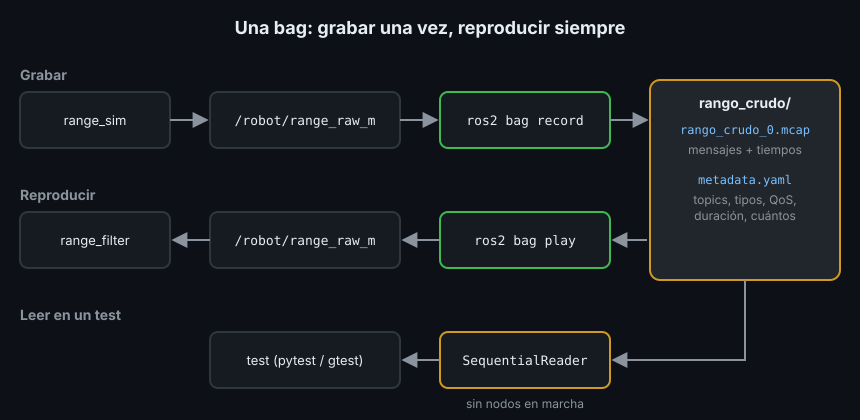

# Grabar y reproducir con rosbag2

> El sensor dio una lectura rara a las 10:42 y el robot frenó en seco. Para entender qué pasó necesitas exactamente esos mensajes, no unos parecidos. Una **bag** (bolsa) es una grabación de los mensajes de uno o varios topics, con su momento exacto. Se reproduce tantas veces como quieras, y tus nodos no notan la diferencia con el sensor real.

## 🎯 Objetivos

- Grabar topics con `ros2 bag record` e inspeccionar la bag con `ros2 bag info`
- Reproducirla con `ros2 bag play`, a otra velocidad o en bucle
- Leer y escribir bags desde código con `rosbag2_py` y `rosbag2_cpp`
- Usar una bag como dato de entrada de un test

## 1. Qué es una bag



Una bag es una **carpeta** con dos tipos de archivo:

| Archivo | Qué contiene |
|---|---|
| `<nombre>_0.mcap` | Los mensajes, serializados, cada uno con su topic y su instante en nanosegundos |
| `metadata.yaml` | El resumen: topics, tipos, QoS, duración y cuántos mensajes hay |

**MCAP** es el formato de almacenamiento por defecto en Jazzy. La alternativa es
SQLite (`-s sqlite3`), el formato por defecto en versiones antiguas de ROS2. Los
comandos y las APIs funcionan igual con los dos.

**Serializar** es convertir un mensaje en bytes para guardarlo o enviarlo; ROS2
usa el formato **CDR**. Al leer la bag, hay que **deserializar**: bytes de vuelta
a un objeto `Float64`.

## 2. Grabar, paso a paso

Con `range_sim` del Ejercicio 01 publicando en otra terminal:

```bash
ros2 bag record -o rango_crudo --topics /robot/range_raw_m
# [INFO] [...] [rosbag2_recorder]: Subscribed to topic '/robot/range_raw_m'
# ...
```

Graba hasta que pulses `Ctrl+C`. Las opciones más útiles:

| Opción | Qué hace |
|---|---|
| `-o rango_crudo` | Nombre de la carpeta. Sin `-o`, `rosbag2_<fecha>_<hora>` |
| `--topics /t1 /t2` | Topics a grabar, separados por espacios. En Jazzy, ponerlos sin `--topics` funciona pero avisa de que está obsoleto |
| `--all-topics` | Todos los topics (cuidado con las cámaras: ocupan mucho) |
| `-e 'robot/.*'` | Los topics cuyo nombre encaja con una expresión regular |
| `-s sqlite3` | Formato SQLite en vez de MCAP |
| `-d 60` | Parte la bag en archivos de 60 s como máximo |

`ros2 bag record` crea la carpeta: si ya existe, no graba nada:

```text
[ERROR] [ros2bag]: Output folder 'rango_crudo' already exists.
```

Bórrala o usa otro nombre.

## 3. Inspeccionar

```bash
ros2 bag info rango_crudo
#
# Files:             rango_crudo_0.mcap
# Bag size:          7.6 KiB
# Storage id:        mcap
# ROS Distro:        jazzy
# Duration:          4.499918875s
# Start:             ...
# End:               ...
# Messages:          46
# Topic information: Topic: /robot/range_raw_m | Type: std_msgs/msg/Float64 | Count: 46 | Serialization Format: cdr
```

Lo primero que miras siempre: `Messages` y `Count` por topic. Si un topic tiene
`Count: 0`, no se grabó nada de él (el nombre estaba mal o no había publicador).

## 4. Reproducir

```bash
ros2 bag play rango_crudo
# [INFO] [...] [rosbag2_player]: Press SPACE for Pause/Resume
# ...
```

`ros2 bag play` publica cada mensaje en su topic original, respetando los tiempos
entre mensajes. Un nodo suscrito, como `range_filter`, no distingue la bag del
sensor. Mientras suena, la terminal acepta teclas: espacio pausa y reanuda, flecha
derecha publica un solo mensaje.

| Opción | Qué hace |
|---|---|
| `--rate 2.0` | Al doble de velocidad (`0.5`, a la mitad) |
| `--loop` | Vuelve a empezar al terminar, hasta `Ctrl+C` |
| `--topics /robot/range_raw_m` | Solo esos topics de la bag |
| `--start-paused` | Empieza en pausa: espacio para arrancar |

## 5. Leer una bag desde Python

`rosbag2_py` lee la bag mensaje a mensaje, sin nada de ROS en marcha:

```python
import rosbag2_py
from rclpy.serialization import deserialize_message
from std_msgs.msg import Float64

reader = rosbag2_py.SequentialReader()
reader.open(
    rosbag2_py.StorageOptions(uri="rango_crudo"),  # el formato lo detecta solo
    rosbag2_py.ConverterOptions("cdr", "cdr"),
)
values: list[float] = []
while reader.has_next():
    name, data, timestamp_ns = reader.read_next()  # topic, bytes, instante
    if name == "/robot/range_raw_m":
        values.append(deserialize_message(data, Float64).data)
```

Para leer solo algunos topics, en vez del `if`:
`reader.set_filter(rosbag2_py.StorageFilter(topics=["/robot/range_raw_m"]))`.

Escribir es el camino inverso, y sirve para que un test cree su propia bag:

```python
from rclpy.serialization import serialize_message

writer = rosbag2_py.SequentialWriter()
writer.open(
    rosbag2_py.StorageOptions(uri=str(tmp_path / "bag"), storage_id="mcap"),
    rosbag2_py.ConverterOptions("cdr", "cdr"),
)
writer.create_topic(
    rosbag2_py.TopicMetadata(
        id=0,
        name="/robot/range_raw_m",
        type="std_msgs/msg/Float64",
        serialization_format="cdr",
    )
)
writer.write("/robot/range_raw_m", serialize_message(Float64(data=1.5)), 100_000_000)
del writer  # cerrar el writer termina de escribir el archivo
```

## 6. Leer una bag desde C++

`rosbag2_cpp` hace lo mismo, y su `read_next<T>()` deserializa directamente al
tipo de mensaje:

```cpp
#include "rosbag2_cpp/reader.hpp"
#include "rosbag2_storage/storage_filter.hpp"
#include "std_msgs/msg/float64.hpp"

rosbag2_cpp::Reader reader;
reader.open("rango_crudo");
rosbag2_storage::StorageFilter filter;
filter.topics = {"/robot/range_raw_m"};
reader.set_filter(filter);  // read_next<T> no mira el topic: filtra antes
std::vector<double> values;
while (reader.has_next()) {
  values.push_back(reader.read_next<std_msgs::msg::Float64>().data);
}
```

Y para escribir, `rosbag2_cpp::Writer` crea el topic solo al primer `write`:

```cpp
rosbag2_cpp::Writer writer;
writer.open("mi_bag");
std_msgs::msg::Float64 msg;
msg.data = 1.5;
writer.write(msg, "/robot/range_raw_m", rclcpp::Time(100'000'000));
```

Dependencias: `rosbag2_cpp` y `rosbag2_storage` en `package.xml` y en
`ament_target_dependencies`; `rosbag2_py` como `exec_depend` en Python.

## 7. Bags en los tests

Dos usos, los dos en esta semana:

- **El test escribe su bag** (Ejercicios 01 y 02): datos pequeños y exactos,
  pensados para un caso concreto. No hay archivos que versionar
- **Bag de referencia grabada** (proyecto): datos reales de tu nodo, guardados
  en `test/data/` y versionados en git. El test comprueba propiedades que deben
  cumplirse siempre (batería entre 0 y 100, tiempos en orden...). Si un cambio
  futuro rompe el formato o los valores, la bag lo delata

Una bag de referencia debe ser pequeña: unos segundos de los topics que
necesitas. Una bag de cámara de un minuto pesa cientos de MB; esa no va en git.

## 8. Antipatrones

- ❌ **`--all-topics` por costumbre.** Graba también imágenes y nubes de puntos:
  gigas en minutos
- ❌ **Grabar sin mirar `ros2 bag info`.** Descubres el `Count: 0` cuando ya no
  puedes repetir la prueba
- ❌ **Reproducir con el nodo original también publicando.** Llegan mensajes de
  los dos al mismo topic. Para la fuente real antes de `ros2 bag play`
- ❌ **Olvidar cerrar el writer.** En Python, sin `del writer` (o sin salir de la
  función), el archivo queda a medias

## 📚 Recursos Adicionales

- [Recording and playing back data — ROS2 Jazzy](https://docs.ros.org/en/jazzy/Tutorials/Beginner-CLI-Tools/Recording-And-Playing-Back-Data/Recording-And-Playing-Back-Data.html)
- [Reading from a bag file (Python) — ROS2 Jazzy](https://docs.ros.org/en/jazzy/Tutorials/Advanced/Reading-From-A-Bag-File-Python.html)
- [Reading from a bag file (C++) — ROS2 Jazzy](https://docs.ros.org/en/jazzy/Tutorials/Advanced/Reading-From-A-Bag-File-CPP.html)
- [rosbag2 — repositorio, rama jazzy](https://github.com/ros2/rosbag2/tree/jazzy)
- [MCAP — especificación del formato](https://mcap.dev/)

## ✅ Checklist de Verificación

- [ ] Sé qué hay dentro de la carpeta de una bag
- [ ] Grabé un topic, revisé `Count` con `ros2 bag info` y lo reproduje
- [ ] Sé leer los mensajes de un topic de una bag desde Python y desde C++
- [ ] Sé cuándo un test debe escribir su bag y cuándo usar una de referencia

---

## 🔗 Navegación

| Anterior | Actual | Siguiente |
| -------- | ------ | --------- |
| [03 · Lint y análisis estático](03-lint-y-analisis-estatico.md) | **04 · rosbag2** | [05 · Depuración](05-depuracion-y-ros2-doctor.md) |

← [Volver a la Semana 05](../README.md)
