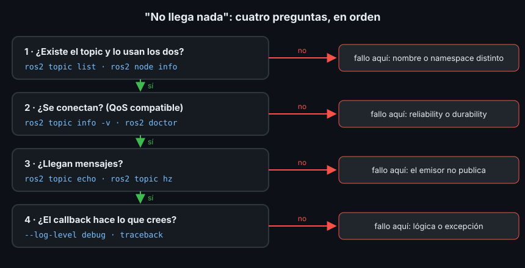

# Depuración y ros2 doctor

> El fallo más frecuente en ROS2 no da ningún error: dos nodos arrancan, ninguno se queja y no pasa nada. Sin un método, acabas cambiando cosas al azar. Con cuatro preguntas en orden, y la herramienta adecuada para cada una, encuentras el fallo en minutos.

## 🎯 Objetivos

- Seguir un método ordenado cuando "no llega nada"
- Usar `ros2 node info`, `ros2 topic info -v` y `ros2 doctor` para ver el grafo
- Reconocer un QoS incompatible por su aviso en el log
- Cambiar el nivel de log de un solo nodo y dar formato a los mensajes
- Leer un traceback de Python hasta la línea que falla

## 1. El método: cuatro preguntas



Cada pregunta descarta un nivel entero. Si respondes "sí", el fallo está más
abajo; si respondes "no", ya sabes dónde buscar. Saltarse el orden (ponerse a
leer el callback cuando el topic está mal escrito) es la forma más común de
perder una tarde.

## 2. ¿Existe el topic y lo usan los dos?

```bash
ros2 topic list
# /parameter_events
# /robot/batery_percent
# /robot/battery_percent
# /rosout
```

Dos topics casi iguales son la pista: cada nodo usa uno. `ros2 node info` dice a
qué está suscrito y en qué publica cada nodo:

```bash
ros2 node info /battery_watchdog
# /battery_watchdog
#   Subscribers:
#     /robot/batery_percent: std_msgs/msg/Float32
#   Publishers:
#     /parameter_events: rcl_interfaces/msg/ParameterEvent
#     /rosout: rcl_interfaces/msg/Log
#   ...
```

Mismo problema con otro aspecto: un nodo en un **namespace** distinto
(`/robot1/battery_percent`) o un nombre absoluto (`/battery`) frente a uno
relativo (`battery`).

## 3. ¿Se conectan?

Mismo nombre y mismo tipo no bastan: los **QoS** de publicador y suscriptor deben
ser compatibles (Semana 02). Un publicador `BEST_EFFORT` no entrega nada a un
suscriptor `RELIABLE`. `ros2 topic info -v` muestra el QoS de cada extremo:

```bash
ros2 topic info -v /robot/battery_percent
# ...
# Node name: battery_sim
# Endpoint type: PUBLISHER
#   Reliability: BEST_EFFORT
# ...
# Node name: battery_watchdog
# Endpoint type: SUBSCRIPTION
#   Reliability: RELIABLE
# ...
```

Y el nodo suscriptor lo avisa en su log, aunque es fácil pasarlo por alto:

```text
[WARN] [...] [battery_watchdog]: New publisher discovered on topic 'robot/battery_percent', offering incompatible QoS. No messages will be received from it. Last incompatible policy: RELIABILITY
```

`Last incompatible policy` dice qué política choca: `RELIABILITY`, `DURABILITY`...

## 4. `ros2 doctor`

`ros2 doctor` revisa el sistema y el grafo en marcha: red, versión de ROS,
middleware, QoS y topics. Sin argumentos da un resumen. Con el QoS incompatible
de la sección anterior:

```bash
ros2 doctor
# ...
# 1/5 check(s) failed
#
# Failed modules: middleware
```

| Mensaje | Qué significa |
|---|---|
| `Publisher without subscriber detected on X` | Alguien publica en `X` y nadie escucha. ¿Nombre mal escrito? |
| `Subscriber without publisher detected on X` | Alguien escucha en `X` y nadie publica |
| `Failed modules: middleware` | Hay una pareja publicador/suscriptor con QoS incompatible |
| `Cannot find the latest versions of packages: ...` | Tus paquetes no están publicados en los repositorios de ROS. Normal: ignóralo |

Los `UserWarning` son **avisos**, no fallos: con un topic mal escrito,
`ros2 doctor` dice `All 5 checks passed` pero imprime los dos avisos de arriba.
Léelos siempre.

Con `--report` saca el informe completo por secciones (`NETWORK CONFIGURATION`,
`PLATFORM INFORMATION`, `QOS COMPATIBILITY LIST`, `RMW MIDDLEWARE`,
`TOPIC LIST`...). La sección de QoS nombra la pareja que choca:

```bash
ros2 doctor --report
# ...
#    QOS COMPATIBILITY LIST
# topic [type]            : /robot/battery_percent [std_msgs/msg/Float32]
# publisher node          : battery_sim
# subscriber node         : battery_watchdog
# compatibility status    : ERROR: Best effort publisher and reliable subscription;
# ...
```

Cuando pidas ayuda en un foro, adjunta `ros2 doctor --report`: responde de una
vez a "¿qué versión, qué middleware, qué red?".

## 5. ¿Llegan mensajes?

Ya conoces las herramientas: `ros2 topic echo <topic>` muestra los mensajes y
`ros2 topic hz <topic>` su frecuencia. Si en el topic correcto, con QoS
compatible, no aparece nada, el problema está en quien publica: no arrancó, no
llegó a `activate` (Semana 04) o su timer no se creó.

## 6. ¿El callback hace lo que crees?

### Niveles de log

Cada mensaje de log tiene un **nivel** (severity): `DEBUG`, `INFO`, `WARN`,
`ERROR` y `FATAL`, de menos a más grave. Por defecto se muestran de `INFO` hacia
arriba. Los `DEBUG` se escriben en el código para depurar y no molestan hasta que
los pides:

```python
self.get_logger().debug(f"lectura: {msg.data:.1f} %")
```

```bash
ros2 run ejercicio04_depuracion_py battery_watchdog --ros-args --log-level battery_watchdog:=debug
# [DEBUG] [...] [battery_watchdog]: lectura: 99.0 %
# [DEBUG] [...] [battery_watchdog]: lectura: 98.5 %
# [INFO] [...] [battery_watchdog]: batería 98.5 %, tiempo restante: 99 s
```

`battery_watchdog:=debug` cambia solo el logger de ese nodo. Con
`--log-level debug` a secas cambias **todos**, incluidos los de la capa DDS, y
la pantalla se llena de líneas del middleware.

### Formato de los mensajes

La variable `RCUTILS_CONSOLE_OUTPUT_FORMAT` decide qué lleva cada línea. Añadir
archivo y línea dice de dónde sale cada mensaje:

```bash
export RCUTILS_CONSOLE_OUTPUT_FORMAT="[{severity}] [{name}]: {message} ({file_name}:{line_number})"
```

Además de la pantalla, cada `ros2 run` guarda su log en un archivo dentro de
`~/.ros/log/`, útil cuando la terminal ya se cerró.

### Leer un traceback

Cuando un callback de Python lanza una excepción, el nodo muere y escribe un
**traceback**: la cadena de llamadas hasta el fallo. Se lee **de abajo arriba**:

```text
Traceback (most recent call last):
  File ".../battery_watchdog", line 33, in <module>
  ...
  File ".../rclpy/executors.py", line 115, in await_or_execute
    return callback(*args)
  File ".../ejercicio04_depuracion_py/battery_watchdog.py", line 46, in _on_battery
    first_s, first_percent = self._first
TypeError: cannot unpack non-iterable NoneType object
[ros2run]: Process exited with failure 1
```

1. La última línea dice **qué** pasó: `TypeError`, no se puede desempaquetar `None`
2. Sube hasta el primer archivo **tuyo**: `battery_watchdog.py`, línea 46, en
   `_on_battery`
3. Las líneas de `rclpy/executors.py` son el executor llamando a tu callback
   (Semana 04): no son el fallo

### Y en C++

Un nodo C++ que accede a memoria inválida muere con `Segmentation fault`, sin
traceback. Para ver dónde, se arranca dentro del depurador **gdb**
(`sudo apt install gdb` si no lo tienes) con `--prefix`, que antepone un comando
al ejecutable:

```bash
ros2 run --prefix 'gdb -ex run --args' <paquete> <ejecutable>
```

Cuando el nodo cae, escribe `bt` (backtrace) en `(gdb)` para ver la cadena de
llamadas, igual que un traceback. Compila con
`colcon build --cmake-args -DCMAKE_BUILD_TYPE=Debug` para que muestre nombres
de archivo y números de línea. Lo usarás cuando escribas plugins de Nav2 y
MoveIt2 en C++.

## 7. Antipatrones

- ❌ **Cambiar cosas al azar.** Cada cambio sin una pregunta detrás añade un
  fallo nuevo posible
- ❌ **Llenar el código de `print`.** Usa `get_logger().debug(...)`: se queda en
  el código y no molesta hasta que lo activas
- ❌ **Ignorar los `WARN`.** El aviso de QoS incompatible lleva ahí desde el
  arranque
- ❌ **Leer el traceback de arriba abajo.** Las primeras líneas son `ros2 run` y
  el executor; la causa está al final

## 📚 Recursos Adicionales

- [Getting started with ros2doctor — ROS2 Jazzy](https://docs.ros.org/en/jazzy/Tutorials/Beginner-Client-Libraries/Getting-Started-With-Ros2doctor.html)
- [Logging — ROS2 Jazzy](https://docs.ros.org/en/jazzy/Concepts/Intermediate/About-Logging.html)
- [QoS compatibilities — ROS2 Jazzy](https://docs.ros.org/en/jazzy/Concepts/Intermediate/About-Quality-of-Service-Settings.html)
- [Getting backtraces in ROS 2 — ROS2 Jazzy](https://docs.ros.org/en/jazzy/How-To-Guides/Getting-Backtraces-in-ROS-2.html)

## ✅ Checklist de Verificación

- [ ] Sé las cuatro preguntas del método y su orden
- [ ] Sé ver el QoS de cada extremo de un topic
- [ ] Sé distinguir en `ros2 doctor` un aviso de un fallo
- [ ] Sé activar el nivel `DEBUG` de un solo nodo
- [ ] Sé encontrar en un traceback la línea de mi código que falló

---

## 🔗 Navegación

| Anterior | Actual | Siguiente |
| -------- | ------ | --------- |
| [04 · rosbag2](04-grabar-y-reproducir-con-rosbag2.md) | **05 · Depuración** | [Prácticas](../2-practicas/README.md) |

← [Volver a la Semana 05](../README.md)
