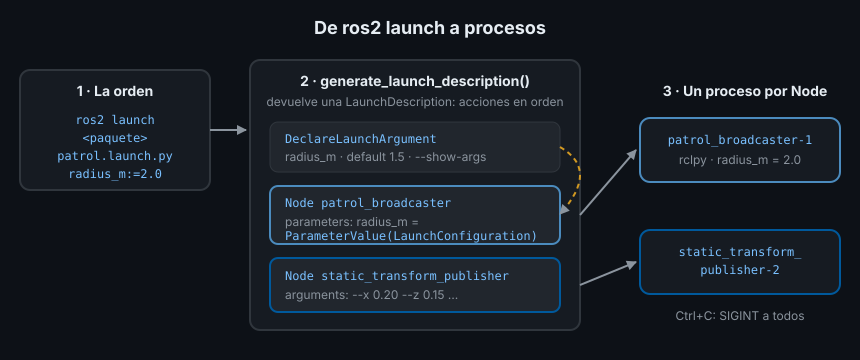

# Launch files en Python

> Tu sistema ya tiene cinco o seis nodos, cada uno con sus parámetros. Arrancarlos a mano, en seis terminales y en el orden correcto, es lento y propenso a errores. Un launch file arranca el sistema entero con una orden, siempre igual.

## 🎯 Objetivos

- Saber qué es un launch file y qué hace `ros2 launch`
- Arrancar nodos con nombre, parámetros, remapeos y argumentos de línea de comandos
- Declarar argumentos con `DeclareLaunchArgument` y leerlos con `LaunchConfiguration`
- Evitar la trampa del tipo de los parámetros con `ParameterValue`
- Instalar launch files en paquetes `ament_python` y `ament_cmake`

## 1. Qué problema resuelve

Para arrancar la patrulla del Ejercicio 01 a mano necesitas dos terminales:

```bash
# Terminal 1
ros2 run ejercicio01_tf_broadcaster_py patrol_broadcaster --ros-args -p radius_m:=2.0
```

```bash
# Terminal 2
ros2 run tf2_ros static_transform_publisher --x 0.20 --z 0.15 \
  --frame-id base_link --child-frame-id laser_link
```

Con dos nodos es tolerable. El robot de la Semana 16 tendrá más de veinte, con
cientos de parámetros. Un **launch file** es un archivo que describe qué nodos se
arrancan y con qué configuración. `ros2 launch` lo lee y arranca todos los
procesos a la vez:

```bash
ros2 launch ejercicio01_tf_broadcaster_py patrol.launch.py radius_m:=2.0
# [INFO] [launch]: All log files can be found below /root/.ros/log/...
# [INFO] [launch]: Default logging verbosity is set to INFO
# [INFO] [patrol_broadcaster-1]: process started with pid [57]
# [INFO] [static_transform_publisher-2]: process started with pid [58]
```

Con `Ctrl+C`, `ros2 launch` para todos los procesos que arrancó. La salida de
cada nodo aparece en la misma terminal, con su nombre delante:
`[patrol_broadcaster-1]`.

## 2. Cómo funciona en ROS2



Un launch file de ROS2 es un **módulo Python** con una función obligatoria,
`generate_launch_description()`, que devuelve una `LaunchDescription`: la lista de
**acciones** que hay que ejecutar.

Ojo con la palabra: una **acción de launch** (*launch action*) es un paso del
arranque (declarar un argumento, arrancar un nodo, incluir otro launch file). No
tiene nada que ver con las acciones de comunicación de la Semana 03.

`ros2 launch` sigue estos pasos:

1. Busca el archivo en `share/<paquete>/launch/` del paquete instalado
2. Importa el módulo y llama a `generate_launch_description()`
3. Ejecuta las acciones en el orden de la lista
4. Cada acción `Node` lanza un **proceso** propio, igual que `ros2 run`
5. Espera hasta `Ctrl+C` (o hasta que todos los procesos terminen) y los para con SIGINT

Python no es la única opción: ROS2 también acepta launch files en XML y YAML. El
bootcamp usa siempre Python porque es el único formato que permite lógica (bucles,
funciones, condiciones calculadas) y el que usan los ejemplos de Nav2 y MoveIt2.

## 3. Cómo se escribe

### 3.1 El launch file mínimo

`src/ejercicio01_tf_broadcaster_py/launch/patrol.launch.py`, reducido a lo esencial:

```python
from launch import LaunchDescription
from launch_ros.actions import Node


def generate_launch_description() -> LaunchDescription:
    patrol = Node(
        package="ejercicio01_tf_broadcaster_py",
        executable="patrol_broadcaster",
    )
    return LaunchDescription([patrol])
```

`launch` es la biblioteca genérica (procesos, argumentos, eventos); `launch_ros`
añade lo específico de ROS (nodos, parámetros, lifecycle). El sufijo
`.launch.py` es una convención: `ros2 launch` lo usa para autocompletar.

### 3.2 Los campos de `Node`

| Campo | Equivale en `ros2 run` a | Para qué |
|---|---|---|
| `package`, `executable` | `ros2 run <package> <executable>` | Qué programa arrancar |
| `name` | `--ros-args -r __node:=<name>` | Cambiar el nombre del nodo |
| `namespace` | `--ros-args -r __ns:=<ns>` | Prefijo para nodo, topics y servicios |
| `parameters` | `-p nombre:=valor` o `--params-file` | Lista de diccionarios o rutas a YAML |
| `remappings` | `-r origen:=destino` | Cambiar el nombre de un topic sin tocar el código |
| `arguments` | lo que va tras el ejecutable | Argumentos propios del programa |
| `output` | — | `"screen"` fuerza que su salida vaya a la terminal |

Un ejemplo con todo, sobre el filtro de distancia del Ejercicio 01 de la Semana 05:

```python
Node(
    package="ejercicio01_tests_rosbag2_py",
    executable="range_filter",
    name="front_filter",
    namespace="robot1",
    parameters=[{"window": 7, "max_range_m": 3.0}],
    # Escucha el sensor delantero en vez de robot/range_raw_m.
    remappings=[("robot/range_raw_m", "robot/front/range_raw_m")],
    output="screen",
)
```

El nodo queda como `/robot1/front_filter` y escucha `/robot1/robot/front/range_raw_m`:
el namespace se antepone a todo nombre relativo, también a los remapeados.

### 3.3 Parámetros desde un YAML versionado

Cuando hay más de dos o tres parámetros, van en un archivo YAML dentro del
paquete, por ejemplo `config/patrol.yaml`:

```yaml
patrol_broadcaster:        # nombre del nodo
  ros__parameters:         # clave fija: lo que hay debajo son sus parámetros
    radius_m: 2.0
    period_s: 30.0
```

Y el launch file pasa la ruta del archivo instalado:

```python
from launch.substitutions import PathJoinSubstitution
from launch_ros.substitutions import FindPackageShare

config = PathJoinSubstitution(
    [FindPackageShare("ejercicio01_tf_broadcaster_py"), "config", "patrol.yaml"]
)
Node(package="ejercicio01_tf_broadcaster_py", executable="patrol_broadcaster",
     parameters=[config])
```

La carpeta `config/` se instala igual que `launch/` (sección 4).

### 3.4 Argumentos: `DeclareLaunchArgument` y `LaunchConfiguration`

Un **argumento de launch** es un valor que se elige al lanzar
(`radius_m:=2.0`) sin editar el archivo. Se declara con `DeclareLaunchArgument` y
se lee con `LaunchConfiguration`:

```python
from launch.actions import DeclareLaunchArgument
from launch.substitutions import LaunchConfiguration

radius_arg = DeclareLaunchArgument(
    "radius_m",
    default_value="1.5",
    description="Radio del círculo de la patrulla, en metros",
)
radius_m = LaunchConfiguration("radius_m")
```

`LaunchConfiguration("radius_m")` no es el número `1.5`: es una **sustitución**
(*substitution*), una promesa de valor que launch resuelve al ejecutar la acción
que la usa. Por eso no puedes hacer `float(LaunchConfiguration("radius_m"))`
dentro de `generate_launch_description()`: en ese momento aún no hay valor.

Los argumentos declarados aparecen con `--show-args`:

```bash
ros2 launch ejercicio01_tf_broadcaster_py patrol.launch.py --show-args
# Arguments (pass arguments as '<name>:=<value>'):
#
#     'radius_m':
#         Radio del círculo de la patrulla, en metros
#         (default: '1.5')
```

### 3.5 La trampa del tipo: `ParameterValue`

Todo argumento de launch es texto. Al pasarlo como parámetro, `launch_ros` lo lee
como YAML: `"1.5"` llega como `double`, pero `"2"` llega como **entero**. El nodo
declaró `radius_m` como `double`, así que se niega a arrancar:

```text
[patrol_broadcaster-1] rclpy.exceptions.InvalidParameterTypeException: Trying to set parameter 'radius_m' to '2' of type 'INTEGER', expecting type 'DOUBLE': radius_m
[ERROR] [patrol_broadcaster-1]: process has died [pid 37, exit code 1, ...]
```

`ParameterValue` fija el tipo:

```python
from launch_ros.parameter_descriptions import ParameterValue

radius_m = ParameterValue(LaunchConfiguration("radius_m"), value_type=float)
Node(..., parameters=[{"radius_m": radius_m}])
```

Ahora `radius_m:=2` y `radius_m:=2.0` funcionan igual.

## 4. Instalar el launch file

`ros2 launch` no busca en `src/`: busca en `install/<paquete>/share/<paquete>/`.
Hay que instalar la carpeta `launch/`.

En un paquete **`ament_python`**, en `setup.py`:

```python
from glob import glob

data_files=[
    # ...
    (f"share/{package_name}/launch", glob("launch/*.launch.py")),
],
```

En un paquete **`ament_cmake`**, en `CMakeLists.txt`:

```cmake
install(DIRECTORY launch DESTINATION share/${PROJECT_NAME})
```

Y en `package.xml`, `exec_depend` de `launch` y `launch_ros`. Con
`--symlink-install` los cambios del launch file se ven sin recompilar; un archivo
**nuevo** sí pide un `colcon build`.

## 5. Antipatrones

- ❌ **Valores fijos en el launch file que alguien querrá cambiar.** Si el radio
  está escrito a mano, cambiarlo exige editar el archivo. Declara un argumento
- ❌ **Confiar en que launch avisa de un argumento mal escrito.** `radio:=2`
  (en vez de `radius_m:=2`) no da error: launch lo ignora y usa el valor por
  defecto. Comprueba con `--show-args` cómo se llama
- ❌ **Pasar argumentos numéricos sin `ParameterValue`.** Funciona con `2.0` y
  falla con `2`: el error aparece el día que alguien teclea un entero
- ❌ **Rutas absolutas** (`/home/ana/ws/src/...`). En otra máquina no existen;
  usa `FindPackageShare`
- ❌ **Lógica de la aplicación en el launch file.** Launch decide qué se arranca y
  con qué configuración, no calcula trayectorias ni lee sensores

## 6. Trucos

- `ros2 launch <paquete> <archivo> --show-args`: los argumentos y sus valores por defecto
- `ros2 launch <paquete> <archivo> --print`: la descripción completa sin arrancar nada
- `ros2 launch <paquete> <archivo> --debug`: el detalle de cada acción y evento
- Los logs de cada lanzamiento quedan en `~/.ros/log/<fecha>/launch.log`: útil cuando
  un nodo muere antes de que puedas leer su salida
- `Node(..., output="screen")` fuerza la salida por la terminal aunque el nodo escriba
  con `print` y no con su logger

## 📚 Recursos Adicionales

- [Creating a launch file — ROS2 Jazzy](https://docs.ros.org/en/jazzy/Tutorials/Intermediate/Launch/Creating-Launch-Files.html)
- [Using substitutions — ROS2 Jazzy](https://docs.ros.org/en/jazzy/Tutorials/Intermediate/Launch/Using-Substitutions.html)
- [Managing large projects — ROS2 Jazzy](https://docs.ros.org/en/jazzy/Tutorials/Intermediate/Launch/Using-ROS2-Launch-For-Large-Projects.html)

## ✅ Checklist de Verificación

- [ ] Sé qué devuelve `generate_launch_description()` y qué hace `ros2 launch` con ello
- [ ] Sé arrancar un nodo con nombre, parámetros y remapeos desde un launch file
- [ ] Sé declarar un argumento y comprobarlo con `--show-args`
- [ ] Sé por qué `radius_m:=2` rompe un nodo sin `ParameterValue`
- [ ] Sé instalar `launch/` en `ament_python` y en `ament_cmake`

---

## 🔗 Navegación

| Anterior | Actual | Siguiente |
| -------- | ------ | --------- |
| [Semana 06](../README.md) | **01 · Launch files en Python** | [02 · Composición de launch y lifecycle](02-composicion-de-launch-y-lifecycle.md) |

← [Volver a la Semana 06](../README.md)
