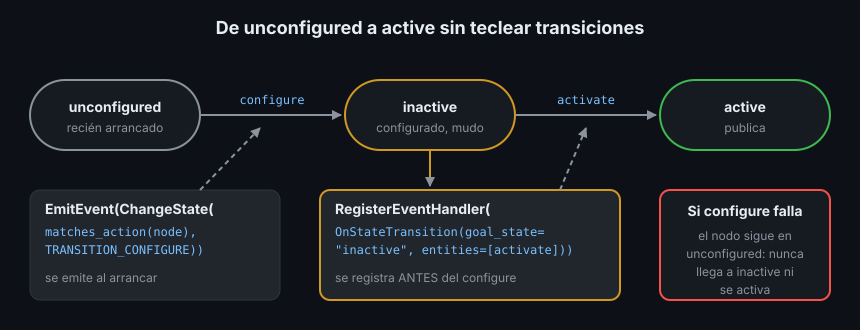

# Composición de launch files y nodos lifecycle

> Un robot real no tiene un launch file: tiene uno por subsistema (modelo, sensores, navegación) y uno de *bringup* que los incluye todos. Esta teoría enseña a componerlos, a elegir qué se arranca con un argumento y a llevar un nodo lifecycle hasta `active` sin teclear ni una transición.

## 🎯 Objetivos

- Incluir un launch file de otro paquete y reenviarle argumentos
- Agrupar acciones, ponerles namespace y arrancarlas solo si se cumple una condición
- Restringir los valores de un argumento con `choices`
- Configurar y activar un nodo lifecycle desde launch con eventos

## 1. Qué problema resuelve

El Ejercicio 02 arranca la patrulla del Ejercicio 01, un dock y un monitor. Podría
copiar los dos nodos de `patrol.launch.py` en su propio launch file, pero entonces
habría dos copias que mantener: si mañana la patrulla gana un nodo, una de las
dos se queda vieja.

Además, en la Semana 04 tu `sensor_stub` se convirtió en un nodo lifecycle. Cada
arranque exige dos órdenes más:

```bash
ros2 lifecycle set /sensor_stub configure
ros2 lifecycle set /sensor_stub activate
```

Un sistema que necesita que alguien teclee transiciones no arranca solo. Launch
resuelve las dos cosas.

## 2. Cómo funciona en ROS2

Launch ejecuta acciones, y algunas acciones contienen otras:

| Acción | Qué hace |
|---|---|
| `IncludeLaunchDescription` | Carga otro launch file y ejecuta sus acciones como si fueran tuyas |
| `GroupAction` | Agrupa acciones; lo que se configura dentro (namespace, condición) no sale fuera |
| `PushRosNamespace` | Dentro de un grupo, antepone un namespace a todos los nodos |
| `SetEnvironmentVariable` | Fija una variable de entorno para todo lo que se lance después |
| `EmitEvent` / `RegisterEventHandler` | Emite un evento o reacciona a uno (un proceso arranca, un nodo cambia de estado) |

Toda acción admite el campo `condition`: si la condición es falsa, la acción (y
todo lo que contiene) no se ejecuta.

## 3. Cómo se escribe

### 3.1 Incluir otro launch file

`src/ejercicio02_tf_listener_cpp/launch/dock.launch.py` incluye la patrulla:

```python
from launch.actions import IncludeLaunchDescription
from launch.launch_description_sources import PythonLaunchDescriptionSource
from launch.substitutions import LaunchConfiguration, PathJoinSubstitution
from launch_ros.substitutions import FindPackageShare

patrol = IncludeLaunchDescription(
    PythonLaunchDescriptionSource(
        PathJoinSubstitution(
            [FindPackageShare("ejercicio01_tf_broadcaster_py"), "launch", "patrol.launch.py"]
        )
    ),
    launch_arguments={"radius_m": LaunchConfiguration("radius_m")}.items(),
)
```

- `FindPackageShare("<paquete>")` es una sustitución que se resuelve a
  `install/<paquete>/share/<paquete>`, esté donde esté el workspace
- `PathJoinSubstitution` une trozos de ruta que aún no tienen valor (por eso no
  sirve `os.path.join` con una sustitución)
- `launch_arguments` reenvía valores a los argumentos del launch incluido. Aquí,
  `dock.launch.py` declara su propio `radius_m` y se lo pasa a `patrol.launch.py`

Funciona aunque los paquetes sean de lenguajes distintos: el Ejercicio 02 (C++)
incluye el launch del Ejercicio 01 (Python) y arranca sus nodos. Por eso el
`package.xml` del 02 declara `<exec_depend>ejercicio01_tf_broadcaster_py</exec_depend>`.

### 3.2 Grupos y namespaces

Para lanzar dos patrullas sin que sus nodos choquen, cada una va en su grupo con
su namespace:

```python
from launch.actions import GroupAction
from launch_ros.actions import PushRosNamespace

robot1 = GroupAction([
    PushRosNamespace("robot1"),
    IncludeLaunchDescription(PythonLaunchDescriptionSource(patrol_launch)),
])
```

Dentro del grupo, `patrol_broadcaster` pasa a ser `/robot1/patrol_broadcaster`.
Lo que ocurre con `/tf` en un sistema de varios robots es tema de la Semana 27.

### 3.3 Condiciones y `choices`

El bringup del proyecto arranca la capa Python o la C++ de `sensor_stub` según un
argumento:

```python
from launch.actions import DeclareLaunchArgument, GroupAction
from launch.conditions import IfCondition
from launch.substitutions import EqualsSubstitution, LaunchConfiguration

impl_arg = DeclareLaunchArgument(
    "impl",
    default_value="py",
    choices=["py", "cpp"],
    description="Capa de sensor_stub que se arranca",
)
python_layer = GroupAction(
    [...],
    condition=IfCondition(EqualsSubstitution(LaunchConfiguration("impl"), "py")),
)
```

`EqualsSubstitution` vale `"true"` si los dos lados coinciden; `IfCondition` lo
convierte en sí o no. Con `choices`, un valor fuera de la lista para el arranque
en vez de lanzar algo a medias:

```bash
ros2 launch proyecto_dominio_py bringup.launch.py impl:=java
# [ERROR] [launch.actions.declare_launch_argument]: Argument "impl" provided value "java" is not valid. Valid options are: ['py', 'cpp']
```

En tutoriales antiguos verás `LaunchConfigurationEquals`. En Jazzy está obsoleto y
avisa en cada arranque:

```text
UserWarning: The 'LaunchConfigurationEquals' and 'LaunchConfigurationNotEquals' Conditions are  deprecated. Use the 'EqualsSubstitution' and 'NotEqualsSubstitution' substitutions instead!
```

### 3.4 Un nodo lifecycle que arranca solo



`launch_ros.actions.LifecycleNode` es un `Node` que, además, sabe pedir
transiciones. La pieza clave son dos eventos:

- `ChangeState`: "pide a este nodo la transición X". Por dentro llama al servicio
  `/<nodo>/change_state`, el mismo que usa `ros2 lifecycle set`
- `OnStateTransition`: "cuando este nodo llegue al estado Y, haz esto"

```python
from launch.actions import EmitEvent, RegisterEventHandler
from launch.events import matches_action
from launch_ros.actions import LifecycleNode
from launch_ros.event_handlers import OnStateTransition
from launch_ros.events.lifecycle import ChangeState
from lifecycle_msgs.msg import Transition

node = LifecycleNode(
    package="proyecto_dominio_py", executable="sensor_stub",
    name="sensor_stub", namespace="",   # LifecycleNode exige los dos
)
configure = EmitEvent(event=ChangeState(
    lifecycle_node_matcher=matches_action(node),   # solo a este nodo
    transition_id=Transition.TRANSITION_CONFIGURE,
))
activate_when_inactive = RegisterEventHandler(OnStateTransition(
    target_lifecycle_node=node,
    goal_state="inactive",
    entities=[EmitEvent(event=ChangeState(
        lifecycle_node_matcher=matches_action(node),
        transition_id=Transition.TRANSITION_ACTIVATE,
    ))],
))
```

La lista es `[node, activate_when_inactive, configure]`: el manejador se registra
**antes** de pedir `configure`, para no perderse el paso a `inactive`. Si
`on_configure` devuelve `FAILURE`, el nodo se queda en `unconfigured`, nunca llega
a `inactive` y nunca se activa: el orden de arranque de la Semana 04 se conserva.

Lanzado así, el nodo publica sin que nadie teclee nada. Lo compruebas con:

```bash
ros2 lifecycle get /sensor_stub
# active [3]
```

## 4. Antipatrones

- ❌ **Copiar los nodos de otro launch file en vez de incluirlo.** Dos copias
  divergen; una inclusión siempre está al día
- ❌ **Activar un lifecycle con dos `EmitEvent` seguidos** (configure y activate).
  Suele funcionar, porque el nodo atiende las peticiones en orden, pero el
  activate se pide pase lo que pase con el configure. Con el manejador, la
  activación depende de que la configuración haya terminado bien, y el código lo dice
- ❌ **`os.path.join` con sustituciones.** `os.path.join(FindPackageShare(...), "launch")`
  falla: la sustitución aún no es texto. Usa `PathJoinSubstitution`
- ❌ **Un argumento libre donde solo valen unos pocos valores.** Sin `choices`, un
  `impl:=Py` arranca un sistema sin `sensor_stub` y sin un solo error

## 5. Trucos

- `IncludeLaunchDescription` no admite `additional_env`; `SetEnvironmentVariable`
  antes de la inclusión sí llega a los procesos incluidos. Es lo que hacen los tests
  de integración de esta semana con `ROS_DOMAIN_ID`
- Un launch file de *bringup* por robot, que incluye uno por subsistema
  (`description.launch.py`, sensores, navegación), es el patrón de Nav2 y MoveIt2
- Si dos launch files declaran un argumento con el mismo nombre (`radius_m` en
  `dock.launch.py` y en `patrol.launch.py`), el valor de la línea de comandos llega a
  los dos: `--show-args` lo muestra una sola vez
- `ros2 lifecycle nodes` lista todos los nodos lifecycle vivos; útil para ver si el
  bringup arrancó la capa que esperabas

## 📚 Recursos Adicionales

- [Using event handlers — ROS2 Jazzy](https://docs.ros.org/en/jazzy/Tutorials/Intermediate/Launch/Using-Event-Handlers.html)
- [Integrating launch files into ROS 2 packages — ROS2 Jazzy](https://docs.ros.org/en/jazzy/Tutorials/Intermediate/Launch/Launch-system.html)
- [Ejemplo de lifecycle en launch — ros2/launch_ros, rama jazzy](https://github.com/ros2/launch_ros/blob/jazzy/launch_ros/examples/lifecycle_pub_sub_launch.py)

## ✅ Checklist de Verificación

- [ ] Sé incluir un launch file de otro paquete con `FindPackageShare` y pasarle argumentos
- [ ] Sé arrancar un grupo de acciones solo si un argumento tiene un valor
- [ ] Sé por qué el manejador `OnStateTransition` se registra antes del `configure`
- [ ] Sé qué pasa con el nodo lifecycle si `on_configure` falla

---

## 🔗 Navegación

| Anterior | Actual | Siguiente |
| -------- | ------ | --------- |
| [01 · Launch files en Python](01-launch-files-en-python.md) | **02 · Composición de launch y lifecycle** | [03 · TF2: marcos y transformaciones](03-tf2-marcos-y-transformaciones.md) |

← [Volver a la Semana 06](../README.md)
