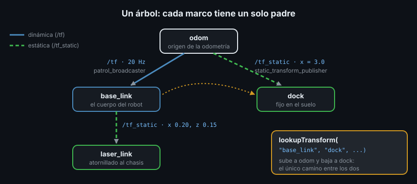

# TF2: marcos de referencia y transformaciones

> El láser ve un obstáculo a 1.2 m "delante". ¿Delante de qué? ¿Del láser, del centro del robot, del punto donde arrancó? Cada sensor mide desde su propia posición, y el robot entero se mueve por el mundo. TF2 es el sistema de ROS2 que lleva la cuenta de dónde está cada cosa respecto a cada otra, en cada instante.

## 🎯 Objetivos

- Saber qué es un marco de referencia, una transformación y un árbol TF
- Conocer las convenciones de REP 103 (unidades y ejes) y REP 105 (`map`, `odom`, `base_link`)
- Distinguir transformaciones estáticas (`/tf_static`) de dinámicas (`/tf`)
- Representar una orientación con un cuaternión en el caso más simple: un giro en el suelo
- Inspeccionar el árbol con `static_transform_publisher`, `tf2_echo` y `view_frames`

## 1. Qué problema resuelve

Un **marco de referencia** (*frame*) es un origen más tres ejes. Un punto solo
tiene coordenadas respecto a un marco: el obstáculo está en `(1.2, 0, 0)` en el
marco del láser, pero en otro sitio en el marco del robot (el láser no está en su
centro) y en otro distinto en el marco del suelo (el robot se ha movido).

Sin TF2, cada nodo tendría que saber dónde está montado cada sensor y dónde está
el robot ahora, y hacer las cuentas. Con TF2 cada nodo publica **solo lo que
sabe** (el URDF sabe dónde va el láser; la odometría sabe cuánto se ha movido el
robot) y cualquier otro nodo pregunta "¿dónde está X visto desde Y?".

## 2. Cómo funciona en ROS2

### 2.1 Transformaciones y árbol

Una **transformación** entre dos marcos dice dónde está el marco hijo dentro del
marco padre: una **traslación** (x, y, z en metros) y una **rotación**. Se publica
como `geometry_msgs/msg/TransformStamped`:

```text
header.stamp        instante en que la transformación es válida
header.frame_id     marco padre (p. ej. base_link)
child_frame_id      marco hijo (p. ej. laser_link)
transform.translation   x, y, z: dónde está el origen del hijo, en ejes del padre
transform.rotation      x, y, z, w: cómo está girado el hijo (cuaternión)
```

Todas las transformaciones juntas forman el **árbol TF** (*TF tree*): cada marco
tiene **un solo padre** y no hay ciclos. Como es un árbol, entre dos marcos
cualesquiera hay un único camino, y TF2 compone las transformaciones de ese
camino para responder cualquier pregunta.



### 2.2 Dos topics: `/tf` y `/tf_static`

| Topic | Qué lleva | Cuándo se publica | QoS |
|---|---|---|---|
| `/tf` | Transformaciones **dinámicas**: cambian con el tiempo (el robot respecto al suelo, una rueda que gira) | Continuamente, a la frecuencia del que la conoce | Volatile |
| `/tf_static` | Transformaciones **estáticas**: no cambian nunca (un sensor atornillado al chasis) | Una vez, al arrancar | Transient local |

`/tf_static` usa durabilidad **transient local** (Semana 02): un nodo que arranca
tarde recibe igualmente las estáticas publicadas antes. Por eso un sensor fijo se
publica una sola vez y no 20 veces por segundo.

### 2.3 Convenciones: REP 103 y REP 105

Un **REP** (*ROS Enhancement Proposal*) es un documento de convenciones de ROS.
Dos de ellos fijan cómo se usan los marcos:

**REP 103**, unidades y ejes:

- Unidades SI: metros, radianes, segundos, kilogramos
- Ejes de un marco del cuerpo: **x hacia delante, y a la izquierda, z hacia
  arriba** (regla de la mano derecha)
- Un giro positivo alrededor de z (**yaw**, la orientación en el suelo) es
  antihorario visto desde arriba: girar a la izquierda

**REP 105**, los marcos de un robot móvil:

| Marco | Qué es | Cómo se comporta |
|---|---|---|
| `map` | Origen fijo del mapa | No deriva, pero la pose del robot en él puede saltar (al relocalizarse) |
| `odom` | Origen donde arrancó la odometría | La pose del robot en él es continua, pero deriva con el tiempo |
| `base_link` | El cuerpo del robot | Se mueve con el robot |

La cadena es `map → odom → base_link → sensores`. Esta semana no hay mapa: el
árbol empieza en `odom`. `map` aparece en la Semana 14 con SLAM.

## 3. Rotaciones: lo mínimo sobre cuaterniones

TF2 guarda las rotaciones como **cuaterniones**: cuatro números `(x, y, z, w)`
que codifican un giro en 3D sin los problemas de los ángulos de Euler. La Semana
07 los explica a fondo. Esta semana solo necesitas un caso: un robot que se mueve
por el suelo y solo gira alrededor de z un ángulo `yaw`:

```text
x = 0
y = 0
z = sin(yaw / 2)
w = cos(yaw / 2)
```

| yaw | Cuaternión (x, y, z, w) | Significa |
|---|---|---|
| 0 | (0, 0, 0, 1) | Sin giro: mira hacia +x |
| π/2 (90°) | (0, 0, 0.707, 0.707) | Mira hacia +y, a la izquierda |
| π (180°) | (0, 0, 1, 0) | Mira hacia atrás |

Un cuaternión de rotación siempre mide 1 (`x² + y² + z² + w² = 1`). Un mensaje
recién creado ya trae `(0, 0, 0, 1)`, sin giro. La trampa es tocarlo a medias:
si escribes `z = sin(yaw / 2)` y olvidas `w`, queda `w = 1` y el cuaternión ya no
mide 1. TF2 descarta esa transformación y solo lo dice en el log del que escucha:

```text
[ERROR] [...]: TF_DENORMALIZED_QUATERNION: Ignoring transform for child_frame_id "b" from authority "Authority undetectable" because of an invalid quaternion in the transform (...)
```

Asigna siempre los cuatro componentes, como hace `yaw_to_quaternion`.

## 4. Las herramientas de línea de comandos

### 4.1 Publicar una estática a mano

```bash
ros2 run tf2_ros static_transform_publisher --x 0.20 --z 0.15 \
  --frame-id base_link --child-frame-id laser_link
# [INFO] [...] [static_transform_publisher_...]: Spinning until stopped - publishing transform
# translation: ('0.200000', '0.000000', '0.150000')
# rotation: ('0.000000', '0.000000', '0.000000', '1.000000')
# from 'base_link' to 'laser_link'
```

Admite también `--y`, `--roll`, `--pitch`, `--yaw` (en radianes) y `--qx` ...
`--qw` para dar el cuaternión directamente.

### 4.2 Preguntar una transformación: `tf2_echo`

```bash
ros2 run tf2_ros tf2_echo odom base_link
# [INFO] [...] [tf2_echo]: Waiting for transform odom ->  base_link: Invalid frame ID "odom" passed to canTransform argument target_frame - frame does not exist
# At time 1794192510.575654583
# - Translation: [-0.582, 1.383, 0.000]
# - Rotation: in Quaternion (xyzw) [0.000, 0.000, 0.980, -0.198]
# - Rotation: in RPY (radian) [0.000, -0.000, -2.743]
# - Rotation: in RPY (degree) [0.000, -0.000, -157.180]
# ...
```

El primer aviso es normal: `tf2_echo` arrancó antes de recibir el primer mensaje.
**RPY** son los ángulos *roll*, *pitch* y *yaw*: giros alrededor de x, y y z. Una
estática sale con `At time 0.0`: no depende del tiempo.

### 4.3 Dibujar el árbol: `view_frames`

```bash
ros2 run tf2_tools view_frames
# [INFO] [...] [view_frames]: Listening to tf data for 5.0 seconds...
# [INFO] [...] [view_frames]: Generating graph...
# [INFO] [...] [view_frames]: Exporting graph in frames_2026-11-09_02.48.43.pdf file...
```

Escucha 5 s y genera un PDF con el árbol: quién es padre de quién, quién publica
cada transformación y a qué frecuencia. Es la primera comprobación cuando "TF no
funciona": un marco que falta o cuelga de un padre equivocado se ve a simple vista.

## 5. Antipatrones

- ❌ **Dos padres para un marco.** Si dos nodos publican `odom → base_link` y
  `world → base_link`, el árbol se rompe y las consultas fallan a ratos según qué
  mensaje llegó último
- ❌ **Publicar en `/tf` algo que no se mueve.** Funciona, pero inunda la red y
  un nodo que arranca tarde no lo ve hasta el siguiente mensaje. Lo fijo va en
  `/tf_static`
- ❌ **Grados donde ROS espera radianes.** `--yaw 90` gira 90 radianes (más de 14
  vueltas), no 90°; para 90° es `--yaw 1.5708`
- ❌ **Cuaternión a medias.** Cambiar `z` sin cambiar `w` da un cuaternión que no
  mide 1: TF2 lo ignora y el marco "desaparece" sin error en tu nodo
- ❌ **Inventar nombres para los marcos estándar** (`robot`, `base`, `world`).
  Nav2 y el resto del ecosistema esperan `map`, `odom` y `base_link`

## 6. Trucos

- `ros2 run tf2_ros tf2_monitor` muestra la frecuencia y el retraso de cada
  transformación: útil cuando el árbol está bien pero las consultas llegan tarde
- `ros2 topic echo /tf_static --once` lista las estáticas tal cual se publicaron
- En `tf2_echo`, el orden importa: `tf2_echo A B` da la pose de B vista desde A
- Si `view_frames` no muestra un marco, el problema no está en quien consulta:
  nadie lo está publicando

## 📚 Recursos Adicionales

- [Introducing tf2 — ROS2 Jazzy](https://docs.ros.org/en/jazzy/Tutorials/Intermediate/Tf2/Introduction-To-Tf2.html)
- [REP 103 — Standard Units of Measure and Coordinate Conventions](https://www.ros.org/reps/rep-0103.html)
- [REP 105 — Coordinate Frames for Mobile Platforms](https://www.ros.org/reps/rep-0105.html)
- [Quaternion fundamentals — ROS2 Jazzy](https://docs.ros.org/en/jazzy/Tutorials/Intermediate/Tf2/Quaternion-Fundamentals.html)

## ✅ Checklist de Verificación

- [ ] Sé qué guarda un `TransformStamped` y qué significan `frame_id` y `child_frame_id`
- [ ] Sé por qué el árbol TF no puede tener ciclos ni dos padres para un marco
- [ ] Sé qué va en `/tf` y qué en `/tf_static`, y por qué `/tf_static` es transient local
- [ ] Sé escribir el cuaternión de un giro `yaw` alrededor de z
- [ ] Sé usar `tf2_echo` y `view_frames` para inspeccionar un árbol

---

## 🔗 Navegación

| Anterior | Actual | Siguiente |
| -------- | ------ | --------- |
| [02 · Composición de launch y lifecycle](02-composicion-de-launch-y-lifecycle.md) | **03 · TF2: marcos y transformaciones** | [04 · Broadcasters y listeners](04-broadcasters-y-listeners.md) |

← [Volver a la Semana 06](../README.md)
