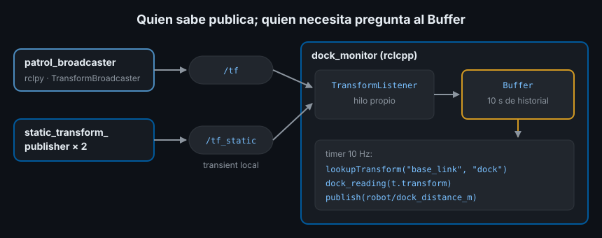

# Broadcasters y listeners de TF2 en rclpy y rclcpp

> Las herramientas de la teoría 03 publican y consultan TF desde la terminal. Tus nodos necesitan hacer lo mismo desde el código: publicar lo que saben (dónde está el robot) y preguntar lo que necesitan (dónde está el dock visto desde el robot).

## 🎯 Objetivos

- Publicar transformaciones dinámicas y estáticas con un *broadcaster* en Python y C++
- Consultar transformaciones con `Buffer` y `TransformListener` en Python y C++
- Leer bien `lookupTransform(target, source, time)`: qué marco es cuál y qué instante pides
- Manejar las excepciones de TF2 en el arranque y probar el `Buffer` sin red

## 1. Qué problema resuelve

Publicar una transformación es publicar un `TransformStamped` en `/tf`. Consultar
una es más difícil: hay que escuchar `/tf` y `/tf_static`, guardar un historial,
encontrar el camino en el árbol, componer las transformaciones e interpolar entre
dos instantes. TF2 te da hecho todo eso en dos piezas:

- **Broadcaster**: publica transformaciones con el QoS correcto
- **Listener + Buffer**: el listener se suscribe a `/tf` y `/tf_static` y llena el
  **buffer**, un almacén con los últimos segundos de cada transformación; tú solo
  le preguntas al buffer

## 2. Cómo funciona en ROS2



El buffer guarda por defecto **10 segundos** de historial de cada transformación
dinámica. Las estáticas se guardan para siempre. Al consultar, el buffer:

1. Busca el camino entre los dos marcos en el árbol
2. Para cada tramo dinámico, interpola entre los dos mensajes más cercanos al
   instante pedido
3. Compone los tramos y te devuelve una sola transformación

## 3. Cómo se escribe

### 3.1 Broadcaster dinámico

Python (`ejercicio01_tf_broadcaster_py/patrol_broadcaster.py`, resumido):

```python
from geometry_msgs.msg import TransformStamped
from tf2_ros import TransformBroadcaster

self._broadcaster = TransformBroadcaster(self)   # en __init__

msg = TransformStamped()                          # en el timer
msg.header.stamp = self.get_clock().now().to_msg()
msg.header.frame_id = "odom"
msg.child_frame_id = "base_link"
msg.transform.translation.x = x
msg.transform.translation.y = y
qx, qy, qz, qw = yaw_to_quaternion(yaw)
msg.transform.rotation.z = qz
msg.transform.rotation.w = qw
self._broadcaster.sendTransform(msg)
```

C++, la misma idea (es lo que añades a `sensor_stub` en el proyecto):

```cpp
#include "geometry_msgs/msg/transform_stamped.hpp"
#include "tf2_ros/transform_broadcaster.h"

// Miembro: std::unique_ptr<tf2_ros::TransformBroadcaster> tf_broadcaster_;
tf_broadcaster_ = std::make_unique<tf2_ros::TransformBroadcaster>(*this);

geometry_msgs::msg::TransformStamped msg;
msg.header.stamp = now();
msg.header.frame_id = "odom";
msg.child_frame_id = "base_link";
msg.transform.translation.x = x;
msg.transform.rotation.z = std::sin(yaw / 2.0);
msg.transform.rotation.w = std::cos(yaw / 2.0);
tf_broadcaster_->sendTransform(msg);
```

`TransformBroadcaster` acepta tanto un `rclcpp::Node` como un
`rclcpp_lifecycle::LifecycleNode`. En C++ existe además `tf2::Quaternion` con
`setRPY(roll, pitch, yaw)`; lo usarás en la Semana 07.

### 3.2 Broadcaster estático

Para lo que no se mueve, `StaticTransformBroadcaster` publica en `/tf_static` y
basta con llamarlo una vez:

```python
from tf2_ros import StaticTransformBroadcaster

self._static = StaticTransformBroadcaster(self)
self._static.sendTransform(laser_msg)   # una vez, en __init__
```

```cpp
#include "tf2_ros/static_transform_broadcaster.h"

static_broadcaster_ = std::make_unique<tf2_ros::StaticTransformBroadcaster>(*this);
static_broadcaster_->sendTransform(laser_msg);
```

En la práctica casi nunca lo escribirás: las estáticas de un robot salen de su
URDF (teoría 05) o de `static_transform_publisher` en un launch file.

### 3.3 Listener en C++

`src/ejercicio02_tf_listener_cpp/src/dock_monitor.cpp`, resumido:

```cpp
#include "tf2/exceptions.h"
#include "tf2_ros/buffer.h"
#include "tf2_ros/transform_listener.h"

// Miembros, en este orden: el listener usa el buffer.
std::unique_ptr<tf2_ros::Buffer> buffer_;
std::shared_ptr<tf2_ros::TransformListener> listener_;

buffer_ = std::make_unique<tf2_ros::Buffer>(get_clock());
listener_ = std::make_shared<tf2_ros::TransformListener>(*buffer_);

// En el timer:
try {
  const auto t = buffer_->lookupTransform("base_link", "dock", tf2::TimePointZero);
  // t.transform.translation: dónde está el dock en ejes del robot
} catch (const tf2::TransformException& error) {
  RCLCPP_WARN_THROTTLE(get_logger(), *get_clock(), 2000, "Sin TF: %s", error.what());
}
```

En C++, `TransformListener` arranca **su propio hilo** para recibir `/tf`: el
buffer se llena aunque tu nodo esté ocupado en otro callback.

### 3.4 Listener en Python

```python
from rclpy.time import Time
from tf2_ros import Buffer, TransformException, TransformListener

self._buffer = Buffer()
self._listener = TransformListener(self._buffer, self)

# En el timer:
try:
    t = self._buffer.lookup_transform("base_link", "dock", Time())
except TransformException as error:
    self.get_logger().warn(f"Sin TF: {error}", throttle_duration_sec=2.0)
    return
```

En Python, el listener se suscribe con **tu nodo** y recibe `/tf` cuando tu
executor lo atiende. Por eso los tests de esta semana llaman a
`rclpy.spin_once` mientras esperan una transformación.

## 4. Leer bien `lookupTransform`

```text
lookupTransform(target_frame, source_frame, time)
```

- Devuelve la pose de `source_frame` **vista desde** `target_frame`. Con
  `("base_link", "dock")`, la traslación es dónde está el dock en ejes del robot:
  `x` hacia delante del robot, `y` a su izquierda
- Al revés, `("dock", "base_link")`, sería dónde está el robot visto desde el dock:
  otro vector, con otros ejes
- `time` es el instante que pides. `tf2::TimePointZero` en C++ (`Time()` en
  Python) significa "lo más reciente que tengas de toda la cadena"

El test `test_tf_buffer.cpp` del Ejercicio 02 lo muestra con números: el dock está
a 3 m en el eje x de `odom`; con el robot en `(1, 0)` mirando hacia +y, el dock
queda a 2 m **a su derecha** (rumbo −90°), aunque en `odom` esté "delante".

### Las excepciones

| Excepción | Cuándo |
|---|---|
| `LookupException` | Uno de los marcos no existe todavía (nadie lo ha publicado) |
| `ConnectivityException` | Los dos existen pero no hay camino entre ellos (dos árboles separados) |
| `ExtrapolationException` | Pides un instante fuera del historial (demasiado viejo o del futuro) |

Las tres derivan de `TransformException`. En el arranque de cualquier sistema
verás alguna durante el primer segundo: es normal y por eso el listener avisa con
`THROTTLE` en vez de terminar.

## 5. Probar sin red: el buffer suelto

El buffer se puede usar sin nodo ni listener: se le meten transformaciones a mano
y se consulta. En C++ es `tf2::BufferCore` (el núcleo de `tf2_ros::Buffer`):

```cpp
tf2::BufferCore buffer;
buffer.setTransform(odom_to_dock, "test", true);    // true: estática
buffer.setTransform(odom_to_base, "test");
const auto t = buffer.lookupTransform("base_link", "dock", tf2::TimePointZero);
```

En Python, `tf2_ros.Buffer()` sin listener, con `set_transform` y
`set_transform_static`. Así pruebas la lógica que usa TF en milisegundos, como los
tests unitarios de la Semana 05.

## 6. Antipatrones

- ❌ **Crear el `Buffer` o el `TransformListener` dentro del callback.** Nace
  vacío cada vez y la consulta siempre falla. Se crean una vez, en el constructor
- ❌ **Confundir el orden de `lookupTransform`.** Pedir `("dock", "base_link")`
  cuando querías `("base_link", "dock")` da un vector con sentido y ejes
  distintos; el robot gira hacia el lado equivocado
- ❌ **Matar el nodo por una `TransformException`.** En el arranque es lo normal;
  avisa y reintenta en el siguiente ciclo
- ❌ **Esperar con plazo dentro de un callback de Python.** `lookup_transform(...,
  timeout=...)` en un timer bloquea ese callback hasta el plazo, y con el executor
  de un hilo el nodo no atiende nada más mientras tanto
- ❌ **Stamp de "ahora" para un dato viejo.** El `stamp` es el instante en que la
  pose era cierta; si pones `now()` a una medida de hace 200 ms, TF interpola en el
  sitio equivocado

## 7. Trucos

- `ros2 run tf2_ros tf2_echo base_link dock` hace la misma consulta que tu nodo:
  si la terminal la responde y tu nodo no, el fallo está en tu código
- `can_transform(target, source, Time())` en Python pregunta sin lanzar excepción
- Para transformar un punto o una pose (no solo consultar), `tf2_geometry_msgs`
  añade `doTransform`; aparece cuando haya datos de sensores reales (Semana 09)
- `tf2::TimePointZero` no es "el instante 0": es "el más reciente común a toda la
  cadena"

## 📚 Recursos Adicionales

- [Writing a broadcaster (Python) — ROS2 Jazzy](https://docs.ros.org/en/jazzy/Tutorials/Intermediate/Tf2/Writing-A-Tf2-Broadcaster-Py.html)
- [Writing a listener (C++) — ROS2 Jazzy](https://docs.ros.org/en/jazzy/Tutorials/Intermediate/Tf2/Writing-A-Tf2-Listener-Cpp.html)
- [Using time (C++) — ROS2 Jazzy](https://docs.ros.org/en/jazzy/Tutorials/Intermediate/Tf2/Learning-About-Tf2-And-Time-Cpp.html)

## ✅ Checklist de Verificación

- [ ] Sé publicar una transformación dinámica en Python y en C++
- [ ] Sé crear `Buffer` y `TransformListener` en los dos lenguajes y dónde se crean
- [ ] Sé qué devuelve `lookupTransform("base_link", "dock", ...)` y en qué ejes
- [ ] Sé qué significan `LookupException`, `ConnectivityException` y `ExtrapolationException`
- [ ] Sé probar código que usa TF con un buffer sin red

---

## 🔗 Navegación

| Anterior | Actual | Siguiente |
| -------- | ------ | --------- |
| [03 · TF2: marcos y transformaciones](03-tf2-marcos-y-transformaciones.md) | **04 · Broadcasters y listeners** | [05 · URDF y xacro](05-urdf-y-xacro.md) |

← [Volver a la Semana 06](../README.md)
