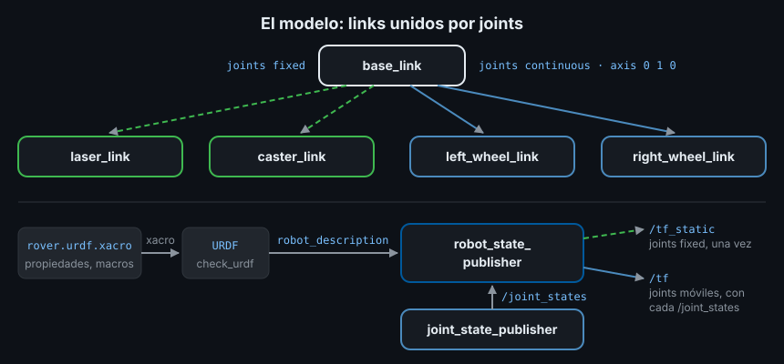

# URDF y xacro: el modelo del robot

> En el Ejercicio 01 escribiste a mano que el láser está 20 cm por delante del centro del robot. Un robot real tiene decenas de piezas así: ruedas, sensores, un brazo. URDF es el archivo donde se describen todas una sola vez, y del que salen el árbol TF, la simulación de Gazebo y el modelo de colisiones de Nav2 y MoveIt2.

## 🎯 Objetivos

- Describir un robot como *links* y *joints* en URDF
- Distinguir los tipos de joint y saber cuál usar para cada pieza
- Validar un modelo con `check_urdf`
- Evitar repeticiones con propiedades y macros de xacro
- Publicar el modelo en TF con `robot_state_publisher` y `joint_state_publisher`

## 1. Qué problema resuelve

Las transformaciones estáticas de `static_transform_publisher` funcionan, pero
cada una vive en un launch file distinto, sin la forma ni la masa de la pieza. Un
simulador necesita saber qué forma tiene la rueda; un planificador, qué volumen
ocupa el chasis para no chocar.

El **URDF** (*Unified Robot Description Format*) es un archivo XML que describe el
robot entero: sus piezas, cómo se unen y cómo se mueven. Una vez escrito,
`robot_state_publisher` publica todas sus transformaciones, y en las semanas
siguientes Gazebo, RViz2, Nav2 y MoveIt2 leen el mismo archivo.

## 2. Cómo funciona en ROS2

### 2.1 Links y joints

Un robot en URDF es un árbol de dos elementos:

- **Link**: una pieza rígida (el chasis, una rueda, un sensor). Cada link es un
  marco TF con su nombre
- **Joint** (articulación): la unión entre un link padre y un link hijo. Dice
  dónde está el hijo respecto al padre (`origin`) y cómo puede moverse



| Tipo de joint | Movimiento | Ejemplo | Se publica en |
|---|---|---|---|
| `fixed` | Ninguno | Sensor atornillado | `/tf_static` |
| `continuous` | Giro sin límite alrededor de `axis` | Rueda | `/tf` |
| `revolute` | Giro entre `lower` y `upper` (radianes) | Articulación de un brazo | `/tf` |
| `prismatic` | Desplazamiento entre `lower` y `upper` (metros) | Elevador, pinza | `/tf` |

`revolute` y `prismatic` exigen un `<limit>` con `lower`, `upper`, `effort`
(fuerza o par máximo) y `velocity`. Los usarás con el brazo en la Fase 4.

### 2.2 Qué lleva un link

```xml
<link name="laser_link">
  <visual>      <!-- cómo se dibuja (RViz2, Gazebo) -->
    <geometry><cylinder radius="0.03" length="0.04"/></geometry>
  </visual>
  <collision>   <!-- con qué choca; suele ser una forma más simple que visual -->
    <geometry><cylinder radius="0.03" length="0.04"/></geometry>
  </collision>
  <inertial>    <!-- masa (kg) e inercia (kg·m²): lo que necesita la física -->
    <mass value="0.1"/>
    <inertia ixx="3.6e-05" ixy="0" ixz="0" iyy="3.6e-05" iyz="0" izz="4.5e-05"/>
  </inertial>
</link>
```

Las formas posibles son `box` (`size="x y z"`), `cylinder` (`radius`, `length`,
con el eje en z), `sphere` (`radius`) y `mesh` (un archivo 3D). La **inercia**
dice cuánto cuesta hacer girar la pieza alrededor de cada eje. Para formas macizas
hay fórmulas cerradas:

| Forma | ixx | iyy | izz |
|---|---|---|---|
| Caja `x × y × z`, masa m | m(y² + z²)/12 | m(x² + z²)/12 | m(x² + y²)/12 |
| Cilindro radio r, largo h (eje z) | m(3r² + h²)/12 | m(3r² + h²)/12 | m r²/2 |

Esta semana nada simula física, pero Gazebo (Semana 08) necesita que todo link
con movimiento tenga `<inertial>`: escríbela ya.

### 2.3 Qué lleva un joint

```xml
<joint name="left_wheel_joint" type="continuous">
  <parent link="base_link"/>
  <child link="left_wheel_link"/>
  <origin xyz="0.08 0.17 -0.05" rpy="0 0 0"/>   <!-- metros y radianes -->
  <axis xyz="0 1 0"/>                            <!-- gira alrededor de y del hijo -->
</joint>
```

`origin` es exactamente la transformación de la teoría 03: dónde está el hijo en
ejes del padre. El URDF solo sabe dónde está cada joint en su posición cero; el
ángulo actual de una rueda llega por el topic `/joint_states`.

## 3. Cómo se escribe: xacro

### 3.1 Por qué xacro

Dos ruedas iguales en URDF puro son dos bloques de 20 líneas casi idénticos, con
las medidas repetidas. **xacro** (*XML macros*) es un preprocesador: lee un
`.urdf.xacro` y escribe un URDF normal. Aporta tres cosas:

```xml
<robot name="rover" xmlns:xacro="http://www.ros.org/wiki/xacro">
  <!-- 1. Propiedades: una medida, un solo sitio -->
  <xacro:property name="wheel_radius" value="0.05"/>

  <!-- 2. Expresiones: ${...} se calcula al expandir -->
  <origin xyz="0 ${chassis_y / 2 + wheel_width / 2} 0" rpy="${-pi/2} 0 0"/>

  <!-- 3. Macros: una plantilla con parámetros -->
  <xacro:macro name="wheel" params="prefix side">
    <link name="${prefix}_wheel_link"> ... </link>
    <joint name="${prefix}_wheel_joint" type="continuous"> ... </joint>
  </xacro:macro>
  <xacro:wheel prefix="left" side="1"/>
  <xacro:wheel prefix="right" side="-1"/>
</robot>
```

`pi` ya existe dentro de `${...}`. Para ver el URDF que genera:

```bash
xacro src/ejercicio03_urdf_xacro/urdf/rover.urdf.xacro > /tmp/rover.urdf
```

El resultado tiene los números ya calculados, con toda su precisión:
`xyz="0.08 0.16999999999999998 -0.05"`.

### 3.2 Validar: `check_urdf`

```bash
check_urdf /tmp/rover.urdf
# robot name is: rover
# ---------- Successfully Parsed XML ---------------
# root Link: base_link has 4 child(ren)
#     child(1):  caster_link
#     child(2):  laser_link
#     child(3):  left_wheel_link
#     child(4):  right_wheel_link
```

Comprueba que el XML es un URDF válido y que forma un árbol con una sola raíz. Un
modelo sin links falla así:

```text
Error:   No link elements found in urdf file
ERROR: Model Parsing the xml failed
```

### 3.3 Publicarlo: `robot_state_publisher`

`robot_state_publisher` recibe el URDF expandido en su parámetro
`robot_description` y:

- Publica los joints `fixed` en `/tf_static`, una vez
- Se suscribe a `/joint_states` (`sensor_msgs/msg/JointState`: nombre y posición
  de cada joint móvil) y publica esos joints en `/tf` cada vez que llega uno
- Republica el URDF en el topic `/robot_description` para quien lo necesite

Sin motores (llegan en la Semana 10), nadie publica `/joint_states`.
`joint_state_publisher` lee el modelo y publica 0 para cada joint móvil:

```bash
ros2 topic echo /joint_states --once
# header: ...
# name:
# - left_wheel_joint
# - right_wheel_joint
# position:
# - 0.0
# - 0.0
```

En un launch file, `Command` ejecuta xacro al lanzar:

```python
from launch.substitutions import Command, PathJoinSubstitution
from launch_ros.parameter_descriptions import ParameterValue
from launch_ros.substitutions import FindPackageShare

model = PathJoinSubstitution(
    [FindPackageShare("ejercicio03_urdf_xacro"), "urdf", "rover.urdf.xacro"]
)
# value_type=str: el URDF es texto XML, no YAML que launch deba interpretar.
robot_description = ParameterValue(Command(["xacro ", model]), value_type=str)
Node(package="robot_state_publisher", executable="robot_state_publisher",
     parameters=[{"robot_description": robot_description}])
```

Al arrancar verás este aviso:

```text
[kdl_parser]: The root link base_link has an inertia specified in the URDF, but KDL does not support a root link with an inertia.  As a workaround, you can add an extra dummy link to your URDF.
```

KDL es la biblioteca de cinemática que usa `robot_state_publisher` por dentro: no
admite masa en el link raíz y la ignora. Las transformaciones se publican igual.

## 4. Antipatrones

- ❌ **Un cilindro de rueda sin girar.** El eje de un `cylinder` es z: sin
  `rpy="${-pi/2} 0 0"` en su `origin` visual, la rueda queda tumbada como un plato
- ❌ **Rueda `revolute` en vez de `continuous`.** Con límites, la rueda deja de
  girar al llegar a `upper`
- ❌ **Medidas repetidas a mano.** Cambias el ancho del chasis y una rueda queda
  dentro de la caja. Una propiedad, un sitio
- ❌ **Links sin `<inertial>`.** `check_urdf` no se queja, pero la física de
  Gazebo (Semana 08) necesita masa e inercia en cada pieza que simula
- ❌ **Dos raíces o un ciclo.** Un link que no cuelga de nada, o que cuelga de dos
  sitios, rompe el árbol: `check_urdf` lo detecta antes de lanzar nada

## 5. Trucos

- `xacro modelo.urdf.xacro | check_urdf /dev/stdin` valida sin archivo intermedio
- `urdf_to_graphviz /tmp/rover.urdf` dibuja el árbol de links y joints en un PDF
- `ros2 param get /robot_state_publisher robot_description` muestra el URDF que
  está usando de verdad el nodo
- Con pantalla, `ros2 run joint_state_publisher_gui joint_state_publisher_gui`
  abre deslizadores para mover cada joint a mano (paquete aparte)

## 📚 Recursos Adicionales

- [URDF tutorials — ROS2 Jazzy](https://docs.ros.org/en/jazzy/Tutorials/Intermediate/URDF/URDF-Main.html)
- [Using Xacro to clean up your code — ROS2 Jazzy](https://docs.ros.org/en/jazzy/Tutorials/Intermediate/URDF/Using-Xacro-to-Clean-Up-a-URDF-File.html)
- [Using URDF with robot_state_publisher (Python) — ROS2 Jazzy](https://docs.ros.org/en/jazzy/Tutorials/Intermediate/URDF/Using-URDF-with-Robot-State-Publisher-py.html)
- [Especificación XML de URDF — wiki.ros.org](https://wiki.ros.org/urdf/XML)

## ✅ Checklist de Verificación

- [ ] Sé qué es un link y un joint, y qué tipo de joint lleva una rueda y un sensor
- [ ] Sé qué guardan `visual`, `collision` e `inertial`
- [ ] Sé usar propiedades, expresiones y macros de xacro
- [ ] Sé validar un modelo con `check_urdf`
- [ ] Sé qué publica `robot_state_publisher` y por qué necesita `/joint_states`

---

## 🔗 Navegación

| Anterior | Actual | Siguiente |
| -------- | ------ | --------- |
| [04 · Broadcasters y listeners](04-broadcasters-y-listeners.md) | **05 · URDF y xacro** | [Prácticas](../2-practicas/README.md) |

← [Volver a la Semana 06](../README.md)
