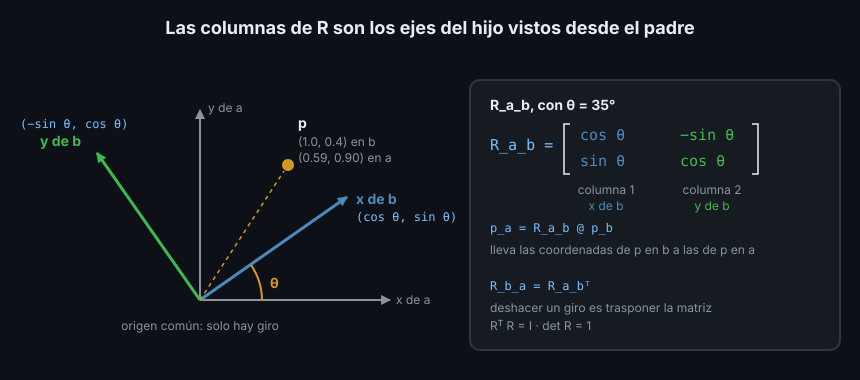

# 01 — Rotaciones y matrices de rotación



## 1. Qué problema resuelve

En la Semana 06 el láser del robot medía cosas en su propio marco, `laser_link`,
y tf2 te las daba en `odom` sin que vieras cómo. Esta semana abres esa caja.
Si el láser ve un obstáculo 1 m por delante, el obstáculo está en `(1, 0, 0)` de
`laser_link`. ¿Dónde está en `odom`? Depende de dónde esté el robot y hacia dónde
mire. Pasar un punto de un marco a otro tiene dos partes:

- **Girarlo**: los ejes de los dos marcos no apuntan igual. Es esta teoría.
- **Desplazarlo**: los orígenes de los dos marcos no coinciden. Es la teoría 02.

Una **rotación** es un giro alrededor de un eje que pasa por el origen, sin
desplazar nada. La forma más directa de escribirla para un ordenador es una
**matriz de rotación**: una tabla de números que, multiplicada por un vector, da
el vector girado. Las matrices son lo que usan por dentro tf2, Gazebo y MoveIt2;
las teorías 03 y 04 cuentan otras dos formas de escribir lo mismo.

## 2. Una rotación en el plano

Gira un marco `b` un ángulo `θ` respecto a su padre `a`, en sentido antihorario
visto desde arriba (el positivo de REP 103). ¿Dónde acaban sus ejes, escritos en
`a`?

- El eje x de `b` apunta a `(cos θ, sin θ)`.
- El eje y de `b`, 90° más allá, apunta a `(-sin θ, cos θ)`.

Pon esos dos vectores como columnas y tienes la matriz:

```text
R(θ) = | cos θ   -sin θ |
       | sin θ    cos θ |
```

Las **columnas de una matriz de rotación son los ejes del marco hijo escritos en
el marco padre**. Es la idea más útil de la semana: si recuerdas eso, puedes
escribir cualquier matriz de rotación sin memorizar signos.

Multiplicar la matriz por las coordenadas de un punto en `b` da sus coordenadas
en `a`. Con `θ = 90°`, lo que en `b` está delante, `(1, 0)`, en `a` está en
`(0, 1)`: el marco hijo mira hacia la `y` del padre.

## 3. Las tres rotaciones básicas en 3D

En 3D un giro tiene un eje. Los tres giros básicos son alrededor de x, y y z:

| Giro | Nombre en un robot | Matriz |
|---|---|---|
| Alrededor de x | **roll** (alabeo): inclinarse a un lado | `Rx(θ) = [[1, 0, 0], [0, c, -s], [0, s, c]]` |
| Alrededor de y | **pitch** (cabeceo): morro arriba o abajo | `Ry(θ) = [[c, 0, s], [0, 1, 0], [-s, 0, c]]` |
| Alrededor de z | **yaw** (guiñada): girar sobre el suelo | `Rz(θ) = [[c, -s, 0], [s, c, 0], [0, 0, 1]]` |

Con `c = cos θ` y `s = sin θ`. Los tres siguen la misma receta: la fila y la
columna del eje de giro son las de la identidad (ese eje no se mueve), y el
resto es la matriz 2D del plano que gira. El signo de `Ry` parece al revés
porque el plano que gira es z-x, no x-z: sale de la **regla de la mano
derecha** (el pulgar en el eje, los dedos doblados marcan el giro positivo).

`Rz` es la que más vas a usar con un robot móvil: un robot sobre el suelo solo
gira en yaw. Con NumPy, la biblioteca de cálculo numérico de Python que viene
con ROS 2 (paquete apt `python3-numpy`, versión 1.26.4 en Jazzy):

```python
import math

import numpy as np


def rot_z(angle: float) -> np.ndarray:
    c, s = math.cos(angle), math.sin(angle)
    return np.array([[c, -s, 0.0], [s, c, 0.0], [0.0, 0.0, 1.0]])


np.set_printoptions(precision=3, suppress=True)
print(rot_z(math.pi / 2) @ np.array([1.0, 0.0, 0.0]))
```

```text
[0. 1. 0.]
```

El operador `@` es la multiplicación de matrices. `suppress=True` evita que
NumPy escriba `6.123e-17` donde quieres ver `0.`: `cos(π/2)` en coma flotante
no es exactamente 0.

## 4. Propiedades que te dan pistas

Toda matriz de rotación `R` cumple dos cosas, y comprobarlas detecta errores:

1. **Es ortonormal**: sus columnas miden 1 y son perpendiculares entre sí, porque
   son ejes. Equivale a `Rᵀ R = I` (traspuesta por la matriz da la identidad).
2. **Su determinante vale 1**. Un determinante -1 sería un espejo, no un giro: te
   habrías equivocado de signo en una columna.

```python
R = rot_z(math.pi / 2)
print(np.allclose(R.T @ R, np.eye(3)), np.linalg.det(R))
```

```text
True 1.0
```

La consecuencia práctica de la primera: **la inversa de una rotación es su
traspuesta**. Deshacer un giro es tan barato como cambiar filas por columnas:
`R.T`. Si `R` lleva de `b` a `a`, `R.T` lleva de `a` a `b`.

## 5. Componer giros: el orden importa

Dos giros seguidos son el producto de sus matrices. Pero el producto de matrices
no es conmutativo, y los giros en 3D tampoco. Gira el vector z primero 90° en x
y luego 90° en z, y después al revés:

```python
def rot_x(angle: float) -> np.ndarray:
    c, s = math.cos(angle), math.sin(angle)
    return np.array([[1.0, 0.0, 0.0], [0.0, c, -s], [0.0, s, c]])


z = np.array([0.0, 0.0, 1.0])
print(rot_z(math.pi / 2) @ rot_x(math.pi / 2) @ z)
print(rot_x(math.pi / 2) @ rot_z(math.pi / 2) @ z)
```

```text
[ 1. -0.  0.]
[ 0. -1.  0.]
```

Se lee de derecha a izquierda: en `Rz @ Rx @ z`, el primer giro que sufre `z` es
`Rx`. Coge un libro y hazlo con las manos: los dos órdenes lo dejan en sitios
distintos. En el plano (solo yaw) el orden da igual, y por eso la Semana 06 no lo
necesitó. En cuanto entran roll y pitch (un dron, un brazo, una cámara inclinada),
importa siempre.

## 6. Dos lecturas de la misma matriz

`R_a_b`, la rotación de `b` respecto a `a`, se puede leer de dos formas, y las
dos son ciertas:

- **Gira un vector**: coge un vector escrito en `a` y lo gira `θ`.
- **Cambia de marco**: coge las coordenadas de un punto en `b` y te da las de
  ese mismo punto en `a`: `p_a = R_a_b @ p_b`.

tf2 siempre usa la segunda: el punto no se mueve, cambia el marco en el que lo
escribes. Por eso esta semana los nombres llevan los dos marcos, `R_a_b` o
`T_a_b`: el de la izquierda es en el que queda escrito el resultado y el de la
derecha el del vector que entra. En la teoría 02 verás que así los productos
encajan como fichas de dominó.

## 7. Antipatrones

- ❌ **Grados donde van radianes.** `math.cos`, NumPy, tf2 y URDF usan radianes:

  ```python
  print(rot_z(90) @ [1, 0, 0])  # ❌ 90 radianes son más de 14 vueltas
  ```

  ```text
  [-0.448  0.894  0.   ]
  ```

  No falla: da un número que parece razonable y está mal. Convierte con
  `math.radians(90)` en la frontera, donde entra el dato de una persona.

- ❌ **`*` en vez de `@`.** En NumPy, `*` multiplica elemento a elemento:

  ```python
  print(R * np.array([1.0, 0.0, 0.0]))  # ❌ no es girar el vector
  ```

  ```text
  [[ 0. -0.  0.]
   [ 1.  0.  0.]
   [ 0.  0.  0.]]
  ```

  Sale una matriz donde esperabas un vector. Usa `@` siempre que quieras el
  producto de matrices.

- ❌ **Matrices escritas con números redondeados.** `[[0.707, -0.707, 0], ...]`
  tiene determinante 0.9997, no 1: ya no es una rotación, y encadenada muchas
  veces deforma lo que gira. Calcula los valores con `math.cos`/`math.sin` o con
  una biblioteca (teoría 05).

- ❌ **Comparar matrices con `==`.** La coma flotante casi nunca da igualdad
  exacta. Usa `np.allclose(a, b)` en el código y `pytest.approx` en los tests.

## 8. Trucos

- Para escribir una matriz sin dudar del signo, dibuja los ejes del hijo vistos
  desde el padre y copia cada eje como columna.
- `np.set_printoptions(precision=3, suppress=True)` al principio de una sesión
  interactiva hace legibles todas las matrices.
- Si un resultado sale mal, comprueba primero `R.T @ R` y `np.linalg.det(R)`: la
  mitad de los errores son una matriz que ya no es una rotación.

## ✅ Checklist

- [ ] Sé que las columnas de `R_a_b` son los ejes de `b` escritos en `a`
- [ ] Escribo `Rx`, `Ry` y `Rz` y sé por qué `Ry` tiene el signo cambiado
- [ ] Sé que la inversa de una rotación es su traspuesta
- [ ] Sé que componer giros en 3D depende del orden y leo los productos de
      derecha a izquierda
- [ ] Uso radianes, `@` y `np.allclose`

---

## 🔗 Navegación

| Anterior | Actual | Siguiente |
| -------- | ------ | --------- |
| [Semana 07](../README.md) | **01 — Rotaciones** | [02 — Matrices homogéneas](02-matrices-homogeneas.md) |

← [Volver a la Semana 07](../README.md)
