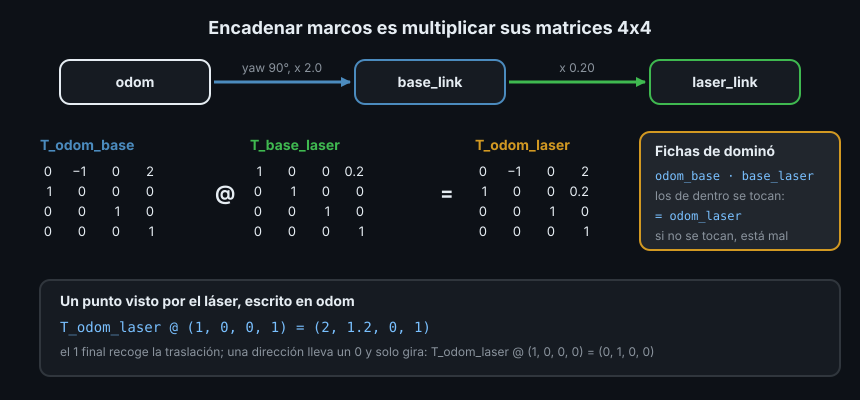

# 02 — Matrices homogéneas: girar y desplazar a la vez



## 1. Qué problema resuelve

Una transformación entre dos marcos es un giro **y** un desplazamiento. Con lo de
la teoría 01, pasar un punto de `b` a `a` son dos operaciones:

```text
p_a = R_a_b · p_b + t_a_b
```

`t_a_b` es la **traslación**: dónde está el origen de `b`, escrito en `a`. Para un
solo paso vale. Para encadenar tres marcos (`odom → base_link → laser_link`) ya
hay que intercalar productos y sumas, y es fácil equivocarse de orden. La
**matriz homogénea** mete el giro y la traslación en una sola matriz 4x4, de modo
que encadenar marcos es solo multiplicar.

## 2. La matriz 4x4

```text
T_a_b = | R_a_b   t_a_b |     | r11 r12 r13 tx |
        |   0       1   |  =  | r21 r22 r23 ty |
                              | r31 r32 r33 tz |
                              |  0   0   0   1 |
```

Arriba a la izquierda la rotación 3x3, en la última columna la traslación y abajo
una fila fija `(0, 0, 0, 1)`. Para multiplicarla por un punto se le añade al punto
una cuarta coordenada:

- Un **punto** (una posición) lleva un **1**: `(x, y, z, 1)`. Al multiplicar, el
  1 recoge la traslación: el punto gira y se desplaza.
- Un **vector** (una dirección, una velocidad) lleva un **0**: `(x, y, z, 0)`. El
  0 anula la traslación: una dirección gira con el marco pero no se mueve con él.
  "Hacia delante del robot" es la misma dirección esté donde esté el robot.

Con NumPy:

```python
import math

import numpy as np

np.set_printoptions(precision=3, suppress=True)


def rot_z(angle: float) -> np.ndarray:
    c, s = math.cos(angle), math.sin(angle)
    return np.array([[c, -s, 0.0], [s, c, 0.0], [0.0, 0.0, 1.0]])


def make_transform(rotation: np.ndarray, translation: list[float]) -> np.ndarray:
    transform = np.eye(4)
    transform[:3, :3] = rotation
    transform[:3, 3] = translation
    return transform


# El robot en (2, 0) de odom, mirando hacia +y (yaw de 90°).
T_odom_base = make_transform(rot_z(math.pi / 2), [2.0, 0.0, 0.0])
print(T_odom_base @ [1.0, 0.0, 0.0, 1.0])  # un punto 1 m delante del robot
print(T_odom_base @ [1.0, 0.0, 0.0, 0.0])  # la dirección "hacia delante"
```

```text
[2. 1. 0. 1.]
[0. 1. 0. 0.]
```

El punto que el robot tiene 1 m delante está en `(2, 1)` de `odom`; la dirección
"delante" del robot es `+y` de `odom`. tf2 te enseña la misma matriz. Con el
robot publicado por un `static_transform_publisher` (Semana 06):

```bash
ros2 run tf2_ros static_transform_publisher --x 2 --yaw 1.5707963267948966 \
  --frame-id odom --child-frame-id base_link
```

```bash
# Terminal 2
ros2 run tf2_ros tf2_echo odom base_link
# At time 0.0
# - Translation: [2.000, 0.000, 0.000]
# - Rotation: in Quaternion (xyzw) [0.000, 0.000, 0.707, 0.707]
# - Rotation: in RPY (radian) [0.000, -0.000, 1.571]
# - Rotation: in RPY (degree) [0.000, -0.000, 90.000]
# - Matrix:
#   0.000 -1.000  0.000  2.000
#   1.000  0.000  0.000  0.000
#   0.000  0.000  1.000  0.000
#   0.000  0.000  0.000  1.000
```

`- Matrix:` es `T_odom_base`, la misma que calculaste. Las otras líneas son la
misma rotación escrita como cuaternión y como ángulos (teorías 03 y 04).

## 3. La notación que evita errores

`T_a_b` es "el marco `b` visto desde `a`". Lleva puntos escritos en `b` a puntos
escritos en `a`. Esta notación coincide con la de ROS 2:

| Lo que escribes | `a` | `b` |
|---|---|---|
| `T_a_b` | marco del resultado | marco del punto que entra |
| `TransformStamped` | `header.frame_id` (padre) | `child_frame_id` (hijo) |
| `lookup_transform(target, source, ...)` | `target` | `source` |
| `tf2_echo a b` | primer argumento | segundo argumento |

`lookup_transform("odom", "laser_link", ...)` devuelve `T_odom_laser`: con ella,
lo que mide el láser pasa a `odom`.

## 4. Encadenar marcos

Para ir de `c` a `a` pasando por `b`:

```text
T_a_c = T_a_b @ T_b_c
```

Los subíndices de dentro se tocan y se cancelan, como fichas de dominó:
`a_b · b_c = a_c`. Si no se tocan (`T_a_b @ T_c_b`), el producto está mal. Con el
láser de la Semana 06, 0.20 m por delante del centro del robot:

```python
T_base_laser = make_transform(np.eye(3), [0.20, 0.0, 0.0])
T_odom_laser = T_odom_base @ T_base_laser
print(T_odom_laser @ [1.0, 0.0, 0.0, 1.0])
```

```text
[2.  1.2 0.  1. ]
```

Lo que el láser ve 1 m delante está en `(2, 1.2)` de `odom`: 1.20 m delante del
centro del robot, que mira hacia `+y`. Es exactamente lo que hace tf2 cuando le
pides `odom → laser_link`: recorre el árbol y multiplica las matrices de cada
tramo.

## 5. Invertir

Si `T_a_b` lleva de `b` a `a`, su inversa `T_b_a` lleva de `a` a `b`. No hace
falta invertir la 4x4 entera con `np.linalg.inv`: con la teoría 01 sale directa.

```text
T_b_a = | R_a_bᵀ   -R_a_bᵀ · t_a_b |
        |   0             1        |
```

La rotación se traspone; la traslación se gira con la rotación traspuesta y se
cambia de signo. Solo cambiar el signo de `t` es el error más común: sale bien
únicamente cuando no hay rotación.

```python
def invert_transform(transform: np.ndarray) -> np.ndarray:
    rotation, translation = transform[:3, :3], transform[:3, 3]
    return make_transform(rotation.T, -rotation.T @ translation)


T_base_odom = invert_transform(T_odom_base)
print(T_base_odom @ [0.0, 0.0, 0.0, 1.0])  # el origen de odom, visto desde el robot
```

```text
[-0.  2.  0.  1.]
```

(`-0.` es un cero con signo de coma flotante: vale lo mismo que `0.`.)

El origen de `odom` está 2 m a la **izquierda** del robot (`y` positiva): el robot
está en `(2, 0)` mirando hacia `+y`, así que el origen le queda a su izquierda.
Si te sale `-2`, has escrito `-translation` sin girarla.

## 6. El árbol TF es un producto de matrices

En la Semana 06 el monitor del dock preguntaba `lookup_transform("base_link",
"dock", ...)` con un árbol `odom → base_link` y `odom → dock`. Los dos marcos son
hermanos: no hay un tramo directo. tf2 sube hasta el antecesor común y baja:

```text
T_base_dock = T_base_odom @ T_odom_dock = inv(T_odom_base) @ T_odom_dock
```

Ese es todo el trabajo de tf2: guardar cada `T_padre_hijo` que le llega por
`/tf` y `/tf_static`, encontrar el camino entre dos marcos, invertir los tramos
que recorre hacia arriba y multiplicar. En el Ejercicio 01 escribes esa
calculadora y la comparas con tf2.

## 7. Antipatrones

- ❌ **Multiplicar al revés.** `T_base_laser @ T_odom_base` no es `T_odom_laser`:
  da un número, y está mal. Escribe los subíndices y comprueba que se tocan.
- ❌ **El 1 o el 0 que falta.** Un punto con `w = 0` no se traslada (la detección
  del láser se quedaría pegada al origen); una velocidad con `w = 1` se traslada
  y deja de ser una velocidad.
- ❌ **Invertir solo el signo de la traslación.** Ver sección 5.
- ❌ **Confundir `T_a_b` con `T_b_a`.** Con `lookup_transform` el primer argumento
  es el marco del **resultado**, no el de origen. Si las traslaciones te salen
  con el signo cambiado, has pedido la transformación al revés.

## 8. Trucos

- `tf2_echo padre hijo` enseña la matriz 4x4 (`- Matrix:`): úsala para comprobar
  tus cuentas contra el robot real.
- Nombra cada variable con sus dos marcos (`T_odom_laser`, no `T2`). Los errores
  de orden se ven en la pantalla.
- La matriz identidad `np.eye(4)` es "no mover nada": el punto de partida de una
  cadena vacía.

## ✅ Checklist

- [ ] Sé construir una matriz 4x4 con rotación y traslación
- [ ] Sé por qué un punto lleva un 1 y un vector un 0
- [ ] Encadeno transformaciones con los subíndices que se tocan
- [ ] Invierto una transformación sin `np.linalg.inv`
- [ ] Sé qué matriz devuelve `lookup_transform(target, source, ...)`

---

## 🔗 Navegación

| Anterior | Actual | Siguiente |
| -------- | ------ | --------- |
| [01 — Rotaciones](01-rotaciones-y-matrices.md) | **02 — Matrices homogéneas** | [03 — Ángulos de Euler](03-angulos-de-euler.md) |

← [Volver a la Semana 07](../README.md)
