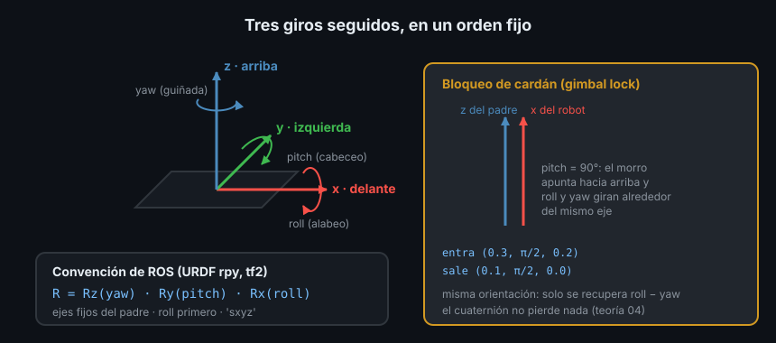

# 03 — Ángulos de Euler: roll, pitch y yaw



## 1. Qué problema resuelve

Una matriz de rotación tiene nueve números, pero un giro en 3D solo tiene tres
grados de libertad: los otros seis están atados por la condición de ser
ortonormal (teoría 01, sección 4). Nadie escribe a mano nueve números ligados.
Una persona describe una orientación como tres giros seguidos: "inclinado 10° a
la derecha, el morro 5° abajo y mirando al norte". Esos tres ángulos son los
**ángulos de Euler**.

Ya los has usado: el atributo `rpy` de un `<origin>` en URDF y los argumentos
`--roll --pitch --yaw` de `static_transform_publisher` son ángulos de Euler. Esta
teoría cuenta qué convención usan exactamente y por qué, fuera de esa entrada
humana, conviene no calcular con ellos.

## 2. La convención de ROS

Los tres giros son los de la teoría 01:

- **roll** (alabeo): alrededor de x, el eje que mira hacia delante.
- **pitch** (cabeceo): alrededor de y, el eje que mira a la izquierda.
- **yaw** (guiñada): alrededor de z, el eje que mira hacia arriba.

Pero "tres giros seguidos" deja dos preguntas abiertas: **en qué orden** y
**alrededor de qué ejes**, los del marco padre, que se quedan fijos, o los del
marco que va girando. Hay doce combinaciones en uso, y con los mismos tres
números dan orientaciones distintas.

ROS usa una: **primero roll en x, luego pitch en y, luego yaw en z, siempre
alrededor de los ejes fijos del padre**. Es la que define la especificación de
URDF para `rpy` y la que asumen tf2 y `tf_transformations` por defecto. En
matrices:

```text
R = Rz(yaw) · Ry(pitch) · Rx(roll)
```

Se lee de derecha a izquierda, como siempre: roll es lo primero que se aplica.
`tf_transformations` (teoría 05) llama a esta convención `'sxyz'`: `s` de
*static*, ejes fijos, y `xyz` el orden. Compruébalo contra las matrices de la
teoría 01:

```python
import math

import numpy as np
import tf_transformations as tft


def rot_x(a: float) -> np.ndarray:
    c, s = math.cos(a), math.sin(a)
    return np.array([[1.0, 0.0, 0.0], [0.0, c, -s], [0.0, s, c]])


def rot_y(a: float) -> np.ndarray:
    c, s = math.cos(a), math.sin(a)
    return np.array([[c, 0.0, s], [0.0, 1.0, 0.0], [-s, 0.0, c]])


def rot_z(a: float) -> np.ndarray:
    c, s = math.cos(a), math.sin(a)
    return np.array([[c, -s, 0.0], [s, c, 0.0], [0.0, 0.0, 1.0]])


roll, pitch, yaw = 0.3, 0.2, 0.1
ros = tft.euler_matrix(roll, pitch, yaw, "sxyz")[:3, :3]
print(np.allclose(ros, rot_z(yaw) @ rot_y(pitch) @ rot_x(roll)))
```

```text
True
```

## 3. Mismos números, otra convención, otra orientación

Con ejes móviles (`'r'` de *rotating*) y el mismo orden x, y, z, los tres mismos
números giran otra cosa:

```python
fixed = tft.euler_matrix(roll, pitch, yaw, "sxyz")
moving = tft.euler_matrix(roll, pitch, yaw, "rxyz")
print(np.allclose(fixed, moving))
```

```text
False
```

Y una curiosidad que explica por qué hay tanta confusión: girar sobre ejes fijos
en orden x, y, z es lo mismo que girar sobre ejes móviles en el orden inverso,
z, y', x'' (cada giro sobre el eje ya girado del anterior):

```python
print(np.allclose(fixed, tft.euler_matrix(yaw, pitch, roll, "rzyx")))
```

```text
True
```

Por eso algunos textos dicen que ROS usa "z-y-x" y otros "x-y-z": describen el
mismo giro desde los dos puntos de vista. Cuando copies ángulos de una hoja de
datos, de un simulador o de otro programa, busca qué convención usa antes de
pegarlos en tu URDF.

## 4. El bloqueo de cardán (gimbal lock)

Con pitch de exactamente ±90°, el eje x del robot queda apuntando hacia arriba o
hacia abajo, alineado con el z del padre. Entonces roll (alrededor de x) y yaw
(alrededor de z) giran alrededor del **mismo eje**: dejan de ser independientes y
solo importa su diferencia. Se pierde un grado de libertad: es el **bloqueo de
cardán**, en inglés *gimbal lock*, por los anillos (cardanes) de las brújulas y
giroscopios mecánicos, que se atascan así.

Se ve al ir y volver:

```python
rpy = (0.3, math.pi / 2, 0.2)
print(tft.euler_from_quaternion(tft.quaternion_from_euler(*rpy)))
print(np.allclose(tft.euler_matrix(*rpy), tft.euler_matrix(0.1, math.pi / 2, 0.0)))
```

```text
(0.10000000000000002, 1.5707963267948966, 0.0)
True
```

Entraron `(0.3, π/2, 0.2)` y salen `(0.1, π/2, 0.0)`: solo se recupera
`roll - yaw = 0.1`. Las dos ternas son la misma orientación (la segunda línea lo
confirma). Ni siquiera hay acuerdo en cómo repartir: tf2 lo resuelve de otra
manera.

```bash
ros2 run tf2_ros static_transform_publisher --x 2 --roll 0.3 \
  --pitch 1.5707963267948966 --yaw 0.2 --frame-id odom --child-frame-id base_link
# Terminal 2
ros2 run tf2_ros tf2_echo odom base_link
# At time 0.0
# - Translation: [2.000, 0.000, 0.000]
# - Rotation: in Quaternion (xyzw) [0.035, 0.706, -0.035, 0.706]
# - Rotation: in RPY (radian) [0.124, 1.571, 0.000]
# ...
```

Roll 0.124: ni el 0.3 que entró ni el 0.1 exacto. Cerca del bloqueo, sacar
ángulos de Euler es numéricamente inestable y cada biblioteca da algo distinto.
El cuaternión `[0.035, 0.706, -0.035, 0.706]`, en cambio, describe la
orientación sin ambigüedad. Un robot de ruedas casi nunca llega a pitch de 90°;
un dron haciendo un looping o la muñeca de un brazo (Semana 19) sí.

## 5. Ángulos que dan la vuelta

Un ángulo y el mismo más 2π son la misma orientación: el yaw de un robot que da
vueltas salta de `π` a `-π` en un instante sin moverse nada. ROS deja los
ángulos en `(-π, π]`, y eso produce dos errores clásicos.

**Restar dos yaw.** El robot mira con yaw 3.0 y quiere mirar con yaw -3.0. Son
dos orientaciones casi iguales (las dos apuntan casi a `-x`), separadas por
0.28 rad. Restando a secas:

```python
error = -3.0 - 3.0
print(error, math.atan2(math.sin(error), math.cos(error)))
```

```text
-6.0 0.28318530717958645
```

Un controlador con el `-6.0` haría girar al robot casi una vuelta entera hacia
la derecha. `atan2(sin(e), cos(e))` deja el error en `(-π, π]`: el giro corto, a
la izquierda. Es la misma normalización del Ejercicio 01 de la Semana 06.

**Promediar yaw.** La media de 3.1 y -3.1 es 0: justo la orientación contraria a
las dos. La media correcta se hace con los vectores `(cos, sin)`:

```python
print((3.1 + -3.1) / 2)
print(math.atan2(math.sin(3.1) + math.sin(-3.1), math.cos(3.1) + math.cos(-3.1)))
```

```text
0.0
3.141592653589793
```

## 6. Cuándo usarlos y cuándo no

| Para | ¿Euler? | Por qué |
|---|---|---|
| Que una persona escriba o lea una orientación (URDF, parámetros, logs) | ✅ | Tres números con significado físico |
| El yaw de un robot de suelo | ✅ | Solo hay un ángulo, sin bloqueo posible |
| Componer orientaciones | ❌ | No hay fórmula simple; usa matrices o cuaterniones |
| Interpolar entre dos orientaciones | ❌ | Interpolar cada ángulo da trayectorias raras y cruza el bloqueo |
| Guardar o transmitir una orientación en 3D | ❌ | Ambiguos cerca del bloqueo; ROS usa cuaterniones en los mensajes |

La regla práctica: Euler en la frontera con las personas, cuaterniones o
matrices por dentro (teoría 04).

## 7. Antipatrones

- ❌ **Pegar ángulos de otra convención.** Un simulador o una IMU que da "yaw,
  pitch, roll" sobre ejes móviles, copiado tal cual en `rpy`, gira otra cosa.
- ❌ **Restar o promediar yaw sin normalizar.** Ver sección 5.
- ❌ **Interpolar roll, pitch y yaw por separado** para mover una cámara o una
  muñeca: la teoría 04 explica slerp.
- ❌ **Fiarse de los tres números cerca de pitch ±90°.** La orientación es
  correcta; su descomposición en tres ángulos, no.

## 8. Trucos

- `tf2_echo` imprime la rotación en radianes y en grados: úsalo para comprobar un
  `rpy` del URDF sin hacer cuentas.
- En un robot de suelo, escribe y compara solo el yaw, pero normalízalo siempre.
- Si un giro "sale al revés", prueba la misma terna en `'rzyx'`: si coincide con
  lo que esperabas, el dato venía en ejes móviles.

## ✅ Checklist

- [ ] Sé qué es roll, pitch y yaw y en qué orden los aplica ROS
- [ ] Sé que `rpy` de URDF es `Rz(yaw) · Ry(pitch) · Rx(roll)` sobre ejes fijos
- [ ] Sé qué es el bloqueo de cardán y cuándo aparece
- [ ] Normalizo la diferencia de dos yaw con `atan2(sin, cos)`
- [ ] Uso Euler para entrada y salida humana, no para calcular

---

## 🔗 Navegación

| Anterior | Actual | Siguiente |
| -------- | ------ | --------- |
| [02 — Matrices homogéneas](02-matrices-homogeneas.md) | **03 — Ángulos de Euler** | [04 — Cuaterniones](04-cuaterniones.md) |

← [Volver a la Semana 07](../README.md)
