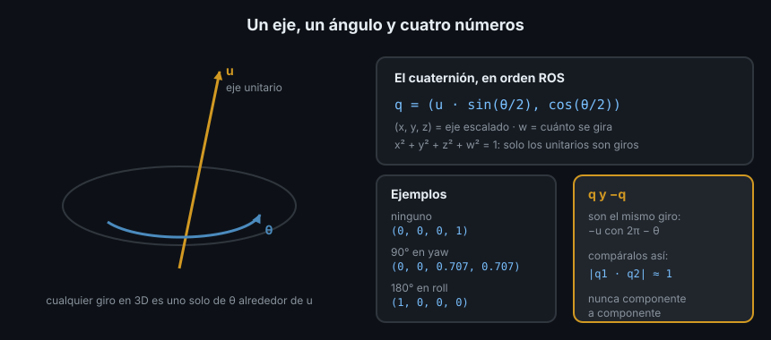

# 04 — Cuaterniones



## 1. Qué problema resuelve

Las matrices (teoría 01) usan nueve números atados entre sí. Los ángulos de
Euler (teoría 03) usan tres, pero se bloquean con pitch de 90° y no se pueden
componer ni interpolar con facilidad. Un **cuaternión** usa cuatro números y no
tiene ninguno de esos problemas: no se bloquea, se compone con un producto de
cuatro números y se interpola de forma natural. Por eso todos los mensajes de
ROS 2 que llevan una orientación (`geometry_msgs/msg/Quaternion`, dentro de
`Pose` y `Transform`) usan cuaterniones.

En la Semana 06 usaste uno sin explicación: `(0, 0, sin(yaw/2), cos(yaw/2))`
para un giro en z. Aquí sale de dónde viene y cómo es el caso general.

## 2. Todo giro es un eje y un ángulo

Un teorema de Euler dice que **cualquier rotación en 3D, por complicada que sea,
es un único giro de un ángulo θ alrededor de un único eje** que pasa por el
origen. Tres giros de roll, pitch y yaw seguidos equivalen a uno solo, alrededor
de algún eje inclinado. Esa forma de escribir un giro se llama **eje-ángulo**: un
vector unitario `u = (ux, uy, uz)` para el eje y un número θ.

## 3. El cuaternión de un giro

El cuaternión de un giro θ alrededor del eje unitario `u` es:

```text
q = (x, y, z, w) = (ux · sin(θ/2), uy · sin(θ/2), uz · sin(θ/2), cos(θ/2))
```

- `(x, y, z)` es el eje escalado; `w` es la parte que dice cuánto se gira.
- Usa **θ/2**, no θ. Es lo que hace que la multiplicación de la sección 4
  funcione, y lo que produce la doble cobertura de la sección 6.
- Siempre **mide 1**: `x² + y² + z² + w² = 1`. Un cuaternión de módulo 1 se llama
  **unitario**, y solo los unitarios representan rotaciones.

Con el eje z, `u = (0, 0, 1)`, sale la fórmula de la Semana 06. Tres ejemplos:

| Giro | Cuaternión `(x, y, z, w)` |
|---|---|
| Ninguno (identidad) | `(0, 0, 0, 1)` |
| 90° en yaw (eje z) | `(0, 0, 0.707, 0.707)` |
| 180° en roll (eje x) | `(1, 0, 0, 0)` |

```python
import math

import numpy as np
import tf_transformations as tft

np.set_printoptions(precision=3, suppress=True)
print(tft.quaternion_from_euler(0.0, 0.0, 0.0))
print(tft.quaternion_from_euler(math.pi, 0.0, 0.0))
```

```text
(0.0, 0.0, 0.0, 1.0)
(1.0, 0.0, 0.0, 6.123233995736766e-17)
```

`6.1e-17` es `cos(π/2)` en coma flotante: cero.

## 4. Componer: el producto de Hamilton

Dos giros seguidos son el **producto de Hamilton** de sus cuaterniones. Con
`q1 = (x1, y1, z1, w1)` y `q2 = (x2, y2, z2, w2)`:

```text
q1 · q2 = ( w1·x2 + x1·w2 + y1·z2 - z1·y2,
            w1·y2 - x1·z2 + y1·w2 + z1·x2,
            w1·z2 + x1·y2 - y1·x2 + z1·w2,
            w1·w2 - x1·x2 - y1·y2 - z1·z2 )
```

Funciona como el producto de matrices: `q_a_c = q_a_b · q_b_c`, los subíndices
que se tocan se cancelan, se lee de derecha a izquierda y **el orden importa**.
Dos cuartos de vuelta en z son media vuelta:

```python
q90 = tft.quaternion_from_euler(0.0, 0.0, math.pi / 2)
print(np.array(tft.quaternion_multiply(q90, q90)))
```

```text
[0. 0. 1. 0.]
```

`(0, 0, 1, 0)`: 180° alrededor de z. En el Ejercicio 02 escribes este producto a
mano y lo comparas con `tft.quaternion_multiply`.

## 5. Girar un vector

Para girar un vector `v` con `q`, se mete `v` en un cuaternión con `w = 0` (un
cuaternión **puro**) y se multiplica por los dos lados:

```text
v' = q · (v, 0) · q*
```

`q*` es el **conjugado**: `(-x, -y, -z, w)`, el mismo eje con el giro al revés.
En un cuaternión unitario el conjugado es también su **inverso**, así que deshacer
un giro es cambiar tres signos. Da lo mismo que la matriz del cuaternión:

```python
print(tft.quaternion_matrix(q90)[:3, :3] @ [1.0, 0.0, 0.0])
print(np.array(tft.quaternion_conjugate(q90)))
```

```text
[0. 1. 0.]
[-0.    -0.    -0.707  0.707]
```

## 6. q y -q son el mismo giro

Cambia de signo los cuatro números de `q`. El eje pasa a ser `-u` y el ángulo
`2π - θ`... que es exactamente el mismo giro. Cada rotación tiene **dos**
cuaterniones, `q` y `-q`: es la **doble cobertura**.

Consecuencia práctica: **no compares cuaterniones componente a componente**. tf2
o un filtro pueden devolverte `-q` donde esperabas `q`, y los dos son correctos.
Dos cuaterniones unitarios son el mismo giro si su producto escalar vale ±1:

```python
q = np.array(q90)
print(abs(np.dot(q, -q)))
```

```text
1.0
```

## 7. Interpolar: slerp

Para ir suavemente de una orientación a otra (girar una cámara, la muñeca de un
brazo) hay que interpolar. La media componente a componente no sirve: el
resultado no mide 1.

```python
q0 = np.array([0.0, 0.0, 0.0, 1.0])
q1 = np.array(q90)
naive = (q0 + q1) / 2
print(naive, np.linalg.norm(naive))
print(tft.quaternion_slerp(q0, q1, 0.5))
```

```text
[0.    0.    0.354 0.854] 0.9238795325112867
[0.    0.    0.383 0.924]
```

**Slerp** (*spherical linear interpolation*) recorre el arco más corto entre las
dos orientaciones, a velocidad de giro constante, y el resultado sigue siendo
unitario: a mitad de camino entre 0° y 90° da exactamente 45°,
`(0, 0, sin(22.5°), cos(22.5°)) = (0, 0, 0.383, 0.924)`.

## 8. El orden de los cuatro números

Aquí está el error más frecuente con cuaterniones, y no es matemático:

| Dónde | Orden |
|---|---|
| Mensajes de ROS 2, tf2, `tf_transformations` | `(x, y, z, w)`: w al final |
| `transforms3d` (debajo de `tf_transformations`) | `(w, x, y, z)`: w al principio |
| Eigen en C++, constructor `Quaterniond(w, x, y, z)` | w al principio |

```python
import transforms3d

print(transforms3d.euler.euler2quat(0.0, 0.0, math.pi / 2))
```

```text
[0.707 0.    0.    0.707]
```

Es el mismo giro de 90° en yaw que `(0, 0, 0.707, 0.707)` en ROS, con `w`
delante. Pasado a un mensaje sin reordenar, sería un giro de 90° en **roll**. Usa
`tf_transformations` y no tendrás que pensarlo; si mezclas bibliotecas, mira en
su documentación dónde va `w`.

## 9. Antipatrones

- ❌ **Escribir componentes a mano** (`q.z = 0.7`) sin calcular `w`: el
  cuaternión no mide 1 y tf2 lo descarta con `TF_DENORMALIZED_QUATERNION`
  (Semana 06). Calcula los cuatro con una función.
- ❌ **Comparar `q1 == q2`** o con `pytest.approx` componente a componente:
  falla con `-q`. Compara el producto escalar.
- ❌ **Promediar o interpolar componentes.** Usa slerp.
- ❌ **Mezclar `(x, y, z, w)` y `(w, x, y, z)`.** Ver sección 8.

## 10. Trucos

- Lee un cuaternión de un vistazo: si `x` e `y` valen 0, es un giro solo en
  yaw, y el yaw es `2 · atan2(z, w)`.
- `w` cerca de 1 es un giro pequeño; `w` cerca de 0, cerca de media vuelta.
- Si acumulas muchos productos (integrar una IMU miles de veces por segundo),
  normaliza de vez en cuando: con números de 64 bits el módulo se aleja de 1
  muy despacio (4·10⁻¹² tras 100 000 productos), pero se aleja.

## ✅ Checklist

- [ ] Sé que todo giro es un eje y un ángulo, y escribo su cuaternión
- [ ] Sé por qué aparece θ/2 y por qué un cuaternión válido mide 1
- [ ] Compongo con el producto de Hamilton y sé que el orden importa
- [ ] Comparo cuaterniones con el producto escalar, no componente a componente
- [ ] Interpolo con slerp
- [ ] Sé que ROS pone `w` al final y otras bibliotecas al principio

---

## 🔗 Navegación

| Anterior | Actual | Siguiente |
| -------- | ------ | --------- |
| [03 — Ángulos de Euler](03-angulos-de-euler.md) | **04 — Cuaterniones** | [05 — tf_transformations y tf2](05-tf-transformations-y-tf2.md) |

← [Volver a la Semana 07](../README.md)
