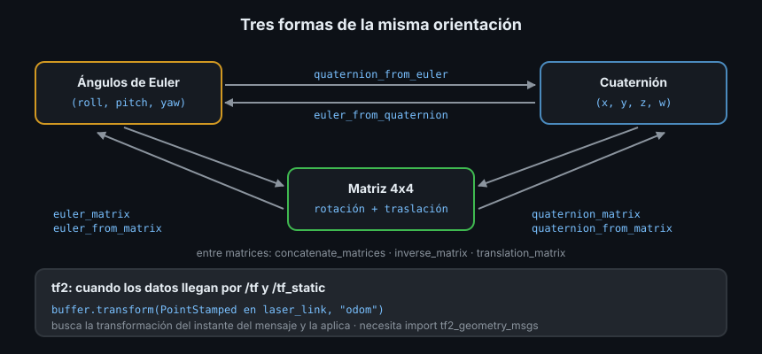

# 05 — `tf_transformations` y tf2 en Python



## 1. Qué problema resuelve

Las teorías 01 a 04 escriben cada fórmula a mano para entenderla. En tus nodos no
las escribirás: cada conversión hecha a mano es una oportunidad de equivocarse en
un signo o en el orden de `w`. Hay dos herramientas, y cada una tiene su sitio:

- **`tf_transformations`**: funciones de cálculo puro (Euler, cuaterniones,
  matrices 4x4) que trabajan con tuplas y arrays de NumPy. Para la matemática.
- **tf2**: el buffer de transformaciones de la Semana 06, que sabe qué
  transformación había entre dos marcos en cada instante. Para los datos que
  llegan por `/tf`.

## 2. Instalar `tf_transformations`

Es la versión para ROS 2 del módulo `tf.transformations` de ROS 1, construida
sobre la biblioteca `transforms3d`. No viene en la imagen base: se instala con
apt, como todo paquete ROS (nunca con `pip`):

```bash
sudo apt install ros-jazzy-tf-transformations
python3 -c "import tf_transformations; print(tf_transformations.__file__)"
# /opt/ros/jazzy/lib/python3.12/site-packages/tf_transformations/__init__.py
```

Instala también `python3-transforms3d`. En tu `package.xml`:

```xml
<exec_depend>tf_transformations</exec_depend>
```

Y `rosdep install --from-paths src -y --ignore-src` la instala en otra máquina.
No trae tipos para mypy: el `ignore_missing_imports = True` de tu `mypy.ini`
(Semana 05) hace que la acepte, y sus resultados llegan a tu código como `Any`.

## 3. Las funciones que vas a usar

Todas usan radianes y cuaterniones en orden ROS, `(x, y, z, w)`:

| Función | Entra | Sale |
|---|---|---|
| `quaternion_from_euler(roll, pitch, yaw)` | 3 ángulos | tupla `(x, y, z, w)` |
| `euler_from_quaternion(q)` | cuaternión | tupla `(roll, pitch, yaw)` |
| `quaternion_multiply(q1, q2)` | 2 cuaterniones | tupla: `q1 · q2` |
| `quaternion_conjugate(q)` / `quaternion_inverse(q)` | cuaternión | array: el giro al revés |
| `quaternion_slerp(q0, q1, fraction)` | 2 cuaterniones y un número | array |
| `quaternion_matrix(q)` / `euler_matrix(r, p, y)` | orientación | array 4x4 sin traslación |
| `translation_matrix([x, y, z])` | traslación | array 4x4 sin rotación |
| `concatenate_matrices(T1, T2, ...)` | matrices 4x4 | array: `T1 @ T2 @ ...` |
| `inverse_matrix(T)` | matriz 4x4 | array: `T⁻¹` |
| `translation_from_matrix(T)` / `quaternion_from_matrix(T)` | matriz 4x4 | sus dos partes |

Fíjate en la columna "Sale": unas devuelven **tuplas** y otras **arrays de
NumPy**. Las dos se pueden pasar a cualquier otra función de la tabla, pero una
tupla no se suma ni se multiplica elemento a elemento: envuélvela en
`np.array(...)` si vas a operar con ella.

`quaternion_from_euler` y las demás funciones con ángulos aceptan un último
argumento con la convención (teoría 03). Por defecto es `'sxyz'`, la de ROS:
no lo cambies salvo que el dato venga de otra convención.

## 4. De un `TransformStamped` a una matriz y vuelta

La conversión que más vas a escribir: un mensaje de tf2 a matriz 4x4 para
calcular con NumPy, y el resultado de vuelta a mensaje.

```python
import math

import numpy as np
import tf_transformations as tft
from geometry_msgs.msg import Transform

np.set_printoptions(precision=3, suppress=True)


def matrix_from_transform(msg: Transform) -> np.ndarray:
    t, r = msg.translation, msg.rotation
    return tft.concatenate_matrices(
        tft.translation_matrix([t.x, t.y, t.z]),
        tft.quaternion_matrix([r.x, r.y, r.z, r.w]),
    )


def transform_from_matrix(matrix: np.ndarray) -> Transform:
    msg = Transform()
    msg.translation.x, msg.translation.y, msg.translation.z = (
        float(v) for v in tft.translation_from_matrix(matrix)
    )
    x, y, z, w = tft.quaternion_from_matrix(matrix)
    msg.rotation.x, msg.rotation.y, msg.rotation.z, msg.rotation.w = x, y, z, w
    return msg


robot = Transform()
robot.translation.x = 2.0
x, y, z, w = tft.quaternion_from_euler(0.0, 0.0, math.pi / 2)
robot.rotation.x, robot.rotation.y, robot.rotation.z, robot.rotation.w = x, y, z, w
T = matrix_from_transform(robot)
print(T @ [1.0, 0.0, 0.0, 1.0])
print(transform_from_matrix(tft.inverse_matrix(T)).translation)
```

```text
[2. 1. 0. 1.]
geometry_msgs.msg.Vector3(x=-4.440892098500626e-16, y=2.0, z=0.0)
```

El mismo robot de la teoría 02: el punto de delante en `(2, 1)` de `odom` y el
origen de `odom` 2 m a su izquierda. El orden de `concatenate_matrices` importa:
primero la traslación y luego la rotación, porque `T = Trasl · Rot` gira el
punto en el marco hijo y después lo desplaza.

## 5. tf2 en Python sin red

`tf2_ros.Buffer` funciona sin nodo ni red: le das transformaciones con
`set_transform` (o `set_transform_static`) y le preguntas con `lookup_transform`.
Es el equivalente en Python del `tf2::BufferCore` del Ejercicio 02 de la Semana
06, y es lo que usan los tests de los Ejercicios 01 y 03.

```python
import rclpy.time
import tf2_geometry_msgs  # noqa: F401  registra PointStamped en Buffer.transform
import tf2_ros
from geometry_msgs.msg import PointStamped, TransformStamped

buffer = tf2_ros.Buffer()
odom_base = TransformStamped()
odom_base.header.frame_id, odom_base.child_frame_id = "odom", "base_link"
odom_base.transform = robot
buffer.set_transform(odom_base, "manual")
base_laser = TransformStamped()
base_laser.header.frame_id, base_laser.child_frame_id = "base_link", "laser_link"
base_laser.transform.translation.x = 0.20
buffer.set_transform_static(base_laser, "manual")

print(buffer.lookup_transform("odom", "laser_link", rclpy.time.Time()).transform.translation)
seen = PointStamped()
seen.header.frame_id = "laser_link"
seen.point.x = 1.0
print(buffer.transform(seen, "odom").point)
```

```text
geometry_msgs.msg.Vector3(x=2.0, y=0.2, z=0.0)
geometry_msgs.msg.Point(x=2.0, y=1.2, z=0.0)
```

- El segundo argumento de `set_transform` (`"manual"`) es el *authority*: quién
  publicó la transformación. Solo sirve para los mensajes de error.
- `rclpy.time.Time()` es el instante 0: "la más reciente que tengas".
- `buffer.transform(objeto, marco)` busca la transformación del
  `header.frame_id` del objeto al marco pedido, en el `header.stamp` del objeto,
  y la aplica. Sirve para `PointStamped`, `PoseStamped`, `Vector3Stamped` y
  otros tipos *stamped* de `geometry_msgs`, siempre que hayas importado
  `tf2_geometry_msgs`. Sin ese import:

  ```text
  tf2_ros.buffer_interface.TypeException: Type <class 'geometry_msgs.msg._point_stamped.PointStamped'> is not loaded or supported
  ```

  El import no se usa por nombre (de ahí el `# noqa: F401` para ruff): registra
  las conversiones al cargarse.

En un nodo, el buffer se llena solo con un `TransformListener` (Semana 06), y
`lookup_transform` y `transform` pueden lanzar las tres excepciones de entonces:
`LookupException` (el marco no existe), `ConnectivityException` (los marcos están
en árboles separados) y `ExtrapolationException` (pides un instante que el buffer
no tiene). Por ejemplo, con el buffer de arriba:

```python
try:
    buffer.lookup_transform("odom", "base_link", rclpy.time.Time(seconds=5))
except tf2_ros.ExtrapolationException as error:
    print(error)
```

```text
Lookup would require extrapolation at time 5.000000, but only time 0.000000 is in the buffer, when looking up transform from frame [base_link] to frame [odom]
```

## 6. Y en C++

La política de esta fase (Python por defecto) no te hace perder el lado C++: lo
usaste en la Semana 06 con tf2. Las mismas operaciones, con las clases de
`tf2/LinearMath`:

```cpp
#include "tf2/LinearMath/Matrix3x3.h"
#include "tf2/LinearMath/Quaternion.h"
#include "tf2/LinearMath/Transform.h"

#include <cmath>
#include <cstdio>

int main() {
  tf2::Quaternion q;
  q.setRPY(0.0, 0.0, M_PI / 2.0);  // roll, pitch, yaw en radianes
  const tf2::Transform odom_base(q, tf2::Vector3(2.0, 0.0, 0.0));
  const tf2::Transform base_laser(tf2::Quaternion::getIdentity(), tf2::Vector3(0.20, 0.0, 0.0));
  // operator* compone igual que T_odom_base @ T_base_laser en NumPy.
  const tf2::Vector3 p = (odom_base * base_laser) * tf2::Vector3(1.0, 0.0, 0.0);
  double roll = 0.0, pitch = 0.0, yaw = 0.0;
  tf2::Matrix3x3(q).getRPY(roll, pitch, yaw);
  std::printf("q = (%.3f, %.3f, %.3f, %.3f)\n", q.x(), q.y(), q.z(), q.w());
  std::printf("yaw = %.4f\n", yaw);
  std::printf("p = (%.2f, %.2f, %.2f)\n", p.x(), p.y(), p.z());
  return 0;
}
```

```text
q = (0.000, 0.000, 0.707, 0.707)
yaw = 1.5708
p = (2.00, 1.20, 0.00)
```

`setRPY` usa la convención de ROS y `tf2::Quaternion` guarda `(x, y, z, w)`.
Para mensajes, `tf2::doTransform` y `tf2_geometry_msgs` hacen en C++ lo que
`buffer.transform` en Python.

## 7. Antipatrones

- ❌ **`import tf`** o un `transformations.py` copiado de ROS 1: no existe en ROS 2
  y la copia no recibe arreglos. Usa `tf_transformations` desde apt.
- ❌ **Reescribir con NumPy lo que tf2 ya sabe.** Si los datos vienen de `/tf`,
  pídelos a tf2 con `buffer.transform`: conoce el instante de cada
  transformación, y tu matriz calculada a mano no.
- ❌ **Olvidar `import tf2_geometry_msgs`**: ver la sección 5.
- ❌ **Operar con la tupla** que devuelve `quaternion_from_euler` como si fuera un
  array (`q * 2` repite la tupla, no multiplica).

## 8. Trucos

- `python3 -c "import tf_transformations as t; print(t.quaternion_from_euler(0, 0, 1.5708))"`
  es la calculadora de cuaterniones más rápida de la terminal.
- Para un robot de suelo, `tft.euler_from_quaternion(q)[2]` te da el yaw de
  cualquier mensaje de orientación.
- En un test sin red, `tf2_ros.Buffer` con `set_transform` comprueba tu código
  contra tf2 sin arrancar nodos (Ejercicios 01 y 03).

## ✅ Checklist

- [ ] Instalo `tf_transformations` con apt y lo declaro en `package.xml`
- [ ] Sé qué funciones devuelven tupla y cuáles array
- [ ] Paso de `TransformStamped` a matriz 4x4 y vuelta
- [ ] Uso `tf2_ros.Buffer` sin red y `buffer.transform` con `tf2_geometry_msgs`
- [ ] Reconozco las tres excepciones de tf2
- [ ] Sé hacer lo mismo en C++ con `tf2::Quaternion` y `tf2::Transform`

---

## 🔗 Navegación

| Anterior | Actual | Siguiente |
| -------- | ------ | --------- |
| [04 — Cuaterniones](04-cuaterniones.md) | **05 — tf_transformations y tf2** | [Prácticas](../2-practicas/README.md) |

← [Volver a la Semana 07](../README.md)
